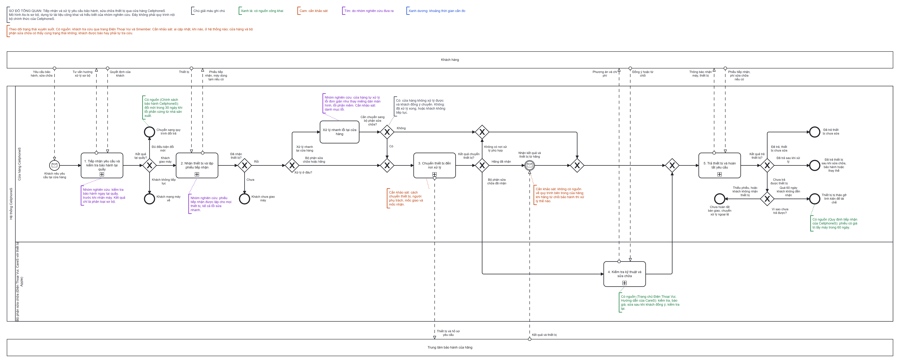
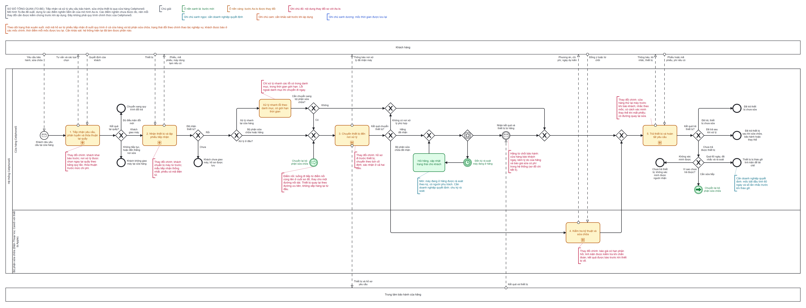

# CPSBA

Mô hình BPMN As-Is và To-Be của quy trình tiếp nhận và xử lý yêu cầu bảo hành, sửa chữa thiết bị qua cửa hàng CellphoneS.

Mô hình As-Is là mô hình sơ bộ, dựng từ tài liệu công khai và hiểu biết của nhóm nghiên cứu. Mô hình To-Be là mô hình đề xuất, dựng từ các điểm nghẽn tiềm ẩn của mô hình As-Is. Cả hai không phải quy trình nội bộ chính thức của CellphoneS.

## Nội dung

| Thư mục hoặc tệp | Nội dung |
|---|---|
| `bpmn/` | Mười hai tệp BPMN 2.0, mở bằng Camunda Modeler hoặc bpmn.io: sáu tệp As-Is và sáu tệp To-Be |
| `png/`, `svg/` | Ảnh của mười hai sơ đồ |
| `drawio/` | Mười hai sơ đồ ở định dạng draw.io, chuyển từ các tệp trong `bpmn/`, mở bằng draw.io (diagrams.net) |
| `description/` | Mô tả nghiệp vụ của từng sơ đồ: tệp `CPS_asis_*` cho As-Is, tệp `CPS_tobe_*` cho To-Be |
| `bottle_neck/` | Điểm nghẽn tiềm ẩn của từng sơ đồ As-Is và đề xuất cách giải quyết, bắt đầu từ [`bottle_neck/README.md`](bottle_neck/README.md) |
| `nghiep-vu.md` | Bản mô tả nghiệp vụ As-Is đầy đủ |
| `CellphoneS_AsIs_danh-muc.md` | Danh mục bước theo mức độ chắc chắn, bảng đối chiếu nguồn, danh sách cần khảo sát, kết quả kiểm tra của bản As-Is |
| `promptASIS.md` | Đề bài và quy tắc vẽ sơ đồ As-Is |
| `tools/` | Bộ lệnh dựng, kiểm tra và xuất ảnh sơ đồ |

Thứ tự đọc: sơ đồ As-Is, rồi các điểm nghẽn tiềm ẩn, rồi sơ đồ To-Be.

## Sáu sơ đồ As-Is

| Sơ đồ | Mô tả nghiệp vụ | Tệp BPMN |
|---|---|---|
| Tổng quan | [CPS_asis_Level0](description/CPS_asis_Level0.md) | [Level0](bpmn/CellphoneS_AsIs_Level0.bpmn) |
| 1. Tiếp nhận yêu cầu và kiểm tra bảo hành tại quầy | [CPS_asis_P1](description/CPS_asis_P1.md) | [P1](bpmn/CellphoneS_AsIs_P1.bpmn) |
| 2. Nhận thiết bị và lập phiếu tiếp nhận | [CPS_asis_P2](description/CPS_asis_P2.md) | [P2](bpmn/CellphoneS_AsIs_P2.bpmn) |
| 3. Chuyển thiết bị đến nơi xử lý | [CPS_asis_P3](description/CPS_asis_P3.md) | [P3](bpmn/CellphoneS_AsIs_P3.bpmn) |
| 4. Kiểm tra kỹ thuật và sửa chữa | [CPS_asis_P4](description/CPS_asis_P4.md) | [P4](bpmn/CellphoneS_AsIs_P4.bpmn) |
| 5. Trả thiết bị và hoàn tất yêu cầu | [CPS_asis_P5](description/CPS_asis_P5.md) | [P5](bpmn/CellphoneS_AsIs_P5.bpmn) |



## Sáu sơ đồ To-Be

Trên sơ đồ To-Be, ô nền xanh lá là bước mới, ô nền vàng là bước As-Is được thay đổi, ô nền trắng là bước giữ nguyên. Cách đọc đầy đủ, danh sách các điều cần doanh nghiệp quyết định và kết quả kiểm tra kỹ thuật nằm ở [mô tả sơ đồ tổng quan To-Be](description/CPS_tobe_Level0.md).

| Sơ đồ | Mô tả nghiệp vụ | Tệp BPMN |
|---|---|---|
| Tổng quan | [CPS_tobe_Level0](description/CPS_tobe_Level0.md) | [Level0](bpmn/CellphoneS_ToBe_Level0.bpmn) |
| 1. Tiếp nhận yêu cầu, phân tuyến và thỏa thuận tại quầy | [CPS_tobe_P1](description/CPS_tobe_P1.md) | [P1](bpmn/CellphoneS_ToBe_P1.bpmn) |
| 2. Nhận thiết bị và lập phiếu tiếp nhận | [CPS_tobe_P2](description/CPS_tobe_P2.md) | [P2](bpmn/CellphoneS_ToBe_P2.bpmn) |
| 3. Chuyển thiết bị đến nơi xử lý | [CPS_tobe_P3](description/CPS_tobe_P3.md) | [P3](bpmn/CellphoneS_ToBe_P3.bpmn) |
| 4. Kiểm tra kỹ thuật và sửa chữa | [CPS_tobe_P4](description/CPS_tobe_P4.md) | [P4](bpmn/CellphoneS_ToBe_P4.bpmn) |
| 5. Trả thiết bị và hoàn tất yêu cầu | [CPS_tobe_P5](description/CPS_tobe_P5.md) | [P5](bpmn/CellphoneS_ToBe_P5.bpmn) |



## Dựng lại sơ đồ

Cần Node.js và trình duyệt Chrome hoặc Edge.

Bản As-Is được sinh từ các tệp trong `tools/diagrams/`:

```
cd tools
npm install
node build.mjs
node check.mjs
node render.mjs
```

Bản To-Be được sinh từ các tệp trong `tools/diagrams-tobe/`. Thêm `--tobe` vào ba lệnh:

```
node build.mjs --tobe
node check.mjs --tobe
node render.mjs --tobe
```

Bản draw.io của cả hai bộ được chuyển từ các tệp trong `bpmn/`, nên chạy sau khi dựng xong:

```
node drawio.mjs
```
