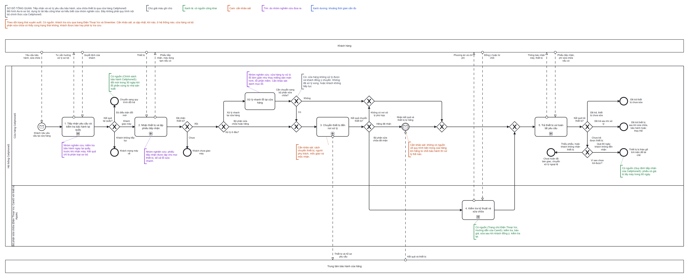

# Điểm nghẽn tiềm ẩn: Sơ đồ tổng quan

Quy trình: Tiếp nhận và xử lý yêu cầu bảo hành, sửa chữa thiết bị qua cửa hàng CellphoneS.

- Sơ đồ As-Is: [`bpmn/CellphoneS_AsIs_Level0.bpmn`](../bpmn/CellphoneS_AsIs_Level0.bpmn)
- Mô tả nghiệp vụ As-Is: [`description/CPS_asis_Level0.md`](../description/CPS_asis_Level0.md)
- Cách đọc và bảng tổng hợp: [`README.md`](README.md)

Các điểm nghẽn dưới đây là giả thuyết suy ra từ sơ đồ, chưa được đo. Tài liệu không khẳng định CellphoneS đang gặp các vấn đề này.

Tệp này nói về những điểm nghẽn chỉ nhìn thấy khi xem cả quy trình. Các điểm nghẽn nằm gọn trong một quy trình con được phân tích ở năm tệp còn lại.

## Tóm tắt

| Điểm nghẽn tiềm ẩn | Mức ưu tiên kiểm chứng | Đề xuất chính |
|---|---|---|
| Thiết bị phải qua nhiều lần giao nhận vì cửa hàng là trạm trung chuyển | Cao | Mở rộng danh mục lỗi cửa hàng tự xử lý; cho khách lựa chọn mang máy thẳng đến nơi sửa |
| Chờ trung tâm bảo hành của hãng mà không có giới hạn thời gian và không có thông tin | Cao | Nói rõ hai cách gửi bảo hành cho khách; lưu mã theo dõi của hãng; có người phụ trách rà soát |
| Trạng thái của yêu cầu chưa rõ ai cập nhật, khách có thể phải tự hỏi | Trung bình | Một mã hồ sơ đi suốt quy trình; danh mục trạng thái dùng chung; chủ động báo khách |
| Nhân viên cửa hàng đảm nhận hầu hết các bước, việc không có khách đứng chờ dễ bị dồn lại | Trung bình | Giao rõ người và khung giờ cho việc giao nhận máy và báo khách |
| Xử lý nhanh tại cửa hàng không thành rồi mới chuyển đi | Thấp | Danh mục lỗi được xử lý nhanh; giới hạn thời gian thử |

## 1. Thiết bị phải qua nhiều lần giao nhận vì cửa hàng là trạm trung chuyển

**Mức ưu tiên kiểm chứng:** Cao.

**Vị trí trên sơ đồ:** Ba ô quy trình con nối tiếp nhau "3. Chuyển thiết bị đến nơi xử lý", "4. Kiểm tra kỹ thuật và sửa chữa" và "5. Trả thiết bị và hoàn tất yêu cầu". Đường đi của thiết bị rời làn Cửa hàng CellphoneS, xuống làn Bộ phận sửa chữa, rồi quay lại làn cửa hàng.

**Vì sao có thể gây nghẽn:** Với mọi lỗi không xử lý nhanh được tại chỗ, cửa hàng không sửa mà chỉ nhận máy và trả máy. Thiết bị vì thế đổi tay bốn lần: khách giao cho cửa hàng, cửa hàng giao cho nơi xử lý, nơi xử lý giao lại cho cửa hàng, cửa hàng giao lại cho khách. Hai lần ở giữa không tạo ra giá trị gì cho khách, và kéo theo ba khoảng thiết bị nằm chờ: chờ được chuyển đi, chờ được nơi xử lý nhận, chờ được chuyển về. So với việc khách mang máy thẳng đến Điện Thoại Vui hoặc CareS, đường qua cửa hàng dài hơn đúng hai lần giao nhận này.

Nếu bộ phận sửa chữa làm việc ngay tại cửa hàng thì hai lần giao nhận ở giữa gần như không tốn thời gian. Mô hình As-Is chưa biết điều này.

**Hậu quả:**

- Thời gian khách không có máy dài hơn nhiều so với thời gian sửa thực tế.
- Mỗi lần đổi tay là một lần thiết bị có thể thất lạc, trầy xước, hoặc phát sinh tranh cãi về trách nhiệm.
- Khi khách hỏi, khó trả lời ngay máy đang ở đâu.

**Căn cứ:**

- Cửa hàng nhận máy, còn Điện Thoại Vui và CareS sửa chữa: Có nguồn (Chính sách bảo hành CellphoneS; Hướng dẫn của CareS).
- Bộ phận sửa chữa ở cùng địa điểm với cửa hàng hay phải vận chuyển: Cần khảo sát.
- Các lần giao nhận làm thiết bị nằm chờ: Suy luận từ sơ đồ.

**Cách kiểm chứng:**

- Khảo sát xem bộ phận sửa chữa có làm việc tại cửa hàng không, và bao nhiêu cửa hàng như vậy.
- Đo ba khoảng: từ khi có phiếu tiếp nhận đến khi cửa hàng giao thiết bị đi; từ khi cửa hàng giao đi đến khi nơi xử lý nhận được; từ khi sửa xong đến khi thiết bị sẵn sàng trả tại cửa hàng.
- So sánh tổng ba khoảng này với thời gian sửa chữa. Nếu tổng thời gian nằm trên đường và nằm chờ lớn hơn thời gian sửa, đây là điểm nghẽn chính của cả quy trình.

**Đề xuất cách giải quyết:**

1. Mở rộng danh mục lỗi cửa hàng được tự xử lý tại chỗ, dựa trên thống kê các lỗi hay gặp. Mỗi lỗi chuyển được từ "phải gửi đi" sang "làm tại cửa hàng" là bỏ được cả hai lần giao nhận.
2. Với lỗi chắc chắn phải chuyển đi, cho khách thêm một lựa chọn ngay tại quầy: mang máy thẳng đến điểm sửa chữa gần nhất, nhân viên cửa hàng đặt lịch hộ. Điện Thoại Vui đã công bố bước đặt lịch và xác nhận lịch cho khách đến trực tiếp (Có nguồn: Trang chủ Điện Thoại Vui).
3. Với các cửa hàng có nhiều máy gửi sửa, bố trí kỹ thuật viên của bộ phận sửa chữa làm việc tại cửa hàng theo ngày cố định.
4. Với những yêu cầu vẫn phải chuyển đi, rút ngắn từng khoảng chờ theo các đề xuất ở [khâu chuyển thiết bị](CPS_bottleneck_P3.md) và [khâu chuyển kết quả về cửa hàng](CPS_bottleneck_P4.md).

**Lưu ý khi áp dụng:**

- Đề xuất 1 đòi hỏi cửa hàng có dụng cụ, linh kiện và người đủ tay nghề, và phải xác định rõ ai chịu trách nhiệm bảo hành cho phần việc cửa hàng tự làm.
- Đề xuất 2 khiến khách phải đi thêm một nơi. Nó chỉ hợp lý khi điểm sửa chữa ở gần và khách tự chọn. Cửa hàng vẫn phải giữ cách nhận máy như hiện nay cho những khách không muốn đi.

## 2. Chờ trung tâm bảo hành của hãng mà không có giới hạn thời gian và không có thông tin

**Mức ưu tiên kiểm chứng:** Cao.

**Vị trí trên sơ đồ:** Sự kiện chờ "Nhận kết quả và thiết bị từ hãng" (hình tròn viền kép có phong bì), nằm sau nhánh "Hãng đã nhận". Hai đường nét đứt nối cửa hàng với khối Trung tâm bảo hành của hãng.

**Vì sao có thể gây nghẽn:** Trung tâm bảo hành của hãng là bên ngoài duy nhất trong mô hình. Cửa hàng không điều khiển được tốc độ xử lý của hãng, và mô hình cũng không có thông tin gì về quy trình bên trong của hãng. Trên sơ đồ, sau khi gửi máy đi, cửa hàng chỉ chờ. Không có giới hạn thời gian, không có bước hỏi lại hãng, không có bước cập nhật cho khách trong lúc chờ.

Có thêm hai điểm làm khoảng chờ này nặng hơn:

- Gửi qua cửa hàng làm đường đi dài hơn. Chính sách cho khách hai cách: tự đến trung tâm bảo hành chính hãng, hoặc đến cửa hàng CellphoneS để được tiếp nhận gửi máy bảo hành chính hãng. Cách thứ hai thêm hai chặng: từ cửa hàng đến hãng và từ hãng về cửa hàng.
- Khi hãng từ chối bảo hành, chưa rõ cửa hàng làm gì. Nếu cửa hàng tư vấn sửa có phí trong hệ thống và khách đồng ý, thiết bị lại đi qua khâu chuyển và khâu sửa chữa thêm một lần.

**Hậu quả:**

- Khách hỏi tình trạng nhưng cửa hàng không có câu trả lời.
- Máy dùng tạm, nếu có, bị khách giữ suốt thời gian chờ.
- Hồ sơ mở kéo dài mà cửa hàng không tác động được.

**Căn cứ:**

- Cửa hàng tiếp nhận để gửi máy bảo hành chính hãng; khách cũng có thể tự đến hãng: Có nguồn (Chính sách bảo hành CellphoneS).
- Quy trình bên trong của hãng, thời gian xử lý, cách gửi và nhận, cách xử lý khi hãng từ chối: Cần khảo sát.
- Khoảng chờ không có giới hạn và không có bước cập nhật cho khách: Suy luận từ sơ đồ.

**Cách kiểm chứng:**

- Đo thời gian từ khi hãng nhận thiết bị đến khi cửa hàng nhận lại kết quả và thiết bị. Mười một khoảng thời gian trong mô hình As-Is chưa có khoảng nào đo riêng nhánh này, nên cần bổ sung.
- Đếm số yêu cầu gửi hãng bị từ chối bảo hành, và xem các yêu cầu đó đi tiếp thế nào.
- Hỏi cửa hàng: ai theo dõi các máy đang ở hãng, và khi khách hỏi thì lấy thông tin ở đâu.

**Đề xuất cách giải quyết:**

1. Tại quầy, nói rõ cho khách cả hai cách gửi bảo hành hãng, kèm thời gian dự kiến của từng cách sau khi đã có số liệu đo. Khách tự chọn, và biết trước mình sẽ chờ bao lâu.
2. Khi gửi máy, lấy mã tiếp nhận hoặc mã theo dõi của hãng nếu hãng có cấp, ghi vào hồ sơ. Nếu hãng có trang tra cứu thì gửi mã cho khách.
3. Giao cho một người ở cửa hàng làm đầu mối cho toàn bộ máy đang ở hãng. Người này rà soát danh sách theo chu kỳ cố định, chủ động hỏi hãng khi một máy đã ở hãng lâu hơn mức thường gặp, và báo lại cho khách.
4. Quy định sẵn cách xử lý khi hãng từ chối bảo hành: báo khách ngay, kèm lý do của hãng và báo giá sửa có phí trong hệ thống, để khách quyết định trong một lần liên hệ.
5. Với thiết bị Apple, CareS là trung tâm bảo hành ủy quyền nằm trong hệ thống CellphoneS (Có nguồn: Hướng dẫn của CareS). Nếu khảo sát xác nhận thiết bị Apple có thể đi qua CareS, tuyến này nên là mặc định, vì khi đó không còn bên ngoài nào tham gia.

**Lưu ý khi áp dụng:** Thời gian xử lý của hãng nằm ngoài quyền quyết định của CellphoneS. Các đề xuất trên chỉ rút ngắn hai chặng ở hai đầu và bớt việc khách phải tự hỏi. Chúng không làm hãng xử lý nhanh hơn.

## 3. Trạng thái của yêu cầu chưa rõ ai cập nhật, khách có thể phải tự hỏi

**Mức ưu tiên kiểm chứng:** Trung bình.

**Vị trí trên sơ đồ:** Ghi chú màu cam chạy ngang phía trên sơ đồ, bắt đầu bằng "Theo dõi trạng thái xuyên suốt".

**Vì sao có thể gây nghẽn:** Khách có nơi tra cứu công khai là trang của Điện Thoại Vui và Smember. Nhưng mô hình chưa biết ai cập nhật trạng thái, cập nhật vào lúc nào, và cửa hàng với bộ phận sửa chữa có nhìn thấy cùng một trạng thái hay không.

Điều này quan trọng vì nhiều bước trong quy trình chỉ bắt đầu được khi biết bước trước đã xong. Cửa hàng chỉ báo khách khi biết máy đã về. Bộ phận sửa chữa chỉ sửa khi biết khách đã đồng ý. Nếu thông tin đến chậm thì thiết bị nằm chờ, dù không ai bận.

Ngoài ra, nếu khách không tự tra cứu được, khách sẽ gọi hoặc đến cửa hàng để hỏi. Nhân viên cửa hàng phải dừng việc đang làm để đi hỏi bộ phận sửa chữa, đúng tại quầy là nơi vốn đã có thể có hàng chờ.

Mô hình As-Is không mặc định rằng doanh nghiệp đang cập nhật thủ công, dùng nhiều phần mềm không liên thông, hay thiếu thông báo tự động. Vì vậy điểm này phải được khảo sát trước khi kết luận.

**Hậu quả:**

- Thiết bị chờ vì thông tin chưa đến, không phải vì thiếu người làm.
- Nhân viên mất thời gian trả lời câu hỏi "máy tôi đến đâu rồi".
- Không có dữ liệu để biết khâu nào chậm.

**Căn cứ:**

- Khách tra cứu được qua trang của Điện Thoại Vui và Smember, đăng nhập bằng số điện thoại và mã đơn hàng trên phiếu tiếp nhận: Có nguồn (Trang tra cứu Điện Thoại Vui).
- Ai cập nhật, cập nhật khi nào, ở hệ thống nào, hai nơi có thấy cùng trạng thái không, khách được báo hay phải tự tra: Cần khảo sát.
- Thông tin chậm làm thiết bị chờ: Suy luận từ sơ đồ.

**Cách kiểm chứng:**

- Hỏi năm câu đã có trong mô hình As-Is: ai cập nhật trạng thái; cập nhật vào thời điểm nào; ở hệ thống nào; cửa hàng và bộ phận sửa chữa có thấy cùng một trạng thái không; khách được thông báo hay phải tự tra cứu.
- Đếm số lượt khách gọi hoặc đến cửa hàng chỉ để hỏi tình trạng máy.
- Chọn một số hồ sơ, so sánh thời điểm trạng thái được cập nhật với thời điểm sự việc thật sự xảy ra.

**Đề xuất cách giải quyết:**

1. Dùng một mã hồ sơ duy nhất đi suốt từ phiếu tiếp nhận đến lúc trả máy, ở cả cửa hàng và bộ phận sửa chữa. Trang tra cứu công khai cho thấy trên phiếu đã có một mã đơn hàng; cần khảo sát xem mã này có được dùng ở cả hai nơi không.
2. Thống nhất một danh mục trạng thái giữa cửa hàng và bộ phận sửa chữa. Mười trạng thái đề xuất khảo sát trong `nghiep-vu.md` có thể dùng làm điểm xuất phát.
3. Gắn việc đổi trạng thái vào chính thao tác nghiệp vụ: xác nhận giao máy, xác nhận nhận máy, gửi báo giá, ghi nhận kết quả. Người làm không phải thêm một thao tác cập nhật riêng, nên trạng thái không bị bỏ quên.
4. Chủ động báo khách ở các mốc chính: nơi xử lý đã nhận máy; đã có phương án và chi phí; phải chờ linh kiện; đã sửa xong; máy sẵn sàng để nhận.
5. Lưu thời điểm của mỗi lần đổi trạng thái. Đây cũng chính là số liệu cho mười một khoảng thời gian cần đo.

**Lưu ý khi áp dụng:** Nếu khảo sát cho thấy đã có một hệ thống trạng thái dùng chung, đề xuất chuyển thành việc kiểm tra xem trạng thái có được cập nhật đúng lúc không, và khách có thật sự nhận được thông báo không.

## 4. Nhân viên cửa hàng đảm nhận hầu hết các bước, việc không có khách đứng chờ dễ bị dồn lại

**Mức ưu tiên kiểm chứng:** Trung bình.

**Vị trí trên sơ đồ:** Làn Cửa hàng CellphoneS chứa bốn trong năm quy trình con (tiếp nhận tại quầy, nhận thiết bị, chuyển thiết bị, trả thiết bị) và ô "Xử lý nhanh lỗi tại cửa hàng". Chỉ có quy trình con kiểm tra kỹ thuật và sửa chữa nằm ở làn Bộ phận sửa chữa.

**Vì sao có thể gây nghẽn:** Mô hình chỉ có một làn cho cửa hàng, vì trang công khai chỉ nhắc đến "nhân viên kỹ thuật" và chưa rõ cửa hàng có tách riêng nhân viên tiếp nhận hay không. Nếu cùng một nhóm người làm tất cả, họ đang làm hai loại việc khác nhau:

- Việc có khách đứng chờ trước mặt: tiếp nhận, tra cứu, tư vấn, lập phiếu, xử lý nhanh, trả máy, thu phí.
- Việc không có khách đứng chờ: chuẩn bị hồ sơ và giao máy đi, nhận máy về, đối chiếu kết quả, báo khách đến nhận.

Khi đông khách, loại việc thứ hai tự nhiên bị lùi lại. Mà loại việc thứ hai lại nằm đúng ở các chỗ nối giữa các quy trình con, nơi thiết bị đang chờ được chuyển sang bước kế tiếp.

**Hậu quả:** Thiết bị nằm lâu hơn ở cửa hàng trước khi được chuyển đi và trước khi khách được báo, đặc biệt vào giờ và ngày đông khách.

**Căn cứ:**

- Trang quy định chỉ nhắc đến "nhân viên kỹ thuật": Có nguồn (Quy định tiếp nhận của CellphoneS).
- Cách phân công thực tế trong cửa hàng, và nhân viên có kiêm bán hàng hay không: Cần khảo sát.
- Việc không có khách đứng chờ bị lùi lại khi đông khách: Suy luận từ sơ đồ.

**Cách kiểm chứng:**

- Khảo sát phân công: ai tiếp nhận, ai xử lý nhanh, ai giao nhận máy, ai báo khách, và những người đó còn làm việc gì khác.
- So sánh thời gian thiết bị chờ được chuyển đi, và thời gian từ khi máy sẵn sàng đến khi khách được báo, giữa ngày đông khách và ngày vắng khách.

**Đề xuất cách giải quyết:**

1. Trong mỗi ca, giao rõ một người phụ trách việc giao nhận máy và báo khách, có khung giờ cố định cho việc này.
2. Chuyển việc báo khách sang thông báo tự động khi trạng thái thay đổi, để việc này không còn phụ thuộc vào lúc nhân viên rảnh.
3. Giảm khối lượng việc tại quầy bằng cách cho khách khai báo và đặt lịch trước, như đề xuất ở [khâu tiếp nhận tại quầy](CPS_bottleneck_P1.md).
4. Nếu khảo sát cho thấy nhân viên bảo hành kiêm cả bán hàng, xem xét tách quầy bảo hành trong các khung giờ cao điểm.

**Lưu ý khi áp dụng:** Giao riêng một người cho việc giao nhận chỉ hợp lý ở cửa hàng có đủ lượng máy. Ở cửa hàng nhỏ, khung giờ cố định trong ngày là đủ.

## 5. Xử lý nhanh tại cửa hàng không thành rồi mới chuyển đi

**Mức ưu tiên kiểm chứng:** Thấp.

**Vị trí trên sơ đồ:** Ô "Xử lý nhanh lỗi tại cửa hàng" và điểm quyết định "Cần chuyển sang bộ phận sửa chữa?".

**Vì sao có thể gây nghẽn:** Khi cửa hàng thử xử lý nhưng không được, thời gian đã thử trở thành thời gian mất. Khách phải quyết định thêm một lần nữa. Nếu khách đồng ý, thiết bị bắt đầu lại từ khâu chuyển đi. Danh mục lỗi cửa hàng được xử lý tại chỗ chưa rõ, nên chưa biết trường hợp này xảy ra nhiều hay ít.

**Căn cứ:**

- Cửa hàng tự xử lý lỗi đơn giản: Nhóm nghiên cứu.
- Danh mục lỗi, người thực hiện, thời gian xử lý: Cần khảo sát.

**Cách kiểm chứng:** Đếm số yêu cầu đi vào nhánh xử lý nhanh rồi phải chuyển sang bộ phận sửa chữa, và thời gian cửa hàng đã dùng cho mỗi yêu cầu đó.

**Đề xuất cách giải quyết:**

1. Lập danh mục rõ ràng các lỗi cửa hàng được xử lý nhanh. Lỗi không có trong danh mục thì chuyển đi ngay, không thử.
2. Đặt giới hạn thời gian cho việc thử xử lý. Hết thời gian mà chưa xong thì chuyển. Mức giới hạn do doanh nghiệp đặt sau khi có số liệu.
3. Ghi vào hồ sơ những gì cửa hàng đã thử, để bộ phận sửa chữa không lặp lại.

## Các kết thúc chưa có bước tiếp theo

Sơ đồ tổng quan có bảy kết thúc. Ba kết thúc dưới đây cần được chú ý vì yêu cầu dừng lại mà vấn đề của khách chưa được giải quyết. Riêng kết thúc "chuyển xử lý ngoại lệ" có hai nguyên nhân khác nhau nên được tách thành hai dòng.

| Kết thúc trên sơ đồ | Điều chưa rõ | Phân tích ở |
|---|---|---|
| Chưa hoàn tất bàn giao, chuyển xử lý ngoại lệ (khách thiếu phiếu) | Chưa có quy trình xử lý ngoại lệ; thiết bị tiếp tục nằm ở cửa hàng | [Khâu trả thiết bị](CPS_bottleneck_P5.md) |
| Chưa hoàn tất bàn giao, chuyển xử lý ngoại lệ (khách không nhận thiết bị) | Chưa có đường đưa thiết bị quay lại sửa | [Khâu trả thiết bị](CPS_bottleneck_P5.md) |
| Thiết bị bị tháo gỡ linh kiện để tái chế | Không có bước nhắc khách trước khi hết 60 ngày; mốc bắt đầu tính 60 ngày chưa rõ | [Khâu trả thiết bị](CPS_bottleneck_P5.md) |
| Khách chưa giao máy | Khách đã được tư vấn nhưng phải ra về vì chưa chuẩn bị xong máy; chưa rõ lần sau có phải làm lại từ đầu không | [Khâu nhận thiết bị](CPS_bottleneck_P2.md) |

Kết thúc "Đã trả thiết bị chưa sửa" không phải lối cụt, nhưng là trường hợp khách chờ qua toàn bộ quy trình mà không nhận được kết quả. Nguyên nhân dẫn đến kết thúc này được phân tích ở [khâu tiếp nhận tại quầy](CPS_bottleneck_P1.md) và [khâu kiểm tra kỹ thuật và sửa chữa](CPS_bottleneck_P4.md).
