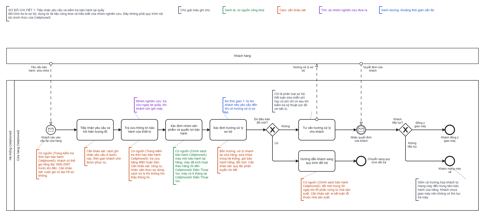

# Điểm nghẽn tiềm ẩn: Quy trình con 1

Tên: Tiếp nhận yêu cầu và kiểm tra bảo hành tại quầy.

- Sơ đồ As-Is: [`bpmn/CellphoneS_AsIs_P1.bpmn`](../bpmn/CellphoneS_AsIs_P1.bpmn)
- Mô tả nghiệp vụ As-Is: [`description/CPS_asis_P1.md`](../description/CPS_asis_P1.md)
- Cách đọc và bảng tổng hợp: [`README.md`](README.md)

Các điểm nghẽn dưới đây là giả thuyết suy ra từ sơ đồ, chưa được đo. Tài liệu không khẳng định CellphoneS đang gặp các vấn đề này.

## Tóm tắt

| Điểm nghẽn tiềm ẩn | Mức ưu tiên kiểm chứng | Đề xuất chính |
|---|---|---|
| Phân loại tại quầy chỉ là sơ bộ, nhưng tuyến xử lý được chọn theo phân loại đó | Cao | Bảng quy tắc phân tuyến; kiểm tra ngoại quan tại quầy; nói trước về khả năng phát sinh chi phí |
| Khách xếp hàng chờ tại quầy | Trung bình | Cho khách khai báo và đặt lịch trước; kết quả tra cứu hiện luôn quyền lợi và nơi bảo hành |
| Tra cứu không ra thông tin bảo hành thì chưa có cách xử lý | Trung bình | Quy định sẵn các cách tra cứu thay thế và người quyết định |
| Xét đổi mới cần kết luận kỹ thuật, nhưng tại quầy chưa rõ ai kết luận | Trung bình | Chỉ định người kết luận; có đường kiểm tra ưu tiên |

Khâu tại quầy có một đặc điểm cần lưu ý: phần lớn hậu quả của nó không xuất hiện tại quầy mà xuất hiện ở các khâu sau. Vì vậy điểm nghẽn đầu tiên dưới đây được xếp ưu tiên cao, dù bản thân bước đó diễn ra nhanh.

## 1. Phân loại tại quầy chỉ là sơ bộ, nhưng tuyến xử lý được chọn theo phân loại đó

**Mức ưu tiên kiểm chứng:** Cao.

**Vị trí trên sơ đồ:** Ô "Xác định hướng xử lý sơ bộ" và ô "Tư vấn hướng xử lý cho khách". Ghi chú màu xám gắn với ô tư vấn ghi rõ: "Chỉ là phân loại sơ bộ. Kết luận sửa miễn phí hay có phí chỉ có sau khi kiểm tra kỹ thuật."

**Vì sao có thể gây nghẽn:** Tại quầy, nhân viên chọn một trong bốn hướng xử lý khi thiết bị chưa được kiểm tra kỹ thuật, và quy tắc để chọn chưa được công bố. Bước này không làm khách chờ lâu. Nhưng nếu chọn chưa đúng, các khâu sau phải làm lại:

- Chọn xử lý nhanh tại cửa hàng, nhưng cửa hàng không xử lý được. Thiết bị phải chuyển sang bộ phận sửa chữa, và khách phải quyết định thêm một lần (sơ đồ tổng quan).
- Chọn một nơi xử lý, nhưng nơi đó không tiếp nhận. Cửa hàng phải xác định lại nơi xử lý sau khi thiết bị đã được chuyển đi (sơ đồ chi tiết 3).
- Tư vấn theo hướng bảo hành, nhưng kiểm tra kỹ thuật kết luận phải sửa có phí. Bộ phận sửa chữa phải báo giá và chờ khách. Khách bất ngờ về chi phí nên có thể từ chối, và nhận lại máy chưa sửa (sơ đồ chi tiết 4).

Mỗi trường hợp làm lại đều kèm theo ít nhất một lần chuyển thiết bị hoặc một lần chờ khách trả lời.

**Hậu quả:**

- Thiết bị đi vòng, tổng thời gian tăng lên nhiều lần so với đường thẳng.
- Trường hợp nặng nhất là khách chờ qua cả khâu chuyển và khâu chẩn đoán rồi nhận lại máy chưa sửa.
- Khách mất lòng tin vì kết quả khác với lời tư vấn ban đầu.

**Căn cứ:**

- Bốn hướng xử lý và nơi bảo hành theo nhóm sản phẩm: Có nguồn (Chính sách bảo hành CellphoneS).
- Quy tắc phân tuyến chi tiết giữa các hướng; danh mục lỗi cửa hàng được xử lý nhanh: Cần khảo sát.
- Phân loại chưa đúng gây làm lại ở các khâu sau: Suy luận từ sơ đồ.

**Cách kiểm chứng:**

- Đếm số yêu cầu bị đổi hướng sau khi cửa hàng đã nhận máy, chia theo ba trường hợp ở trên.
- Đếm số yêu cầu mà lời tư vấn tại quầy là bảo hành nhưng kết quả cuối là sửa có phí hoặc trả máy chưa sửa.
- Hỏi nhân viên: dựa vào đâu để chọn hướng xử lý, và có tài liệu hướng dẫn nào không.

**Đề xuất cách giải quyết:**

1. Lập bảng quy tắc phân tuyến trong một trang. Đầu vào là nhóm sản phẩm, thời hạn bảo hành còn lại, hãng và loại lỗi. Đầu ra là hướng xử lý và nơi xử lý cụ thể. Nhân viên tra bảng thay vì tự phán đoán.
2. Thêm một bước kiểm tra ngoại quan ngắn tại quầy, để sớm nhận ra những dấu hiệu có thể khiến thiết bị không được bảo hành. CareS công bố việc kiểm tra ngoại quan khi tiếp nhận (Có nguồn: Hướng dẫn của CareS, chỉ áp dụng cho CareS).
3. Khi tư vấn, nói rõ với khách khả năng phát sinh chi phí và khoảng chi phí tham khảo cho loại lỗi đó. Hỏi luôn khách mức chi phí mà khách đồng ý cho sửa mà không cần hỏi lại, và ghi vào phiếu tiếp nhận. Việc này rút ngắn [khoảng chờ khách đồng ý ở khâu sửa chữa](CPS_bottleneck_P4.md).
4. Đưa việc "Xác định nơi xử lý cụ thể" từ sơ đồ chi tiết 3 lên quầy, trước khi nhận máy. Khi đó trường hợp "không có nơi xử lý phù hợp" được phát hiện lúc khách còn giữ máy.
5. Ghi lại mỗi lần hướng xử lý bị đổi và lý do. Dùng số liệu này để chỉnh bảng quy tắc.

**Lưu ý khi áp dụng:**

- Kiểm tra ngoại quan làm thời gian phục vụ mỗi khách tại quầy dài hơn. Đổi lại là ít phải làm lại ở sau. Cần đo cả hai để biết có lợi hay không.
- Khoảng chi phí tham khảo dễ bị khách hiểu thành cam kết. Phải ghi rõ đây là số tham khảo, và kết luận chỉ có sau khi kiểm tra kỹ thuật.

## 2. Khách xếp hàng chờ tại quầy

**Mức ưu tiên kiểm chứng:** Trung bình.

**Vị trí trên sơ đồ:** Chuỗi bốn ô nối tiếp nhau: "Tiếp nhận yêu cầu và hỏi hiện tượng lỗi", "Tra cứu thông tin bảo hành của thiết bị", "Xác định nhóm sản phẩm và quyền lợi bảo hành", "Xác định hướng xử lý sơ bộ".

**Vì sao có thể gây nghẽn:** Bốn bước được làm lần lượt, cho từng khách, trong lúc khách đứng tại quầy. Thông tin đầu vào là hiện tượng lỗi và số IMEI hoặc Seri chỉ được thu khi khách đã tới quầy. Khách có thể đã gọi tổng đài trước đó, nhưng cuộc gọi chỉ là tư vấn và chưa rõ có tạo hồ sơ hay không. Khi nhiều khách đến cùng lúc, hàng chờ hình thành ngay ở bước đầu tiên của cả quy trình. Mô hình As-Is cũng đã ghi "thời gian khách chờ được phục vụ" là nội dung cần khảo sát.

**Hậu quả:** Khách chờ trước cả khi yêu cầu được ghi nhận. Một số khách bỏ về. Nhân viên bị dồn việc tại quầy và lùi các việc khác lại, như đã nêu ở [sơ đồ tổng quan](CPS_bottleneck_Level0.md).

**Căn cứ:**

- Website có trang tra cứu thời hạn bảo hành bằng IMEI hoặc Seri và công bố số tổng đài: Có nguồn (Trang kiểm tra thời hạn bảo hành CellphoneS).
- Việc tra cứu diễn ra ngay tại quầy, trước khi nhận máy: Nhóm nghiên cứu.
- Công cụ nhân viên thật sự dùng, cách ghi nhận yêu cầu, thời gian khách chờ: Cần khảo sát.
- Bốn bước nối tiếp tạo hàng chờ khi đông khách: Suy luận từ sơ đồ.

**Cách kiểm chứng:**

- Đo thời gian từ khi khách nêu yêu cầu tại quầy đến khi có hướng xử lý sơ bộ.
- Đo thêm thời gian khách chờ đến lượt, tức là từ khi khách đến cửa hàng đến khi được nhân viên tiếp. Khoảng này chưa có trong mười một khoảng thời gian của mô hình As-Is.
- Quan sát tại quầy xem trong bốn bước, bước nào chiếm nhiều thời gian nhất.

**Đề xuất cách giải quyết:**

1. Cho khách khai báo trước khi đến: hiện tượng lỗi và số IMEI hoặc Seri, qua website, ứng dụng hoặc tổng đài. Trang tra cứu bảo hành công khai đã nhận IMEI, nên kết quả tra cứu có thể có sẵn trước khi khách tới. Khi khách đến, nhân viên chỉ xác nhận lại.
2. Cho khách đặt lịch hẹn. Điện Thoại Vui đã công bố bước đặt lịch và xác nhận lịch cho khách đến trực tiếp (Có nguồn: Trang chủ Điện Thoại Vui). Có thể áp dụng cùng cách này cho yêu cầu bảo hành tại cửa hàng CellphoneS.
3. Gộp hai bước tra cứu và xác định quyền lợi: kết quả tra cứu hiện luôn nhóm sản phẩm, quyền lợi, nơi bảo hành, và thiết bị còn trong 30 ngày đổi mới hay không. Nhân viên không phải tự đối chiếu với bảng chính sách. Cần khảo sát xem công cụ hiện tại đã làm được việc này chưa.
4. Nếu khách đã gọi tổng đài, tổng đài tạo sẵn một hồ sơ nháp để cửa hàng dùng lại.

**Lưu ý khi áp dụng:** Khai báo trước chỉ có ích khi cửa hàng thật sự dùng lại thông tin khách đã khai. Vẫn phải giữ cách tiếp nhận tại quầy cho khách không khai báo trước.

## 3. Tra cứu không ra thông tin bảo hành thì chưa có cách xử lý

**Mức ưu tiên kiểm chứng:** Trung bình.

**Vị trí trên sơ đồ:** Ô "Tra cứu thông tin bảo hành của thiết bị". Sơ đồ không có nhánh nào cho trường hợp không tìm thấy thông tin.

**Vì sao có thể gây nghẽn:** Trang tra cứu công khai chỉ áp dụng cho sản phẩm bán ra tại CellphoneS. Khi không thấy thông tin, trang chỉ hướng dẫn khách liên hệ cửa hàng hoặc tổng đài 1900.6480. Nhưng lúc này khách đang đứng ở chính cửa hàng. Nếu nhân viên cũng không tra được, ba bước tiếp theo không có đầu vào: không xác định được nhóm sản phẩm, quyền lợi và hướng xử lý. Nhân viên phải dừng lại để hỏi người khác hoặc tìm chứng từ mua hàng, còn khách thì chờ.

**Hậu quả:** Một khách giữ quầy lâu, hàng chờ phía sau dài ra. Khách có thể phải về lấy hóa đơn rồi đến lại.

**Căn cứ:**

- Trang tra cứu hướng dẫn khách liên hệ cửa hàng hoặc tổng đài khi không thấy thông tin: Có nguồn (Trang kiểm tra thời hạn bảo hành CellphoneS).
- Cách cửa hàng xử lý khi không tìm thấy thông tin sản phẩm: Cần khảo sát.

**Cách kiểm chứng:**

- Đếm số lần tra cứu không ra kết quả, và thời gian cửa hàng dùng để xử lý mỗi lần.
- Hỏi nhân viên: khi không tra được thì làm gì, hỏi ai.

**Đề xuất cách giải quyết:**

1. Quy định sẵn thứ tự các cách tra cứu thay thế: theo số điện thoại mua hàng hoặc tài khoản thành viên, theo hóa đơn, theo số Seri in trên máy.
2. Quy định ai có quyền quyết định khi mọi cách đều không ra, và thời hạn người đó phải trả lời.
3. Khi vẫn không xác minh được, nói rõ với khách các lựa chọn còn lại, ví dụ tiếp nhận theo diện sửa chữa có phí, để khách quyết định ngay thay vì chờ.
4. Ghi lại các trường hợp không tra được để sửa dữ liệu gốc.

**Lưu ý khi áp dụng:** Các cách tra cứu thay thế ở đề xuất 1 phụ thuộc vào dữ liệu CellphoneS đang lưu, là điều mô hình As-Is chưa biết.

## 4. Xét đổi mới cần kết luận kỹ thuật, nhưng tại quầy chưa rõ ai kết luận

**Mức ưu tiên kiểm chứng:** Trung bình.

**Vị trí trên sơ đồ:** Điểm quyết định "Đủ điều kiện đổi mới?" và ô "Hướng dẫn khách sang quy trình đổi trả".

**Vì sao có thể gây nghẽn:** Điều kiện đổi mới có hai phần. Phần thứ nhất là thiết bị còn trong 30 ngày, tra cứu được ngay. Phần thứ hai là lỗi phần cứng từ phía nhà sản xuất, đòi hỏi một kết luận kỹ thuật. Trên sơ đồ, điểm quyết định này nằm ngay sau bước phân loại sơ bộ và trước mọi bước kiểm tra kỹ thuật. Mô hình chưa biết ai kết luận lỗi thuộc nhà sản xuất tại cửa hàng.

Nếu người kết luận không có mặt, hoặc phải gửi máy đi kiểm tra mới kết luận được, khách phải chờ tại quầy hoặc quay lại sau. Thêm vào đó, quyền lợi này có hạn 30 ngày. Nếu việc kết luận kéo dài, cần biết mốc 30 ngày được tính đến ngày khách báo lỗi hay đến ngày có kết luận.

**Hậu quả:** Khách có quyền đổi mới nhưng phải chờ kết luận. Nếu nhân viên không chắc, thiết bị có thể bị đưa vào đường sửa chữa thay vì đổi mới, rồi phải đổi hướng về sau.

**Căn cứ:**

- Đổi mới trong 30 ngày khi lỗi phần cứng từ nhà sản xuất: Có nguồn (Chính sách bảo hành CellphoneS).
- Ai kết luận lỗi thuộc nhà sản xuất; mốc tính 30 ngày: Cần khảo sát.
- Điểm quyết định cần một thông tin mà quy trình chưa tạo ra tại thời điểm đó: Suy luận từ sơ đồ.

**Cách kiểm chứng:**

- Hỏi cửa hàng: ai kết luận, kết luận dựa trên tiêu chí gì, mất bao lâu.
- Đếm số yêu cầu đổi mới không được kết luận ngay trong lần khách đến đầu tiên.

**Đề xuất cách giải quyết:**

1. Chỉ định rõ người được kết luận tại mỗi cửa hàng, và lập danh mục các lỗi được phép kết luận ngay tại quầy.
2. Với trường hợp chưa kết luận được ngay, nhận máy theo một đường kiểm tra ưu tiên có thời hạn trả lời, tách khỏi hàng chờ sửa chữa thông thường.
3. Lấy ngày khách báo lỗi tại cửa hàng làm mốc xét 30 ngày, và ghi ngày này vào hồ sơ, để thời gian chờ kết luận không làm khách mất quyền lợi.

**Lưu ý khi áp dụng:** Đề xuất 3 là thay đổi về chính sách, cần quyết định của doanh nghiệp. Quy trình đổi trả nằm ngoài phạm vi mô hình, nên các đề xuất ở đây chỉ nói đến phần việc trước khi yêu cầu được chuyển sang quy trình đó.

## Điểm cần theo dõi thêm

| Điểm | Vì sao nên theo dõi | Hướng xử lý |
|---|---|---|
| Chờ khách quyết định tại quầy (sự kiện "Nhận quyết định của khách") | Thường ngắn vì khách có mặt. Nhưng nếu khách cần về suy nghĩ thêm, yêu cầu kết thúc ở "Khách mang máy về", và chưa rõ kết quả tra cứu và tư vấn có được lưu lại không | Lưu kết quả tra cứu và tư vấn theo số IMEI, để khi khách quay lại không phải làm lại từ đầu |
| Cuộc gọi tổng đài trước khi đến | Chưa rõ cuộc gọi có tạo hồ sơ hay không. Nếu không, khách phải trình bày lại toàn bộ tại quầy | Tổng đài tạo hồ sơ nháp, như đề xuất ở điểm nghẽn về hàng chờ tại quầy |

## Liên hệ với các sơ đồ khác

- Phân loại sơ bộ tại quầy là nguyên nhân của ba đường làm lại ở [sơ đồ tổng quan](CPS_bottleneck_Level0.md), [khâu chuyển thiết bị](CPS_bottleneck_P3.md) và [khâu kiểm tra kỹ thuật và sửa chữa](CPS_bottleneck_P4.md).
- Số điện thoại và kênh liên lạc của khách được hỏi ở khâu này và [khâu nhận thiết bị](CPS_bottleneck_P2.md) quyết định việc liên hệ được với khách ở hai khâu về sau: báo giá và báo nhận máy.
