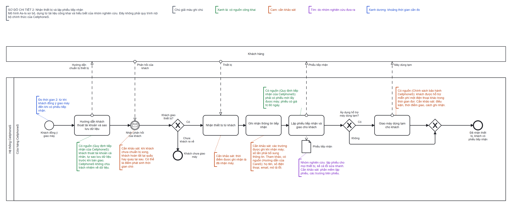

# Điểm nghẽn tiềm ẩn: Quy trình con 2

Tên: Nhận thiết bị và lập phiếu tiếp nhận.

- Sơ đồ As-Is: [`bpmn/CellphoneS_AsIs_P2.bpmn`](../bpmn/CellphoneS_AsIs_P2.bpmn)
- Mô tả nghiệp vụ As-Is: [`description/CPS_asis_P2.md`](../description/CPS_asis_P2.md)
- Cách đọc và bảng tổng hợp: [`README.md`](README.md)

Các điểm nghẽn dưới đây là giả thuyết suy ra từ sơ đồ, chưa được đo. Tài liệu không khẳng định CellphoneS đang gặp các vấn đề này.

## Tóm tắt

| Điểm nghẽn tiềm ẩn | Mức ưu tiên kiểm chứng | Đề xuất chính |
|---|---|---|
| Chờ khách thoát tài khoản và sao lưu dữ liệu | Cao | Báo khách chuẩn bị từ trước khi đến; hướng dẫn sớm hơn; có chỗ tự sao lưu tách khỏi quầy |
| Thông tin tiếp nhận thiếu hoặc phải nhập lại | Trung bình | Mẫu tiếp nhận có trường bắt buộc do cửa hàng và bộ phận sửa chữa cùng thống nhất |
| Phiếu tiếp nhận là căn cứ duy nhất để lấy máy | Trung bình | Gửi mã phiếu cho khách qua tin nhắn hoặc tài khoản ngay khi lập phiếu |

## 1. Chờ khách thoát tài khoản và sao lưu dữ liệu

**Mức ưu tiên kiểm chứng:** Cao.

**Vị trí trên sơ đồ:** Ô "Hướng dẫn khách thoát tài khoản và sao lưu dữ liệu", sự kiện chờ "Nhận phản hồi của khách", điểm quyết định "Khách giao thiết bị?" và kết thúc "Khách chưa giao máy".

**Vì sao có thể gây nghẽn:** Quy định công khai yêu cầu khách thoát các tài khoản cá nhân và tự sao lưu toàn bộ dữ liệu trước khi bàn giao máy, và CellphoneS không chịu trách nhiệm về dữ liệu của khách. Trên sơ đồ, khách chỉ được hướng dẫn việc này sau khi đã đồng ý giao máy, tức là khi đã đứng ở quầy. Sao lưu toàn bộ dữ liệu có thể mất nhiều thời gian, và cần có mạng, chỗ lưu trữ và mật khẩu tài khoản.

Mô hình thể hiện hai khả năng, và cả hai đều gây chậm:

- Khách làm ngay tại quầy. Khách giữ chỗ ở quầy, nhân viên chờ, hàng chờ phía sau dài ra.
- Khách ra về để chuẩn bị. Yêu cầu kết thúc ở "Khách chưa giao máy". Khách phải đến lần hai, và chưa rõ lần hai có phải làm lại phần tra cứu và tư vấn không.

Chính mô hình As-Is đã ghi đây có thể là điểm phát sinh thời gian chờ.

Còn một trường hợp sơ đồ chưa có nhánh: thiết bị hỏng đến mức không thao tác được, ví dụ không lên nguồn hoặc hỏng màn hình. Khi đó khách không thể tự sao lưu hay thoát tài khoản ngay trên máy. Đây là suy luận của bản phân tích, cần được khảo sát.

**Hậu quả:**

- Thời gian từ lúc khách đồng ý giao máy đến lúc có phiếu tiếp nhận phụ thuộc vào khách, không phụ thuộc vào nhân viên.
- Khách phải đến cửa hàng hai lần cho một yêu cầu.
- Một số khách bỏ luôn yêu cầu sau khi ra về.

**Căn cứ:**

- Khách thoát tài khoản và tự sao lưu trước khi bàn giao; CellphoneS không chịu trách nhiệm về dữ liệu: Có nguồn (Quy định tiếp nhận của CellphoneS).
- Khi khách chưa chuẩn bị xong thì hoàn tất tại quầy hay quay lại sau: Cần khảo sát.
- Trường hợp thiết bị không thao tác được: Suy luận từ sơ đồ.

**Cách kiểm chứng:**

- Đo thời gian từ khi khách đồng ý giao máy đến khi có phiếu tiếp nhận, và tách riêng phần chờ khách chuẩn bị máy.
- Đếm số yêu cầu kết thúc ở "Khách chưa giao máy", và trong đó bao nhiêu khách quay lại.
- Hỏi nhân viên: khách thường đã sao lưu sẵn chưa, và gặp máy không thao tác được thì làm thế nào.

**Đề xuất cách giải quyết:**

1. Báo yêu cầu này cho khách trước khi khách đến cửa hàng: ở trang tra cứu bảo hành, trong lời hướng dẫn của tổng đài, và trong tin nhắn xác nhận lịch hẹn nếu có đặt lịch.
2. Đưa bước hướng dẫn lên sớm hơn, ngay khi nhân viên tiếp nhận yêu cầu. Trong lúc nhân viên tra cứu bảo hành và tư vấn, khách đã bắt đầu sao lưu. Hai việc diễn ra cùng lúc thay vì nối tiếp nhau.
3. Bố trí một chỗ tự sao lưu tách khỏi quầy, có mạng không dây, ổ sạc và tờ hướng dẫn từng bước theo dòng máy. Quầy được giải phóng để phục vụ khách tiếp theo.
4. Khi khách buộc phải ra về, lưu lại kết quả tra cứu và tư vấn theo số IMEI. Lần sau khách đi thẳng vào bước nhận máy.
5. Quy định riêng cho thiết bị không thao tác được: hướng dẫn khách gỡ thiết bị khỏi tài khoản từ một thiết bị khác nếu nhà cung cấp tài khoản cho phép, và ghi nhận việc khách đã được thông báo về dữ liệu.

**Lưu ý khi áp dụng:** Các đề xuất không thay đổi quy định về trách nhiệm đối với dữ liệu. Chúng chỉ thay đổi thời điểm khách biết về yêu cầu này và nơi khách thực hiện.

## 2. Thông tin tiếp nhận thiếu hoặc phải nhập lại

**Mức ưu tiên kiểm chứng:** Trung bình.

**Vị trí trên sơ đồ:** Ô "Ghi nhận thông tin tiếp nhận" và ô "Lập phiếu tiếp nhận và giao cho khách".

**Vì sao có thể gây nghẽn:** Mô hình chưa biết cửa hàng ghi những trường thông tin nào, bằng phần mềm gì, và đã đặt câu hỏi về "số lần phải bổ sung thông tin". Có hai vấn đề có thể xảy ra.

Vấn đề thứ nhất là nhập lại. Hiện tượng lỗi đã được hỏi và số IMEI đã được tra cứu ở khâu tại quầy. Nếu các thông tin đó không được lưu, nhân viên phải nhập lại ở bước này.

Vấn đề thứ hai nặng hơn: thông tin ghi thiếu ở đây không gây chậm ngay, mà gây chậm ở các khâu sau.

- Nơi xử lý yêu cầu bổ sung thông tin sau khi thiết bị đã được chuyển đi.
- Kỹ thuật viên không tái hiện được lỗi vì mô tả lỗi quá sơ sài.
- Bộ phận sửa chữa không liên hệ được với khách để báo giá, hoặc cửa hàng không báo được khách đến nhận máy, vì số điện thoại sai hoặc khách không dùng kênh đó.
- Khi trả máy, hai bên tranh cãi về tình trạng bên ngoài của máy lúc nhận.

**Hậu quả:** Thiết bị nằm chờ ở khâu sau trong lúc các bên hỏi lại nhau, và người phải trả lời thường là khách, là người khó liên hệ nhất.

**Căn cứ:**

- CareS ghi họ tên, số điện thoại, email và mô tả ban đầu về lỗi: Có nguồn (Hướng dẫn của CareS, chỉ áp dụng cho CareS).
- Các trường thông tin cửa hàng CellphoneS ghi, phần mềm lập phiếu, số lần phải bổ sung thông tin: Cần khảo sát.
- Thông tin thiếu ở khâu này gây chậm ở khâu sau: Suy luận từ sơ đồ.

**Cách kiểm chứng:**

- Xem một số phiếu tiếp nhận thật để biết các trường đang được ghi.
- Đếm số lần nơi xử lý hoặc kỹ thuật viên phải hỏi lại cửa hàng hoặc khách, và hỏi về điều gì.
- Đếm số lần không liên hệ được khách ở lần gọi đầu.

**Đề xuất cách giải quyết:**

1. Lập mẫu tiếp nhận có các trường bắt buộc do cửa hàng và bộ phận sửa chữa cùng thống nhất. Tiêu chí: kỹ thuật viên nhận máy là bắt tay vào kiểm tra được, không phải hỏi lại.
2. Tự điền các trường đã có từ kết quả tra cứu tại quầy, như dòng máy, số IMEI và thông tin bảo hành.
3. Ghi mô tả lỗi theo lời khách, kèm điều kiện làm lỗi xuất hiện. Chụp ảnh tình trạng bên ngoài của máy lúc nhận và lưu cùng hồ sơ.
4. Xác nhận lại số điện thoại và hỏi khách muốn được liên hệ qua kênh nào. Hai khoảng chờ khách về sau, là chờ đồng ý báo giá và chờ đến nhận máy, đều phụ thuộc vào thông tin này.
5. Ghi luôn vào phiếu mức chi phí khách đồng ý cho sửa mà không cần hỏi lại, như đề xuất ở [khâu tiếp nhận tại quầy](CPS_bottleneck_P1.md).

**Lưu ý khi áp dụng:** Thêm trường bắt buộc và chụp ảnh làm bước lập phiếu dài hơn. Chỉ nên thêm những trường mà số liệu cho thấy hay bị hỏi lại.

## 3. Phiếu tiếp nhận là căn cứ duy nhất để lấy máy

**Mức ưu tiên kiểm chứng:** Trung bình.

**Vị trí trên sơ đồ:** Chứng từ "Phiếu tiếp nhận", được tạo ở ô "Lập phiếu tiếp nhận và giao cho khách" và được dùng lại ở sơ đồ chi tiết 5.

**Vì sao có thể gây nghẽn:** Điểm này không gây chậm tại khâu nhận máy. Nó tạo ra một điểm nghẽn ở khâu trả máy. Quy định công khai ghi CellphoneS không trả máy nếu khách không có phiếu tiếp nhận. Phiếu được giao cho khách ở khâu này và chỉ được dùng lại sau nhiều ngày. Nếu khách làm mất phiếu trong thời gian đó, yêu cầu rơi vào lối cụt "Chưa trả thiết bị: khách không có phiếu".

Mô hình chưa biết phiếu là giấy hay điện tử. Có một chi tiết đáng chú ý: trang tra cứu của Điện Thoại Vui cho khách đăng nhập bằng số điện thoại cùng mã đơn hàng trên phiếu tiếp nhận. Như vậy trên phiếu đã có một mã, và mã đó gắn được với số điện thoại của khách.

**Hậu quả:** Xem phân tích về việc khách mất phiếu ở [khâu trả thiết bị](CPS_bottleneck_P5.md).

**Căn cứ:**

- Phải có phiếu mới lấy được máy; phiếu có giá trị 60 ngày: Có nguồn (Quy định tiếp nhận của CellphoneS).
- Mã đơn hàng trên phiếu dùng được để tra cứu cùng số điện thoại: Có nguồn (Trang tra cứu Điện Thoại Vui).
- Phiếu là giấy hay điện tử, các trường trên phiếu: Cần khảo sát.

**Cách kiểm chứng:**

- Xem phiếu tiếp nhận thật.
- Đếm số lượt khách đến nhận máy mà không có phiếu.

**Đề xuất cách giải quyết:**

1. Ngay khi lập phiếu, gửi mã phiếu cho khách qua tin nhắn hoặc tài khoản thành viên. Phiếu không còn chỉ tồn tại trên một tờ giấy.
2. Ghi trên phiếu ngày hết hạn 60 ngày cụ thể, thay vì để khách tự tính.
3. Lập quy trình xác minh thay thế cho trường hợp mất phiếu, như đề xuất ở [khâu trả thiết bị](CPS_bottleneck_P5.md).

**Lưu ý khi áp dụng:** Quy định phải có phiếu tồn tại để tránh trả nhầm máy cho người khác. Mọi cách thay thế phải giữ được mức an toàn đó.

## Điểm cần theo dõi thêm

| Điểm | Vì sao nên theo dõi | Hướng xử lý |
|---|---|---|
| Thủ tục đầy đủ áp dụng cả cho lỗi sửa nhanh | Theo nhận định của nhóm nghiên cứu, phiếu được lập cho mọi thiết bị, kể cả lỗi sửa nhanh. Với việc chỉ mất ít thời gian như thay miếng dán màn hình, chuỗi hướng dẫn sao lưu, ghi nhận thông tin, lập phiếu, rồi kiểm tra phiếu khi trả có thể dài hơn chính việc xử lý | Thủ tục rút gọn khi khách chờ tại chỗ và việc xử lý không đụng đến dữ liệu trong máy |
| Máy dùng tạm | Điều kiện được mượn, số máy có sẵn và thời điểm giao chưa rõ. Theo chính sách, khách trả máy mượn sau khi nhận lại máy của mình. Vì vậy thiết bị càng nằm lâu ở khâu trả thì máy dùng tạm càng chậm quay về, và khách sau có thể không còn máy để mượn | Theo dõi số máy đang cho mượn; nhắc khách đến nhận máy để thu hồi máy mượn sớm |
| Thời điểm được ghi nhận là đã nhận máy | Đây là mốc đầu của mọi phép đo về sau. Nếu mốc này không được ghi, không tính được tổng thời gian khách không có máy | Lấy thời điểm lập phiếu tiếp nhận làm mốc và lưu lại |

## Liên hệ với các sơ đồ khác

- Việc khách chưa chuẩn bị xong máy nối ngược về [khâu tiếp nhận tại quầy](CPS_bottleneck_P1.md): nếu khách được báo sớm hơn thì khâu này không phải chờ.
- Thông tin ghi ở khâu này là đầu vào cho [khâu chuyển thiết bị](CPS_bottleneck_P3.md) và [khâu kiểm tra kỹ thuật và sửa chữa](CPS_bottleneck_P4.md).
- Phiếu tiếp nhận lập ở khâu này là điều kiện để trả máy ở [khâu trả thiết bị](CPS_bottleneck_P5.md).
