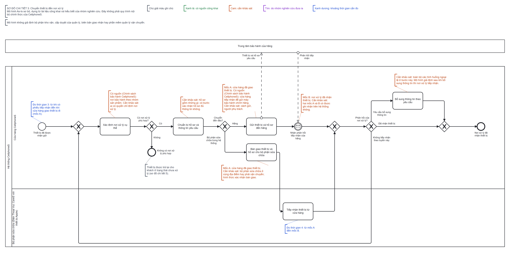

# Điểm nghẽn tiềm ẩn: Quy trình con 3

Tên: Chuyển thiết bị đến nơi xử lý.

- Sơ đồ As-Is: [`bpmn/CellphoneS_AsIs_P3.bpmn`](../bpmn/CellphoneS_AsIs_P3.bpmn)
- Mô tả nghiệp vụ As-Is: [`description/CPS_asis_P3.md`](../description/CPS_asis_P3.md)
- Cách đọc và bảng tổng hợp: [`README.md`](README.md)

Các điểm nghẽn dưới đây là giả thuyết suy ra từ sơ đồ, chưa được đo. Tài liệu không khẳng định CellphoneS đang gặp các vấn đề này.

Đây là quy trình con có ít căn cứ công khai nhất: gần như mọi bước đều thuộc loại cần khảo sát. Vì vậy các điểm nghẽn ở đây cũng kém chắc chắn nhất. Tuy nhiên đây lại là khâu mà khách không tham gia và không nhìn thấy, nên thiết bị nằm chờ ở đây là khó phát hiện nhất.

## Tóm tắt

| Điểm nghẽn tiềm ẩn | Mức ưu tiên kiểm chứng | Đề xuất chính |
|---|---|---|
| Thiết bị nằm chờ tại cửa hàng trước khi được chuyển đi | Cao | Lịch chuyển cố định có giờ chốt; mỗi ca có người phụ trách giao nhận |
| Khoảng trống giữa lúc cửa hàng giao và lúc nơi xử lý nhận | Cao | Xác nhận ở cả hai đầu; rà soát hằng ngày các máy đã giao nhưng chưa có xác nhận nhận |
| Nơi xử lý yêu cầu bổ sung thông tin hoặc không tiếp nhận | Trung bình | Gửi hồ sơ đi trước, nơi xử lý xác nhận rồi mới chuyển thiết bị |
| Gửi hãng: chờ bên ngoài phản hồi việc tiếp nhận | Cao | Danh sách kiểm hồ sơ theo từng hãng; lưu mã tiếp nhận của hãng |

## 1. Thiết bị nằm chờ tại cửa hàng trước khi được chuyển đi

**Mức ưu tiên kiểm chứng:** Cao.

**Vị trí trên sơ đồ:** Đoạn từ điểm bắt đầu "Thiết bị đã được nhận giữ", qua ô "Xác định nơi xử lý cụ thể" và ô "Chuẩn bị hồ sơ và thông tin yêu cầu", đến ô "Bàn giao thiết bị và hồ sơ cho bộ phận sửa chữa" hoặc ô "Gửi thiết bị và hồ sơ đến hãng". Ghi chú màu xanh dương ở đầu sơ đồ đánh dấu khoảng thời gian cần đo cho đoạn này.

**Vì sao có thể gây nghẽn:** Ba việc trong đoạn này đều là việc không có khách đứng chờ. Mô hình chưa biết ai chỉ định nơi xử lý, ai phụ trách chuyển máy và chuyển bằng cách nào. Có hai lý do khiến thiết bị dễ nằm lại:

- Nếu máy được gom lại để chuyển theo chuyến, một máy nhận ngay sau khi chuyến vừa đi sẽ phải chờ đến chuyến sau.
- Nếu không có người được giao rõ việc này, việc chuyển máy phụ thuộc vào lúc nhân viên rảnh tay, như đã nêu ở [sơ đồ tổng quan](CPS_bottleneck_Level0.md).

Trong lúc đó khách đã giao máy và nghĩ rằng máy đang được xử lý.

**Hậu quả:** Thời gian chờ này cộng thẳng vào thời gian khách không có máy, nhưng không ai sửa gì trong khoảng đó.

**Căn cứ:**

- Nơi bảo hành theo nhóm sản phẩm; cửa hàng tiếp nhận để gửi máy bảo hành chính hãng: Có nguồn (Chính sách bảo hành CellphoneS).
- Ai chỉ định nơi xử lý, ai chuyển, chuyển theo chuyến hay từng máy, bộ phận sửa chữa có ở cùng địa điểm không: Cần khảo sát.
- Thiết bị nằm chờ trước khi chuyển: Suy luận từ sơ đồ.

**Cách kiểm chứng:**

- Đo thời gian từ khi có phiếu tiếp nhận đến khi cửa hàng giao thiết bị đi.
- Xem thời gian này có khác nhau theo giờ nhận máy trong ngày không. Nếu máy nhận buổi chiều chờ lâu hơn hẳn máy nhận buổi sáng thì nguyên nhân là lịch chuyển.
- Hỏi cửa hàng: mỗi ngày chuyển máy mấy lần, ai mang đi.

**Đề xuất cách giải quyết:**

1. Đặt lịch chuyển cố định, có giờ chốt được thông báo trong cửa hàng: máy nhận trước giờ chốt thì đi trong chuyến đó. Số chuyến và giờ chốt do doanh nghiệp quyết định theo lượng máy. Nhờ vậy nhân viên tư vấn nói được cho khách biết máy sẽ rời cửa hàng lúc nào.
2. Trong mỗi ca, giao rõ một người phụ trách việc giao nhận máy.
3. Chuẩn bị hồ sơ chuyển ngay trong lúc lập phiếu tiếp nhận, dùng chung thông tin đã ghi, không để thành một việc riêng làm sau.
4. Gửi thông tin yêu cầu cho nơi xử lý ngay khi lập phiếu, trước khi thiết bị đến. Nơi xử lý biết trước sẽ nhận máy gì và có thể chuẩn bị.
5. Nếu bộ phận sửa chữa ở cùng địa điểm với cửa hàng, bàn giao ngay sau khi lập phiếu, không gom.

**Lưu ý khi áp dụng:** Tăng số chuyến làm tăng chi phí vận chuyển. Cần số liệu về lượng máy mỗi ngày để chọn số chuyến hợp lý.

## 2. Khoảng trống giữa lúc cửa hàng giao và lúc nơi xử lý nhận

**Mức ưu tiên kiểm chứng:** Cao.

**Vị trí trên sơ đồ:** Giữa ô "Bàn giao thiết bị và hồ sơ cho bộ phận sửa chữa" và ô "Tiếp nhận thiết bị từ cửa hàng" ở làn Bộ phận sửa chữa. Với tuyến hãng là giữa ô "Gửi thiết bị và hồ sơ đến hãng" và sự kiện chờ "Nhận phản hồi tiếp nhận của hãng". Các ghi chú trên sơ đồ đánh dấu hai mốc: cửa hàng đã giao thiết bị, và nơi xử lý đã nhận thiết bị.

**Vì sao có thể gây nghẽn:** Mô hình cố ý tách hai mốc này, vì khoảng giữa là lúc thiết bị đang trên đường, hoặc đã đến nơi nhưng chưa được ai nhận. Mô hình chưa biết hai mốc có được ghi nhận hay không. Nếu không được ghi nhận thì trong khoảng này không bên nào đứng tên chịu trách nhiệm: cửa hàng coi là đã giao, nơi xử lý coi là chưa nhận. Một thiết bị bị chậm hoặc thất lạc ở đây sẽ không ai thấy, cho đến khi khách hỏi.

Mô hình As-Is không giả định có biên bản giao nhận hay phần mềm quản lý vận chuyển, nên không thể nói khoảng trống này đang được kiểm soát bằng cách nào.

**Hậu quả:**

- Thiết bị chậm mà không ai biết để xử lý.
- Khi có sự cố, không xác định được thiết bị đang thuộc trách nhiệm của bên nào.
- Khách tra cứu không thấy thay đổi gì.

**Căn cứ:**

- Hai mốc "đã giao" và "đã nhận" có được ghi nhận trên hệ thống không; hình thức xác nhận bàn giao: Cần khảo sát.
- Khoảng trống không có người chịu trách nhiệm: Suy luận từ sơ đồ.

**Cách kiểm chứng:**

- Đo thời gian từ khi cửa hàng giao thiết bị đi đến khi nơi xử lý nhận được.
- Chọn một số hồ sơ đã xử lý, thử xác định lại hai thời điểm này. Nếu không xác định được, đó là bằng chứng hai mốc chưa được ghi nhận.

**Đề xuất cách giải quyết:**

1. Xác nhận ở cả hai đầu, gắn với mã trên phiếu tiếp nhận: người giao xác nhận lúc giao, người nhận xác nhận lúc nhận, và cả hai thời điểm được lưu lại.
2. Mỗi ngày, người phụ trách xem danh sách các máy đã giao nhưng chưa có xác nhận nhận. Máy nào ở trong danh sách lâu hơn mức thường gặp thì phải hỏi ngay.
3. Nơi xử lý xác nhận đã nhận ngay khi thiết bị đến, tách khỏi lúc bắt đầu kiểm tra. Nhờ vậy phân biệt được thiết bị chậm vì vận chuyển hay vì chờ đến lượt.
4. Báo cho khách khi nơi xử lý đã nhận máy.

**Lưu ý khi áp dụng:** Thêm thao tác xác nhận là thêm việc cho hai đầu. Nên dùng cách nhanh nhất mà doanh nghiệp có, ví dụ quét mã trên phiếu. Phần mềm hiện có cần được khảo sát trước.

## 3. Nơi xử lý yêu cầu bổ sung thông tin hoặc không tiếp nhận

**Mức ưu tiên kiểm chứng:** Trung bình.

**Vị trí trên sơ đồ:** Điểm quyết định "Phản hồi của nơi xử lý?". Nhánh "Yêu cầu bổ sung thông tin" dẫn đến ô "Bổ sung thông tin theo yêu cầu". Nhánh "Không tiếp nhận theo tuyến này" quay ngược về ô "Xác định nơi xử lý cụ thể".

**Vì sao có thể gây nghẽn:** Cả hai nhánh chỉ xảy ra sau khi thiết bị đã được chuyển đi.

- Khi nơi xử lý yêu cầu bổ sung thông tin, thiết bị nằm ở nơi xử lý để chờ cửa hàng trả lời. Nếu cửa hàng không có sẵn thông tin thì phải hỏi lại khách.
- Khi nơi xử lý không tiếp nhận, thiết bị phải quay về cửa hàng hoặc chuyển tiếp sang nơi khác. Cả hai khoảng chờ ở hai điểm nghẽn phía trên lặp lại thêm một lần.

Toàn bộ phần này là giả thuyết của mô hình As-Is, chưa có nguồn nào xác nhận các tình huống này có xảy ra.

**Hậu quả:** Thời gian vận chuyển tăng gấp đôi cho những yêu cầu bị trả lại, và thiết bị đổi tay thêm nhiều lần.

**Căn cứ:**

- Các tình huống bổ sung thông tin, không tiếp nhận, xác định lại nơi xử lý: Cần khảo sát.
- Nguyên nhân nằm ở phân loại sơ bộ tại quầy và ở hồ sơ thiếu thông tin: Suy luận từ sơ đồ.

**Cách kiểm chứng:**

- Đếm số yêu cầu bị nơi xử lý yêu cầu bổ sung thông tin, và số yêu cầu bị từ chối tiếp nhận.
- Ghi lại lý do của từng trường hợp để biết nguyên nhân nằm ở hồ sơ hay ở việc chọn tuyến.

**Đề xuất cách giải quyết:**

1. Lập danh sách kiểm hồ sơ trước khi chuyển, và đưa việc kiểm này vào bước "Chuẩn bị hồ sơ và thông tin yêu cầu".
2. Xác nhận trước, chuyển sau: cửa hàng gửi hồ sơ cho nơi xử lý trước; nơi xử lý trả lời là tiếp nhận, cần bổ sung, hay không tiếp nhận, trong lúc thiết bị còn ở cửa hàng. Thiết bị chỉ rời cửa hàng khi đã có nơi nhận chắc chắn.
3. Dùng bảng quy tắc phân tuyến như đề xuất ở [khâu tiếp nhận tại quầy](CPS_bottleneck_P1.md), để chọn đúng nơi xử lý ngay từ đầu.
4. Ghi lý do mỗi lần hồ sơ bị trả lại, và dùng các lý do đó để cập nhật danh sách kiểm và bảng quy tắc.

**Lưu ý khi áp dụng:** Đề xuất 2 thêm một bước chờ nơi xử lý trả lời trước khi chuyển. Nó chỉ có lợi khi nơi xử lý trả lời nhanh, và khi số yêu cầu bị trả lại đủ nhiều. Nếu khảo sát cho thấy hầu như không có yêu cầu nào bị trả lại thì không cần áp dụng.

## 4. Gửi hãng: chờ bên ngoài phản hồi việc tiếp nhận

**Mức ưu tiên kiểm chứng:** Cao.

**Vị trí trên sơ đồ:** Ô "Gửi thiết bị và hồ sơ đến hãng" và sự kiện chờ "Nhận phản hồi tiếp nhận của hãng". Hai đường nét đứt nối với khối Trung tâm bảo hành của hãng.

**Vì sao có thể gây nghẽn:** Ở tuyến hãng, nơi nhận là một bên ngoài hệ thống CellphoneS. Cửa hàng không điều khiển được việc hãng nhận máy nhanh hay chậm. Cách gửi và người phụ trách đều chưa rõ. Mỗi hãng có thể đòi hỏi hồ sơ khác nhau; nếu hồ sơ thiếu thì thiết bị bị trả lại sau khi đã đi một chặng dài hơn so với tuyến trong hệ thống.

Khoảng chờ ở đây mới chỉ là chờ hãng nhận máy. Khoảng chờ hãng xử lý và trả kết quả được phân tích ở [sơ đồ tổng quan](CPS_bottleneck_Level0.md).

**Hậu quả:** Giống hai điểm nghẽn đầu của tệp này, nhưng kéo dài hơn và khó tác động hơn vì phụ thuộc bên ngoài.

**Căn cứ:**

- Cửa hàng tiếp nhận để gửi máy bảo hành chính hãng: Có nguồn (Chính sách bảo hành CellphoneS).
- Cách gửi, người phụ trách, hồ sơ hãng yêu cầu, thời gian hãng phản hồi: Cần khảo sát.

**Cách kiểm chứng:**

- Đo thời gian từ khi cửa hàng gửi máy đến khi hãng phản hồi đã nhận, tách riêng theo từng hãng.
- Đếm số máy bị hãng trả lại vì thiếu hồ sơ.

**Đề xuất cách giải quyết:**

1. Lập danh sách kiểm hồ sơ riêng cho từng hãng mà cửa hàng hay gửi.
2. Lấy mã tiếp nhận của hãng nếu hãng có cấp, và ghi vào hồ sơ làm mốc "hãng đã nhận".
3. Giao một người làm đầu mối cho các máy gửi hãng, như đề xuất ở [sơ đồ tổng quan](CPS_bottleneck_Level0.md).
4. Với thiết bị Apple, khảo sát khả năng chuyển qua CareS là đơn vị trong hệ thống, thay vì gửi ra ngoài.

**Lưu ý khi áp dụng:** Danh sách kiểm theo hãng phải được cập nhật khi hãng đổi yêu cầu, nên cần có người chịu trách nhiệm giữ danh sách.

## Điểm cần theo dõi thêm

| Điểm | Vì sao nên theo dõi | Hướng xử lý |
|---|---|---|
| Sau khi đã nhận máy mới biết không có nơi xử lý phù hợp (kết thúc "Không có nơi xử lý phù hợp") | Khách đã sao lưu, giao máy và nhận phiếu, rồi phải quay lại nhận máy chưa xử lý. Toàn bộ công sức của khách và cửa hàng không đem lại kết quả | Xác định nơi xử lý cụ thể ngay tại quầy, trước khi nhận máy |
| Cách phân tuyến thiết bị Apple | CareS là trung tâm bảo hành ủy quyền Apple thuộc hệ thống CellphoneS, nên thiết bị Apple có thể không cần gửi ra ngoài. Mô hình chưa biết thực tế phân tuyến thế nào | Khảo sát trước; kết quả quyết định thiết bị Apple đi theo tuyến trong hệ thống hay tuyến hãng |

## Liên hệ với các sơ đồ khác

- Hai điểm nghẽn đầu của tệp này lặp lại ở chiều về, khi bộ phận sửa chữa chuyển kết quả và thiết bị về cửa hàng. Xem [khâu kiểm tra kỹ thuật và sửa chữa](CPS_bottleneck_P4.md).
- Nguyên nhân của việc bị trả lại nằm ở [khâu tiếp nhận tại quầy](CPS_bottleneck_P1.md) và [khâu nhận thiết bị](CPS_bottleneck_P2.md).
