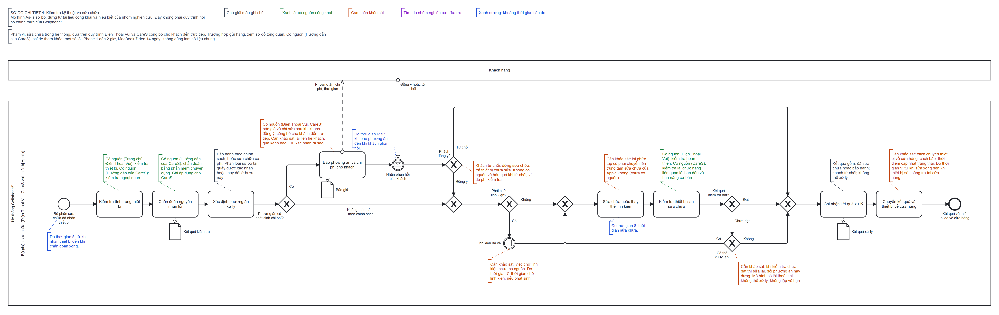

# Điểm nghẽn tiềm ẩn: Quy trình con 4

Tên: Kiểm tra kỹ thuật và sửa chữa.

- Sơ đồ As-Is: [`bpmn/CellphoneS_AsIs_P4.bpmn`](../bpmn/CellphoneS_AsIs_P4.bpmn)
- Mô tả nghiệp vụ As-Is: [`description/CPS_asis_P4.md`](../description/CPS_asis_P4.md)
- Cách đọc và bảng tổng hợp: [`README.md`](README.md)

Các điểm nghẽn dưới đây là giả thuyết suy ra từ sơ đồ, chưa được đo. Tài liệu không khẳng định CellphoneS đang gặp các vấn đề này.

Sơ đồ này chỉ mô tả trường hợp sửa chữa trong hệ thống, tại Điện Thoại Vui hoặc CareS. Trường hợp gửi bảo hành tại hãng được phân tích ở [sơ đồ tổng quan](CPS_bottleneck_Level0.md). Các bước trong sơ đồ dựa trên quy trình mà hai đơn vị công bố cho khách mang máy đến trực tiếp. Nhiều điểm nghẽn dưới đây xuất phát từ chính khác biệt đó: với máy nhận qua cửa hàng CellphoneS, khách không có mặt tại nơi sửa.

## Tóm tắt

| Điểm nghẽn tiềm ẩn | Mức ưu tiên kiểm chứng | Đề xuất chính |
|---|---|---|
| Chờ khách phản hồi phương án và chi phí | Cao | Thỏa thuận trước mức chi phí ngay tại quầy; báo giá qua kênh khách trả lời được ngay; có hạn phản hồi và có nhắc |
| Chờ linh kiện | Cao, nếu khảo sát xác nhận có phát sinh | Kiểm tra linh kiện ngay khi chẩn đoán; đưa thời gian chờ linh kiện vào báo giá |
| Thiết bị chờ đến lượt kiểm tra và chẩn đoán | Trung bình | Tách hàng chờ lỗi đơn giản và lỗi phức tạp; quy tắc thứ tự xử lý rõ ràng |
| Sửa lại khi kiểm tra sau sửa chữa chưa đạt | Trung bình | Giới hạn số lần sửa lại; ghi lý do chưa đạt |
| Sửa xong nhưng kết quả và thiết bị chưa về đến cửa hàng | Cao | Báo kết quả đi trước thiết bị; chuyển về theo lịch cố định |

## 1. Chờ khách phản hồi phương án và chi phí

**Mức ưu tiên kiểm chứng:** Cao.

**Vị trí trên sơ đồ:** Ô "Báo phương án và chi phí cho khách", sự kiện chờ "Nhận phản hồi của khách" và điểm quyết định "Khách đồng ý?". Ghi chú màu xanh dương đánh dấu khoảng thời gian cần đo từ khi báo phương án đến khi khách phản hồi.

**Vì sao có thể gây nghẽn:** Việc sửa chữa có phí chỉ được làm sau khi khách đồng ý. Cả Điện Thoại Vui và CareS đều công bố điều này, nhưng cho khách mang máy đến trực tiếp: khách có mặt và trả lời ngay. Với máy nhận qua cửa hàng CellphoneS thì khác. Khách không có mặt, phải liên hệ từ xa, và mô hình chưa biết ai liên hệ, qua kênh nào, lưu xác nhận của khách ra sao.

Trên sơ đồ, sự kiện chờ này không có giới hạn thời gian và không có bước nhắc. Nếu khách không nghe máy hoặc chưa quyết định, thiết bị nằm tại bộ phận sửa chữa không biết đến bao giờ.

Có hai yếu tố có thể làm khoảng chờ dài thêm:

- Nếu thông tin phải đi vòng qua cửa hàng, tức là bộ phận sửa chữa báo cửa hàng, cửa hàng báo khách, rồi câu trả lời đi ngược lại, thì mỗi chiều thêm một chặng truyền tin.
- Lời tư vấn tại quầy chỉ là phân loại sơ bộ. Khách có thể chưa nghĩ đến việc phải trả tiền, nên cần thời gian cân nhắc khi nhận báo giá.

**Hậu quả:**

- Thiết bị chiếm chỗ tại bộ phận sửa chữa trong lúc chờ.
- Kỹ thuật viên phải đặt máy xuống, sau đó quay lại và mất công nắm lại tình trạng máy.
- Nếu khách từ chối, toàn bộ thời gian chuyển máy và chẩn đoán không đem lại kết quả, và thiết bị còn phải đi hết đường về để được trả ở trạng thái chưa sửa.

**Căn cứ:**

- Báo giá và chỉ sửa sau khi khách đồng ý: Có nguồn (Trang chủ Điện Thoại Vui; Hướng dẫn của CareS). Cả hai nguồn viết cho khách đến trực tiếp.
- Với thiết bị nhận qua cửa hàng: ai liên hệ khách, qua kênh nào, lưu xác nhận ra sao: Cần khảo sát.
- Hậu quả khi khách từ chối, ví dụ phí kiểm tra: Cần khảo sát, hiện không có nguồn.
- Khoảng chờ không có giới hạn và không có bước nhắc: Suy luận từ sơ đồ.

**Cách kiểm chứng:**

- Đo thời gian từ khi báo phương án đến khi khách phản hồi.
- Đếm số lần phải liên hệ mới gặp được khách, và tỷ lệ khách từ chối.
- So sánh tỷ lệ từ chối giữa khách đã được nói trước về chi phí tại quầy và khách chưa được nói.

**Đề xuất cách giải quyết:**

1. Thỏa thuận trước tại quầy: hỏi khách mức chi phí mà khách đồng ý cho sửa luôn, và ghi vào phiếu tiếp nhận. Nếu chi phí thực tế nằm trong mức đó thì sửa ngay và báo cho khách biết. Chỉ khi vượt mức mới phải hỏi lại. Đề xuất này bỏ hẳn khoảng chờ cho một phần yêu cầu.
2. Gửi báo giá qua kênh mà khách bấm đồng ý hoặc từ chối được ngay, ví dụ tin nhắn có đường dẫn hoặc tài khoản thành viên. Câu trả lời được lưu vào hồ sơ làm xác nhận. Chỉ gọi điện khi khách chưa phản hồi.
3. Chỉ định một đầu mối liên hệ khách duy nhất. Nếu bộ phận sửa chữa liên hệ trực tiếp thì cửa hàng phải xem được nội dung đã trao đổi, để trả lời được khi khách hỏi tại cửa hàng.
4. Đặt hạn phản hồi và số lần nhắc, và nói rõ cho khách ngay khi gửi báo giá. Hết hạn mà không liên hệ được thì chuyển sang trả máy chưa sửa. Hạn cụ thể do doanh nghiệp đặt sau khi có số liệu đo.
5. Báo giá gồm đủ ba thông tin trong một lần: chi phí, điều kiện bảo hành, và thời gian sửa dự kiến kể cả thời gian chờ linh kiện nếu có. CareS công bố việc thông tin cả ba nội dung này cho khách (Có nguồn: Hướng dẫn của CareS, chỉ áp dụng cho CareS).
6. Nói rõ với khách ngay từ quầy điều gì xảy ra nếu khách từ chối sửa, để khách không bất ngờ khi nhận báo giá.

**Lưu ý khi áp dụng:**

- Mức chi phí chấp nhận trước phải được khách xác nhận rõ ràng trên phiếu, để tránh tranh cãi về sau.
- Hạn phản hồi là một thay đổi về chính sách đối với khách, cần được doanh nghiệp quyết định và công bố.

## 2. Chờ linh kiện

**Mức ưu tiên kiểm chứng:** Cao, nếu khảo sát xác nhận có phát sinh.

**Vị trí trên sơ đồ:** Điểm quyết định "Phải chờ linh kiện?" và sự kiện chờ "Linh kiện đã về".

**Vì sao có thể gây nghẽn:** Việc chờ linh kiện chưa có nguồn công khai nào xác nhận. Nếu có xảy ra, đây là khoảng chờ phụ thuộc vào nguồn cung, kỹ thuật viên không thể tự rút ngắn.

Thứ tự các bước trên sơ đồ làm khoảng chờ này nặng thêm. Việc xét linh kiện chỉ diễn ra sau khi khách đã đồng ý. Như vậy có hai khoảng chờ nối tiếp nhau: chờ khách đồng ý xong mới bắt đầu chờ linh kiện. Khách cũng đã đồng ý khi chưa biết mình sẽ phải chờ linh kiện bao lâu.

Mô hình As-Is còn nêu một tình huống tương tự cần khảo sát: lỗi phức tạp phải chuyển thiết bị lên trung tâm sửa chữa của Apple. Nếu có, đó là thêm một chặng chuyển ra bên ngoài nằm giữa khâu sửa chữa.

**Hậu quả:** Thiết bị nằm chờ lâu tại bộ phận sửa chữa. Khách không biết vì sao chậm. Máy dùng tạm, nếu có, bị giữ suốt thời gian đó.

**Căn cứ:**

- Việc phải chờ linh kiện, và việc chuyển lên trung tâm sửa chữa của Apple: Cần khảo sát, hiện không có nguồn.
- CareS công bố thời gian tham khảo: một số lỗi iPhone 1 đến 2 giờ, dịch vụ MacBook có thể 7 đến 14 ngày (Có nguồn: Hướng dẫn của CareS). Các con số này chỉ đúng cho CareS, và nguồn không nói phần nào trong đó là chờ linh kiện.
- Hai khoảng chờ nối tiếp nhau do thứ tự các bước: Suy luận từ sơ đồ.

**Cách kiểm chứng:**

- Hỏi bộ phận sửa chữa: có phải chờ linh kiện không, với loại linh kiện nào, thường chờ bao lâu.
- Đo thời gian chờ linh kiện, nếu phát sinh, và đếm tỷ lệ yêu cầu phải chờ.

**Đề xuất cách giải quyết:**

1. Kiểm tra linh kiện có sẵn hay không ngay ở bước "Xác định phương án xử lý", trước khi báo giá. Thời gian chờ linh kiện được đưa vào báo giá, và khách quyết định khi đã biết đủ thông tin.
2. Với linh kiện đặt trước được và hủy được, đặt hoặc giữ chỗ ngay khi gửi báo giá, song song với việc chờ khách trả lời. Hai khoảng chờ chồng lên nhau thay vì nối tiếp.
3. Dự trữ sẵn các linh kiện hay dùng, dựa trên thống kê lỗi.
4. Khi thiết bị vẫn dùng được trong lúc chờ linh kiện, cho khách lựa chọn nhận lại máy và hẹn quay lại khi linh kiện về.
5. Báo cho khách ngay khi phát sinh việc chờ linh kiện, kèm ngày dự kiến.

**Lưu ý khi áp dụng:**

- Dự trữ linh kiện làm tăng tiền hàng nằm trong kho. Chỉ nên dự trữ loại mà số liệu cho thấy hay thiếu.
- Đề xuất 4 làm khách phải đi lại thêm một lượt và thiết bị đổi tay thêm hai lần. Chỉ nên là lựa chọn của khách, không phải mặc định.

## 3. Thiết bị chờ đến lượt kiểm tra và chẩn đoán

**Mức ưu tiên kiểm chứng:** Trung bình.

**Vị trí trên sơ đồ:** Đoạn từ điểm bắt đầu "Bộ phận sửa chữa đã nhận thiết bị" đến ô "Chẩn đoán nguyên nhân lỗi". Ghi chú màu xanh dương đánh dấu khoảng thời gian cần đo từ khi nhận thiết bị đến khi chẩn đoán xong.

**Vì sao có thể gây nghẽn:** Kiểm tra và chẩn đoán cần người có chuyên môn, và số kỹ thuật viên là có hạn. Cùng một bộ phận sửa chữa có thể nhận máy từ nhiều cửa hàng CellphoneS, đồng thời phục vụ khách mang máy đến trực tiếp. Mô hình chưa biết thứ tự ưu tiên giữa hai nguồn máy này. Nếu khách đang ngồi chờ tại chỗ được làm trước, máy chuyển từ cửa hàng có thể bị lùi lại.

Ngoài ra, nếu mọi máy xếp chung một hàng, máy lỗi đơn giản phải chờ sau máy lỗi phức tạp.

**Hậu quả:** Thiết bị đã đến nơi sửa nhưng chưa ai xem. Thời gian chờ này cộng vào trước cả khoảng chờ khách đồng ý và khoảng chờ linh kiện.

**Căn cứ:**

- Kiểm tra thiết bị; chẩn đoán bằng phần mềm chuyên dụng tại CareS: Có nguồn (Trang chủ Điện Thoại Vui; Hướng dẫn của CareS).
- Bộ phận sửa chữa phục vụ cả khách đến trực tiếp: Có nguồn (hai trang trên mô tả quy trình cho khách đến trực tiếp).
- Số kỹ thuật viên, lượng máy, thứ tự ưu tiên giữa máy từ cửa hàng và máy của khách đến trực tiếp: Cần khảo sát.
- Máy từ cửa hàng bị lùi lại: Suy luận từ sơ đồ.

**Cách kiểm chứng:**

- Đo thời gian từ khi nơi xử lý nhận thiết bị đến khi chẩn đoán xong, tách riêng phần chờ đến lượt và phần kiểm tra thật sự.
- So sánh thời gian chờ đến lượt giữa máy chuyển từ cửa hàng và máy của khách đến trực tiếp.
- Đếm số máy đang chờ chẩn đoán vào cuối mỗi ngày.

**Đề xuất cách giải quyết:**

1. Phân loại nhanh ngay khi nhận máy thành lỗi đơn giản và lỗi phức tạp, và cho hai loại đi hai hàng chờ riêng.
2. Công bố quy tắc thứ tự xử lý. Với máy từ cửa hàng, tính thứ tự từ lúc khách giao máy tại cửa hàng chứ không phải từ lúc máy đến nơi sửa, để thời gian vận chuyển không làm máy bị thiệt thêm.
3. Theo dõi số máy đang chờ chẩn đoán mỗi ngày, và điều phối kỹ thuật viên khi con số này tăng.
4. Dùng thông tin cửa hàng gửi trước để chuẩn bị, như đề xuất ở [khâu chuyển thiết bị](CPS_bottleneck_P3.md).

**Lưu ý khi áp dụng:** Ưu tiên máy từ cửa hàng có nghĩa là khách đến trực tiếp phải chờ lâu hơn. Đây là sự đánh đổi cần doanh nghiệp quyết định.

## 4. Sửa lại khi kiểm tra sau sửa chữa chưa đạt

**Mức ưu tiên kiểm chứng:** Trung bình.

**Vị trí trên sơ đồ:** Điểm quyết định "Kết quả kiểm tra đạt?", điểm quyết định "Có thể xử lý lại?" và đường quay ngược về ô "Sửa chữa hoặc thay thế linh kiện".

**Vì sao có thể gây nghẽn:** Mỗi vòng sửa lại lặp lại toàn bộ thời gian sửa và thời gian kiểm tra, và có thể cả thời gian chờ linh kiện. Sơ đồ có lối thoát là nhánh "không thể xử lý lại", nhưng mô hình chưa biết thực tế sau bao nhiêu lần thì dừng, và ai quyết định dừng.

Có một trường hợp sơ đồ chưa thể hiện: nếu sửa lại đòi hỏi một phương án khác với chi phí khác, bộ phận sửa chữa phải hỏi lại khách, tức là quay lại khoảng chờ ở điểm nghẽn đầu tiên.

**Hậu quả:** Kỹ thuật viên dùng thời gian cho máy cũ thay vì máy mới, nên hàng chờ chẩn đoán dài ra. Trường hợp nặng nhất là sau nhiều vòng, kết quả là "không thể xử lý": khách chờ lâu nhất mà nhận lại máy chưa sửa.

**Căn cứ:**

- Kiểm tra lại sau sửa chữa: Có nguồn (Trang chủ Điện Thoại Vui; Hướng dẫn của CareS).
- Khi kiểm tra chưa đạt thì sửa lại, đổi phương án hay dừng: Cần khảo sát.

**Cách kiểm chứng:**

- Đếm tỷ lệ yêu cầu phải sửa lại, và số lần sửa lại của mỗi yêu cầu.
- So sánh thời gian sửa chữa giữa yêu cầu sửa một lần và yêu cầu phải sửa lại.

**Đề xuất cách giải quyết:**

1. Đặt giới hạn số lần sửa lại. Quá giới hạn thì chuyển cho người có kinh nghiệm hơn hoặc xem xét đổi phương án, thay vì tiếp tục thử.
2. Ghi lý do mỗi lần kiểm tra chưa đạt. Thống kê theo loại lỗi, loại linh kiện và nơi sửa để tìm nguyên nhân lặp lại.
3. Dùng danh sách kiểm sau sửa chữa gồm lỗi ban đầu theo mô tả trên phiếu và các tính năng cơ bản. CareS công bố việc kiểm tra cả hai phần này (Có nguồn: Hướng dẫn của CareS).
4. Báo cho khách khi việc sửa lại làm lùi ngày dự kiến trả máy.

**Lưu ý khi áp dụng:** Giới hạn số lần sửa lại không được làm kỹ thuật viên bỏ qua lỗi để máy "đạt". Vì vậy cần kèm việc cửa hàng thử lại lỗi ban đầu khi nhận máy về, như đề xuất ở [khâu trả thiết bị](CPS_bottleneck_P5.md).

## 5. Sửa xong nhưng kết quả và thiết bị chưa về đến cửa hàng

**Mức ưu tiên kiểm chứng:** Cao.

**Vị trí trên sơ đồ:** Ô "Ghi nhận kết quả xử lý" và ô "Chuyển kết quả và thiết bị về cửa hàng", đến kết thúc "Kết quả và thiết bị đã về cửa hàng". Ghi chú đánh dấu khoảng thời gian cần đo từ khi sửa xong đến khi thiết bị sẵn sàng trả tại cửa hàng.

**Vì sao có thể gây nghẽn:** Đây là chiều về của khâu chuyển thiết bị, và có cùng hai vấn đề như chiều đi: thiết bị chờ đến chuyến, và khoảng trống giữa lúc bộ phận sửa chữa giao với lúc cửa hàng nhận. Chiều về còn thêm một vấn đề: thiết bị đã sửa xong nhưng khách chưa biết, vì theo sơ đồ chi tiết 5, cửa hàng chỉ báo khách sau khi đã nhận lại máy và đối chiếu kết quả.

Cách chuyển thiết bị về, cách báo cho cửa hàng và thời điểm cập nhật trạng thái đều chưa rõ. Bản mô tả nghiệp vụ As-Is cũng xác định việc chuyển kết quả giữa khâu sửa chữa và khâu trả máy là một trong hai phần cần bổ sung dữ liệu nhiều nhất.

**Hậu quả:** Từ góc nhìn của khách, máy "chưa xong" cho đến khi cửa hàng gọi, dù thực tế đã sửa xong từ trước. Đây là thời gian chờ khó chấp nhận nhất, vì không còn việc gì phải làm với thiết bị.

**Căn cứ:**

- Cách chuyển thiết bị về cửa hàng, cách báo, thời điểm cập nhật trạng thái: Cần khảo sát.
- Khách chỉ được báo sau khi máy đã về cửa hàng: Suy luận từ sơ đồ.

**Cách kiểm chứng:**

- Đo thời gian từ khi sửa xong đến khi thiết bị sẵn sàng trả tại cửa hàng.
- So sánh khoảng này với thời gian sửa chữa. Nếu thời gian đưa máy về lớn hơn thời gian sửa thì đây là điểm nghẽn rõ ràng.

**Đề xuất cách giải quyết:**

1. Cho thông tin đi trước thiết bị: ngay khi ghi nhận kết quả, cửa hàng và khách đều được báo là máy đã xử lý xong và dự kiến có tại cửa hàng vào lúc nào. Khách sắp xếp được thời gian đến nhận.
2. Chuyển máy về theo cùng lịch chuyển cố định đã đề xuất cho chiều đi: chuyến mang máy mới đến cũng là chuyến mang máy đã xong về.
3. Xác nhận ở cả hai đầu như chiều đi, để biết máy đang ở bộ phận sửa chữa, trên đường, hay đã về cửa hàng.
4. Cho khách lựa chọn nhận máy tại nơi sửa nếu khách thấy tiện hơn. Khi đó bỏ được hẳn lần chuyển về.

**Lưu ý khi áp dụng:** Đề xuất 4 đòi hỏi nơi sửa làm được đủ các việc của khâu trả máy: kiểm tra phiếu tiếp nhận, thu phí và thu lại máy dùng tạm.

## Điểm cần theo dõi thêm

| Điểm | Vì sao nên theo dõi | Hướng xử lý |
|---|---|---|
| Khách từ chối phương án (nhánh "Từ chối") | Thiết bị vẫn phải được ghi nhận kết quả và chuyển về cửa hàng, rồi mới trả cho khách. Khách chờ thêm cả chiều về chỉ để nhận lại máy chưa sửa | Ưu tiên chuyển về sớm cho máy bị từ chối; giảm số trường hợp từ chối bằng cách nói trước về chi phí tại quầy |
| Bảo hành không phát sinh chi phí (nhánh "Không: bảo hành theo chính sách") | Nhánh này không phải chờ khách, nên không gây nghẽn. Nhưng sơ đồ không có bước báo cho khách biết máy được bảo hành và đang được sửa | Báo cho khách kết quả chẩn đoán cả khi không phát sinh chi phí |
| Chuyển lên trung tâm sửa chữa của Apple | Chưa có nguồn. Nếu có xảy ra, đây là thêm một chặng chuyển và một khoảng chờ bên ngoài | Khảo sát trước; nếu có thì đo riêng khoảng này |

## Liên hệ với các sơ đồ khác

- Khoảng chờ khách đồng ý được rút ngắn chủ yếu bằng việc làm ở [khâu tiếp nhận tại quầy](CPS_bottleneck_P1.md) và [khâu nhận thiết bị](CPS_bottleneck_P2.md): nói trước về chi phí, ghi mức chi phí chấp nhận, xác nhận kênh liên lạc.
- Chiều về của thiết bị có cùng vấn đề với chiều đi ở [khâu chuyển thiết bị](CPS_bottleneck_P3.md).
- Kết quả ghi nhận ở khâu này quyết định cách trả máy ở [khâu trả thiết bị](CPS_bottleneck_P5.md).
