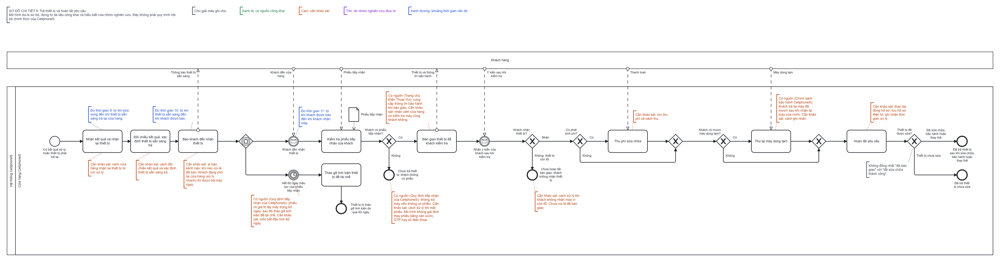

# Điểm nghẽn tiềm ẩn: Quy trình con 5

Tên: Trả thiết bị và hoàn tất yêu cầu.

- Sơ đồ As-Is: [`bpmn/CellphoneS_AsIs_P5.bpmn`](../bpmn/CellphoneS_AsIs_P5.bpmn)
- Mô tả nghiệp vụ As-Is: [`description/CPS_asis_P5.md`](../description/CPS_asis_P5.md)
- Cách đọc và bảng tổng hợp: [`README.md`](README.md)

Các điểm nghẽn dưới đây là giả thuyết suy ra từ sơ đồ, chưa được đo. Tài liệu không khẳng định CellphoneS đang gặp các vấn đề này.

Ở khâu này thiết bị đã được xử lý xong. Mọi thời gian chờ ở đây đều là thời gian khách không có máy mà không còn việc gì phải làm với thiết bị. Đây cũng là khâu có nhiều lối cụt nhất: ba trong năm kết thúc của sơ đồ là kết thúc mà khách không nhận được máy.

## Tóm tắt

| Điểm nghẽn tiềm ẩn | Mức ưu tiên kiểm chứng | Đề xuất chính |
|---|---|---|
| Thiết bị đã sẵn sàng nhưng khách chưa được báo | Cao | Báo ngay khi thiết bị sẵn sàng, có ghi nhận là đã báo thành công, có nhắc lại |
| Khách chậm đến nhận, thiết bị tồn tại cửa hàng đến 60 ngày | Trung bình | Nhắc theo mốc; ghi rõ ngày hết hạn; rà soát trước khi tháo gỡ linh kiện |
| Khách mất phiếu tiếp nhận thì không có lối đi tiếp | Trung bình | Quy trình xác minh thay thế có ghi nhận và có người duyệt |
| Khách không nhận máy vì còn lỗi, chưa có đường quay lại sửa | Trung bình | Cửa hàng thử lại lỗi ban đầu trước khi báo khách; có đường sửa lại được ưu tiên |

## 1. Thiết bị đã sẵn sàng nhưng khách chưa được báo

**Mức ưu tiên kiểm chứng:** Cao.

**Vị trí trên sơ đồ:** Ba ô đầu tiên: "Nhận kết quả và nhận lại thiết bị", "Đối chiếu kết quả, xác định thiết bị sẵn sàng trả" và "Báo khách đến nhận thiết bị". Ghi chú màu xanh dương đánh dấu khoảng thời gian cần đo từ khi thiết bị sẵn sàng đến khi khách được báo.

**Vì sao có thể gây nghẽn:** Cả ba việc đều là việc không có khách đứng chờ, nên dễ bị lùi lại khi cửa hàng đông khách. Mô hình chưa biết ai báo khách, qua kênh nào, và lúc nào thì coi là đã báo thành công. Không có nguồn công khai nào mô tả việc này.

Trên sơ đồ, cửa hàng báo một lần rồi chuyển sang chờ. Không có bước kiểm tra xem khách đã nhận được tin chưa, và không có bước nhắc lại. Nếu tin không đến được khách, vì số điện thoại sai hoặc khách không nghe máy, thì khách không đến, quy trình vẫn tiếp tục chờ, và hạn 60 ngày của phiếu tiếp nhận vẫn chạy.

**Hậu quả:**

- Thiết bị đã xong nằm ở cửa hàng mà khách không biết.
- Khách phải tự gọi hoặc tự đến hỏi.
- Trường hợp nặng nhất là khách không hề nhận được tin, và thiết bị đi đến kết thúc bị tháo gỡ linh kiện.

**Căn cứ:**

- Ai báo khách, qua kênh nào, khi nào coi là đã báo; cách cửa hàng nhận lại thiết bị và đối chiếu kết quả: Cần khảo sát.
- Báo một lần, không xác nhận, không nhắc: Suy luận từ sơ đồ.

**Cách kiểm chứng:**

- Đo thời gian từ khi thiết bị sẵn sàng đến khi khách được báo.
- Đếm số trường hợp lần báo đầu tiên không đến được khách.
- Đếm số khách tự đến hoặc tự gọi hỏi trước khi được cửa hàng báo.

**Đề xuất cách giải quyết:**

1. Báo cho khách ngay khi cửa hàng xác nhận thiết bị sẵn sàng trả, qua kênh khách đã chọn lúc lập phiếu. Nếu được, báo tự động để không phụ thuộc vào lúc nhân viên rảnh.
2. Nội dung báo gồm đủ những gì khách cần để đến một lần là xong: kết quả xử lý, số tiền phải trả nếu có, lời nhắc mang theo phiếu tiếp nhận và máy dùng tạm, và ngày hết hạn nhận máy.
3. Ghi nhận việc báo có thành công không. Nếu không thành công thì gọi điện hoặc thử kênh khác, và lưu lại số lần đã thử.
4. Gộp việc đối chiếu vào lúc nhận máy về: nhân viên nhận máy thì thử luôn lỗi ban đầu và xác nhận sẵn sàng trả, không để thành hai việc cách nhau.
5. Kết hợp với việc báo kết quả đi trước thiết bị, như đề xuất ở [khâu kiểm tra kỹ thuật và sửa chữa](CPS_bottleneck_P4.md).

**Lưu ý khi áp dụng:** Thông báo tự động chỉ đáng tin khi số điện thoại và kênh liên lạc đã được xác nhận lúc nhận máy.

## 2. Khách chậm đến nhận, thiết bị tồn tại cửa hàng đến 60 ngày

**Mức ưu tiên kiểm chứng:** Trung bình.

**Vị trí trên sơ đồ:** Điểm chờ một trong hai sự kiện, vẽ bằng hình thoi có vòng tròn bên trong. Sau đó là sự kiện "Khách đến nhận thiết bị", hoặc sự kiện hẹn giờ "Hết 60 ngày hiệu lực của phiếu tiếp nhận" dẫn đến ô "Tháo gỡ linh kiện thiết bị để tái chế".

**Vì sao có thể gây nghẽn:** Khoảng chờ này phụ thuộc hoàn toàn vào khách. Đây là khoảng chờ duy nhất trong mô hình có giới hạn thời gian, nhưng giới hạn đó dài: 60 ngày. Trong suốt thời gian chờ:

- Thiết bị đã xong nằm tồn ở cửa hàng, và cửa hàng phải bảo quản.
- Hồ sơ chưa đóng, phí sửa chữa chưa thu.
- Máy dùng tạm, nếu khách có mượn, chưa được thu về. Khách sau có thể không còn máy để mượn.

Có hai chỗ chưa rõ làm vấn đề nặng hơn. Thứ nhất, mốc bắt đầu tính 60 ngày chưa được công bố. Nếu mốc là ngày lập phiếu thì thời gian sửa chữa càng kéo dài, khách càng còn ít ngày để đến nhận. Thứ hai, kết thúc "tháo gỡ linh kiện để tái chế" là kết thúc không đảo ngược được, nhưng trên sơ đồ không có bước nhắc khách nào trước đó.

**Hậu quả:** Cửa hàng tồn máy và tồn hồ sơ. Khách có nguy cơ mất thiết bị.

**Căn cứ:**

- Phiếu có giá trị lấy máy trong 60 ngày; sau đó thiết bị bị tháo gỡ linh kiện để tái chế: Có nguồn (Quy định tiếp nhận của CellphoneS).
- Khách trả máy mượn sau khi nhận lại máy của mình: Có nguồn (Chính sách bảo hành CellphoneS).
- Mốc bắt đầu tính 60 ngày: Cần khảo sát.
- Không có bước nhắc trước khi hết hạn: Suy luận từ sơ đồ.

**Cách kiểm chứng:**

- Đo thời gian từ khi khách được báo đến khi khách nhận máy.
- Đếm số thiết bị đang chờ khách nhận vào một thời điểm, và số thiết bị đã bị tháo gỡ linh kiện.
- Hỏi cửa hàng: 60 ngày tính từ ngày nào, và có nhắc khách trước khi hết hạn không.

**Đề xuất cách giải quyết:**

1. Nhắc khách theo các mốc: vài ngày sau khi báo mà khách chưa đến, khi đã qua nửa thời hạn, và trước khi hết hạn. Lần nhắc cuối phải gọi điện và có ghi nhận.
2. Ghi ngày hết hạn cụ thể trên phiếu tiếp nhận và trong mỗi tin nhắc.
3. Xem xét tính 60 ngày từ lúc báo khách thành công thay vì từ lúc lập phiếu, để thời gian sửa chữa không ăn vào thời gian khách được đến nhận.
4. Cho khách hẹn giờ đến nhận, để cửa hàng chuẩn bị sẵn máy và hồ sơ.
5. Trước khi tháo gỡ linh kiện, thêm một bước rà soát có người duyệt, xác nhận là khách đã được nhắc đủ số lần quy định.

**Lưu ý khi áp dụng:** Đề xuất 3 và 5 thay đổi một quy định đã công bố với khách, nên cần quyết định của doanh nghiệp. Số lần nhắc và khoảng cách giữa các lần cũng do doanh nghiệp đặt.

## 3. Khách mất phiếu tiếp nhận thì không có lối đi tiếp

**Mức ưu tiên kiểm chứng:** Trung bình.

**Vị trí trên sơ đồ:** Ô "Kiểm tra phiếu tiếp nhận của khách", điểm quyết định "Khách có phiếu tiếp nhận?" và kết thúc "Chưa trả thiết bị: khách không có phiếu".

**Vì sao có thể gây nghẽn:** Quy định công khai ghi CellphoneS không trả máy nếu khách không có phiếu tiếp nhận. Cách xử lý khi khách mất phiếu chưa được công bố. Mô hình As-Is không giả định có cách xác minh nào thay thế, nên yêu cầu kết thúc ở trạng thái chuyển xử lý ngoại lệ.

Nếu thực tế cũng không có quy định sẵn, nhân viên phải dừng lại để xin ý kiến, khách chờ tại quầy hoặc ra về tay không. Thiết bị đã sửa xong tiếp tục nằm ở cửa hàng, và hạn 60 ngày tiếp tục chạy.

**Hậu quả:** Khách đã đến tận nơi mà không lấy được máy của mình. Hồ sơ không đóng được.

**Căn cứ:**

- Phải mang phiếu khi lấy máy; không trả máy nếu không có phiếu: Có nguồn (Quy định tiếp nhận của CellphoneS).
- Cách xử lý khi khách mất phiếu: Cần khảo sát.

**Cách kiểm chứng:**

- Đếm số lượt khách đến nhận máy mà không có phiếu, và các trường hợp đó được giải quyết thế nào, trong bao lâu.
- Hỏi nhân viên: gặp khách mất phiếu thì làm gì, ai quyết định.

**Đề xuất cách giải quyết:**

1. Giảm số trường hợp mất phiếu bằng cách gửi mã phiếu cho khách qua tin nhắn hoặc tài khoản thành viên ngay khi lập phiếu, như đề xuất ở [khâu nhận thiết bị](CPS_bottleneck_P2.md).
2. Lập quy trình xác minh thay thế, gồm nhiều lớp đối chiếu: mã xác nhận gửi về số điện thoại đã đăng ký lúc giao máy; giấy tờ tùy thân trùng với tên trên hồ sơ; số IMEI hoặc Seri của máy. Khách ký biên nhận, và một người có thẩm quyền tại cửa hàng duyệt.
3. Ghi nhận mọi trường hợp trả máy không có phiếu để kiểm tra lại về sau.

**Lưu ý khi áp dụng:** Quy định phải có phiếu tồn tại để tránh trả nhầm máy cho người khác. Quy trình thay thế phải giữ được mức an toàn đó. Đây là đề xuất cho mô hình To-Be và làm thay đổi một quy định đã công bố; mô hình As-Is không khẳng định CellphoneS đang có hay không có cách xử lý này.

## 4. Khách không nhận máy vì còn lỗi, chưa có đường quay lại sửa

**Mức ưu tiên kiểm chứng:** Trung bình.

**Vị trí trên sơ đồ:** Ô "Bàn giao thiết bị để khách kiểm tra", sự kiện chờ "Nhận ý kiến của khách sau khi kiểm tra", điểm quyết định "Khách nhận thiết bị?" và kết thúc "Chưa hoàn tất bàn giao: khách không nhận thiết bị".

**Vì sao có thể gây nghẽn:** Đây là lần kiểm tra cuối cùng, và là lần đầu tiên khách nhìn thấy kết quả. Một lỗi được phát hiện ở đây là lỗi được phát hiện muộn nhất. Muốn sửa tiếp, thiết bị phải đi lại toàn bộ đường chuyển đi, sửa, rồi chuyển về. Sơ đồ không có đường quay lại nào; yêu cầu kết thúc ở trạng thái ngoại lệ.

Trước bước này, cửa hàng có bước "Đối chiếu kết quả, xác định thiết bị sẵn sàng trả". Nhưng mô hình chưa biết nhân viên có bật máy lên thử lỗi ban đầu hay chỉ đối chiếu giấy tờ. Việc nhân viên có kiểm tra máy cùng khách hay không cũng cần khảo sát.

**Hậu quả:** Khách mất công đến mà không nhận được máy dùng được. Thiết bị lặp lại cả quy trình. Hồ sơ treo ở trạng thái ngoại lệ.

**Căn cứ:**

- Điện Thoại Vui cung cấp thông tin bảo hành khi bàn giao; CareS khuyên khách kiểm tra máy ngay tại trung tâm: Có nguồn (Trang chủ Điện Thoại Vui; Hướng dẫn của CareS).
- Nhân viên cửa hàng CellphoneS có kiểm tra máy cùng khách không; cách xử lý khi khách không nhận máy: Cần khảo sát.
- Lỗi phát hiện ở bước cuối phải đi lại toàn bộ quy trình: Suy luận từ sơ đồ.

**Cách kiểm chứng:**

- Đếm số lượt khách không nhận máy vì còn lỗi, và số lượt khách nhận máy rồi quay lại vì cùng lỗi cũ trong thời gian ngắn.
- Hỏi nhân viên: khi nhận máy từ nơi sửa về, có bật máy thử không.

**Đề xuất cách giải quyết:**

1. Khi nhận máy về, nhân viên cửa hàng thử lại đúng lỗi ban đầu theo mô tả trên phiếu, trước khi báo khách. Lỗi được phát hiện sớm hơn một bước, và khách không phải đến vô ích.
2. Khi bàn giao, nhân viên cùng khách kiểm tra theo một danh sách ngắn, gồm lỗi ban đầu và các tính năng cơ bản. Khách xác nhận kết quả.
3. Mở một đường quay lại sửa được ưu tiên: thiết bị không phải xếp hàng lại từ đầu, hồ sơ được đánh dấu là sửa lại, và khách được báo ngày hẹn mới ngay tại quầy.
4. Thống kê các trường hợp này theo nơi sửa và loại lỗi, để tìm nguyên nhân từ khâu kiểm tra sau sửa chữa.

**Lưu ý khi áp dụng:** Việc thử máy tại cửa hàng thêm việc cho nhân viên cửa hàng, là những người vốn đã đảm nhận nhiều bước. Nên giới hạn ở việc thử đúng lỗi ban đầu, không kiểm tra lại toàn bộ.

## Điểm cần theo dõi thêm

| Điểm | Vì sao nên theo dõi | Hướng xử lý |
|---|---|---|
| Nhiều thủ tục nối tiếp tại quầy lúc trả máy | Khi khách đến nhận, năm việc được làm lần lượt: kiểm tra phiếu, khách kiểm tra máy, thu phí, thu lại máy dùng tạm, hoàn tất yêu cầu. Nơi thu phí chưa rõ; nếu thu ở một quầy khác thì khách phải xếp hàng hai lần | Cho khách thanh toán trước qua kênh trực tuyến khi nhận thông báo; chuẩn bị sẵn máy và hồ sơ khi khách đã hẹn giờ |
| Thu lại máy dùng tạm | Cách ghi nhận chưa rõ. Máy mượn trả về cần được kiểm tra tình trạng, làm lần trả máy dài hơn | Mẫu kiểm tra ngắn cho máy dùng tạm, lập từ lúc cho mượn |
| Hoàn tất yêu cầu | Thao tác đóng hồ sơ chưa rõ. Các hồ sơ kết thúc ở trạng thái ngoại lệ có được đóng hay không cũng chưa rõ, và mô hình As-Is đã ghi "số hồ sơ chưa thể hoàn tất" là số liệu cần khảo sát | Mỗi hồ sơ ngoại lệ có một người phụ trách và một hạn xử lý; rà soát danh sách hồ sơ chưa đóng theo định kỳ |
| Khách đang chờ tại cửa hàng ở nhánh xử lý nhanh | Trường hợp này khách được trả máy ngay, không qua bước báo khách và chờ khách đến. Đây là đường ngắn nhất của cả quy trình, đáng dùng làm mốc so sánh | Đo riêng thời gian của nhánh này để so với các nhánh phải chuyển máy đi |

## Liên hệ với các sơ đồ khác

- Việc báo khách phụ thuộc vào số điện thoại và kênh liên lạc được ghi ở [khâu nhận thiết bị](CPS_bottleneck_P2.md).
- Lối cụt do mất phiếu bắt nguồn từ cách phiếu được lập và giao ở [khâu nhận thiết bị](CPS_bottleneck_P2.md).
- Lỗi còn lại khi trả máy bắt nguồn từ bước kiểm tra sau sửa chữa ở [khâu kiểm tra kỹ thuật và sửa chữa](CPS_bottleneck_P4.md).
- Thời gian thiết bị tồn ở khâu này quyết định số máy dùng tạm còn lại để cho khách khác mượn, là điểm đã nêu ở [khâu nhận thiết bị](CPS_bottleneck_P2.md).
