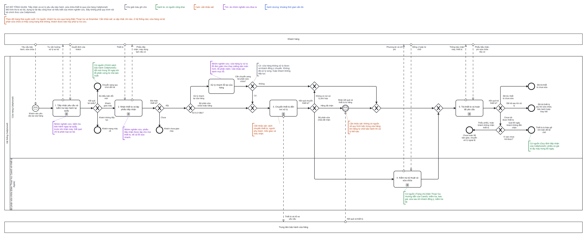

# Mô tả nghiệp vụ As-Is: Sơ đồ tổng quan

Quy trình: Tiếp nhận và xử lý yêu cầu bảo hành, sửa chữa thiết bị qua cửa hàng CellphoneS.

- Tệp sơ đồ: [`bpmn/CellphoneS_AsIs_Level0.bpmn`](../bpmn/CellphoneS_AsIs_Level0.bpmn)
- Ảnh: [`png/CellphoneS_AsIs_Level0.png`](../png/CellphoneS_AsIs_Level0.png)

Đây là mô hình As-Is sơ bộ, dựng từ tài liệu công khai và hiểu biết của nhóm nghiên cứu. Đây không phải quy trình nội bộ chính thức của CellphoneS.

## Mô tả quy trình (văn xuôi, dùng cho báo cáo)

Quy trình tiếp nhận và xử lý yêu cầu bảo hành, sửa chữa thiết bị qua cửa hàng CellphoneS có sự tham gia của ba bên: khách hàng, hệ thống CellphoneS và trung tâm bảo hành của hãng. Trong hệ thống CellphoneS, cửa hàng là nơi tiếp nhận yêu cầu, nhận và trả thiết bị, còn việc sửa chữa do bộ phận sửa chữa đảm nhận, gồm Điện Thoại Vui và CareS đối với thiết bị Apple. Trung tâm bảo hành của hãng là bên ngoài duy nhất tham gia quy trình.

Quy trình bắt đầu khi khách hàng mang thiết bị gặp lỗi đến cửa hàng và nêu yêu cầu. Nhân viên kiểm tra thông tin bảo hành ngay tại quầy, khi khách còn giữ máy, sau đó xác định hướng xử lý sơ bộ và tư vấn để khách quyết định. Nếu thiết bị đủ điều kiện đổi mới, yêu cầu được chuyển sang quy trình đổi trả. Nếu khách không tiếp tục, khách mang máy về và yêu cầu kết thúc. Nếu khách đồng ý, cửa hàng nhận thiết bị và lập phiếu tiếp nhận, là chứng từ để khách nhận lại máy.

Sau khi nhận máy, thiết bị được xử lý ở một trong ba nơi. Với lỗi đơn giản, nhân viên kỹ thuật của cửa hàng xử lý nhanh tại chỗ; nếu không xử lý được và khách đồng ý, thiết bị được chuyển tiếp cho bộ phận sửa chữa. Với các trường hợp còn lại, cửa hàng chuyển thiết bị đến bộ phận sửa chữa trong hệ thống hoặc gửi đến trung tâm bảo hành của hãng. Tại bộ phận sửa chữa, thiết bị được kiểm tra, khách được báo phương án và chi phí nếu có phát sinh, và việc sửa chữa có phí chỉ được thực hiện sau khi khách đồng ý. Đối với thiết bị gửi hãng, cửa hàng chờ nhận lại kết quả và thiết bị.

Khi có kết quả, cửa hàng báo khách đến nhận, kiểm tra phiếu tiếp nhận, bàn giao thiết bị, thu phí sửa chữa và thu lại máy dùng tạm nếu có. Quy trình kết thúc theo một trong các kết quả sau: thiết bị được trả sau khi sửa chữa, bảo hành hoặc thay thế; thiết bị được trả ở trạng thái chưa sửa; thiết bị bị tháo gỡ linh kiện để tái chế do quá 60 ngày khách không đến nhận; hoặc việc bàn giao chưa hoàn tất vì khách thiếu phiếu tiếp nhận hay không nhận thiết bị. Việc đã bàn giao thiết bị không đồng nghĩa với việc đã sửa chữa thành công.

Mô hình được xây dựng từ tài liệu công khai và hiểu biết của nhóm nghiên cứu, không phải quy trình nội bộ chính thức của CellphoneS. Việc kiểm tra bảo hành tại quầy trước khi nhận máy, việc cửa hàng tự xử lý các lỗi đơn giản và việc lập phiếu tiếp nhận cho mọi thiết bị là nhận định của nhóm nghiên cứu. Cách chuyển thiết bị giữa các bộ phận, quy trình bên trong của hãng và cách cập nhật trạng thái cho khách hàng là những nội dung cần được khảo sát thêm.

## Mục đích

Sơ đồ cho thấy toàn bộ đường đi của một yêu cầu, từ lúc khách nêu yêu cầu tại cửa hàng đến lúc yêu cầu kết thúc. Mỗi ô có dấu cộng là một quy trình con, được mô tả chi tiết ở một sơ đồ riêng.

## Các bên tham gia

- **Khách hàng.** Sơ đồ chỉ thể hiện những gì khách trao đổi với hệ thống CellphoneS.
- **Hệ thống CellphoneS**, gồm hai bộ phận:
  - Cửa hàng CellphoneS: tiếp nhận yêu cầu, kiểm tra bảo hành, nhận máy, xử lý nhanh lỗi đơn giản và trả máy.
  - Bộ phận sửa chữa: Điện Thoại Vui, và CareS đối với thiết bị Apple.
- **Trung tâm bảo hành của hãng.** Đây là bên ngoài duy nhất. Sơ đồ chỉ thể hiện việc gửi thiết bị đi và nhận kết quả về.

## Điểm bắt đầu

Khách hàng mang thiết bị gặp lỗi đến cửa hàng CellphoneS và nêu yêu cầu bảo hành hoặc sửa chữa.

## Diễn biến

1. **Quy trình con 1: Tiếp nhận yêu cầu và kiểm tra bảo hành tại quầy.** Nhân viên kiểm tra thông tin bảo hành khi khách còn giữ máy, xác định hướng xử lý sơ bộ và tư vấn cho khách. Kết quả tại quầy là một trong ba trường hợp:
   - Khách đồng ý giao máy: yêu cầu đi tiếp.
   - Thiết bị đủ điều kiện đổi mới: yêu cầu chuyển sang quy trình đổi trả và kết thúc tại đây.
   - Khách không tiếp tục: khách mang máy về, yêu cầu kết thúc.
2. **Quy trình con 2: Nhận thiết bị và lập phiếu tiếp nhận.** Cửa hàng nhận máy và lập phiếu tiếp nhận cho khách. Nếu cuối cùng khách chưa giao máy, yêu cầu kết thúc.
3. **Chọn nơi xử lý.** Sau khi nhận máy, thiết bị đi theo một trong hai đường:
   - Xử lý nhanh tại cửa hàng, đối với lỗi đơn giản.
   - Chuyển đến bộ phận sửa chữa trong hệ thống hoặc trung tâm bảo hành của hãng.
4. **Xử lý nhanh lỗi tại cửa hàng.** Nhân viên kỹ thuật của cửa hàng xử lý tại chỗ. Sau đó:
   - Nếu cửa hàng không xử lý được và khách đồng ý chuyển, thiết bị đi sang quy trình con 3.
   - Nếu đã xử lý xong, hoặc khách không tiếp tục, thiết bị đi sang quy trình con 5 để trả cho khách.
5. **Quy trình con 3: Chuyển thiết bị đến nơi xử lý.** Kết quả chuyển là một trong ba trường hợp:
   - Bộ phận sửa chữa trong hệ thống đã nhận: sang quy trình con 4.
   - Trung tâm bảo hành của hãng đã nhận: cửa hàng chờ nhận kết quả và thiết bị từ hãng.
   - Không có nơi xử lý phù hợp: sang quy trình con 5 để trả thiết bị chưa xử lý.
6. **Quy trình con 4: Kiểm tra kỹ thuật và sửa chữa.** Bộ phận sửa chữa kiểm tra, báo phương án và chi phí nếu có, sửa chữa, rồi chuyển kết quả và thiết bị về cửa hàng.
7. **Quy trình con 5: Trả thiết bị và hoàn tất yêu cầu.** Cửa hàng báo khách, kiểm tra phiếu tiếp nhận, bàn giao thiết bị và hoàn tất yêu cầu.

## Các kết thúc

1. Yêu cầu chuyển sang quy trình đổi trả.
2. Khách mang máy về (không tiếp tục sau khi được tư vấn).
3. Khách chưa giao máy.
4. Đã trả thiết bị sau khi sửa chữa, bảo hành hoặc thay thế.
5. Đã trả thiết bị chưa sửa.
6. Thiết bị bị tháo gỡ linh kiện để tái chế, do quá 60 ngày khách không đến nhận.
7. Chưa hoàn tất bàn giao, chuyển xử lý ngoại lệ, do khách thiếu phiếu hoặc không nhận thiết bị.

Mô hình không đồng nhất "đã bàn giao" với "đã sửa chữa thành công".

## Trao đổi với bên ngoài

**Với khách hàng:**

| Thời điểm | Khách gửi | Khách nhận |
|---|---|---|
| Bắt đầu | Yêu cầu bảo hành, sửa chữa | |
| Quy trình con 1 | Quyết định của khách | Tư vấn hướng xử lý sơ bộ |
| Quy trình con 2 | Thiết bị | Phiếu tiếp nhận, máy dùng tạm nếu có |
| Quy trình con 4 | Đồng ý hoặc từ chối | Phương án và chi phí |
| Quy trình con 5 | Phiếu tiếp nhận, phí sửa chữa nếu có | Thông báo nhận máy, thiết bị |

**Với trung tâm bảo hành của hãng:** cửa hàng gửi thiết bị và hồ sơ yêu cầu, sau đó nhận lại kết quả và thiết bị.

## Mức độ chắc chắn của thông tin

- **Có nguồn công khai:**
  - Điện Thoại Vui và CareS thuộc hệ thống CellphoneS (Chính sách bảo hành CellphoneS; Hướng dẫn của CareS).
  - Đổi mới trong 30 ngày khi lỗi phần cứng từ nhà sản xuất (Chính sách bảo hành CellphoneS).
  - Phiếu tiếp nhận có giá trị lấy máy trong 60 ngày (Quy định tiếp nhận của CellphoneS).
  - Kiểm tra, báo giá, sửa sau khi khách đồng ý, kiểm tra lại (Trang chủ Điện Thoại Vui; Hướng dẫn của CareS).
- **Do nhóm nghiên cứu đưa ra:**
  - Kiểm tra bảo hành ngay tại quầy, trước khi nhận máy.
  - Cửa hàng tự xử lý lỗi đơn giản như thay miếng dán màn hình, lỗi phần mềm.
  - Phiếu tiếp nhận được lập cho mọi thiết bị, kể cả lỗi sửa nhanh.
- **Cần khảo sát:**
  - Danh mục lỗi được xử lý nhanh tại cửa hàng.
  - Cách chuyển thiết bị, người phụ trách, mốc giao và mốc nhận.
  - Quy trình bên trong của hãng; cách xử lý khi hãng từ chối bảo hành.

## Theo dõi trạng thái

Theo dõi trạng thái diễn ra xuyên suốt quy trình, không phải một quy trình con riêng. Khách có thể tra cứu qua trang của Điện Thoại Vui và Smember (có nguồn). Các nội dung sau cần khảo sát: ai cập nhật trạng thái, cập nhật khi nào và ở hệ thống nào; cửa hàng và bộ phận sửa chữa có thấy cùng trạng thái không; khách được báo hay phải tự tra cứu.

## Sơ đồ chi tiết

- [Quy trình con 1](CPS_asis_P1.md)
- [Quy trình con 2](CPS_asis_P2.md)
- [Quy trình con 3](CPS_asis_P3.md)
- [Quy trình con 4](CPS_asis_P4.md)
- [Quy trình con 5](CPS_asis_P5.md)
