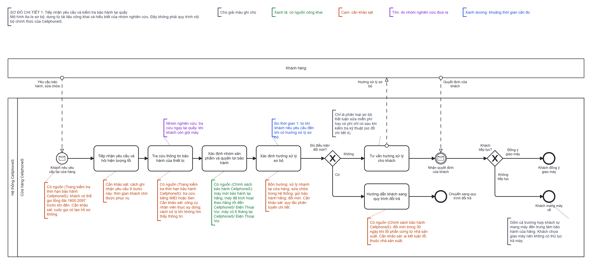

# Mô tả nghiệp vụ As-Is: Quy trình con 1

Tên: Tiếp nhận yêu cầu và kiểm tra bảo hành tại quầy.

- Tệp sơ đồ: [`bpmn/CellphoneS_AsIs_P1.bpmn`](../bpmn/CellphoneS_AsIs_P1.bpmn)
- Ảnh: [`png/CellphoneS_AsIs_P1.png`](../png/CellphoneS_AsIs_P1.png)

Đây là mô hình As-Is sơ bộ, dựng từ tài liệu công khai và hiểu biết của nhóm nghiên cứu. Đây không phải quy trình nội bộ chính thức của CellphoneS.

## Mô tả quy trình (văn xuôi, dùng cho báo cáo)

Quy trình con này bắt đầu khi khách hàng mang thiết bị gặp lỗi đến cửa hàng CellphoneS và nêu yêu cầu bảo hành hoặc sửa chữa. Trước đó khách có thể đã liên hệ tổng đài để hỏi, nhưng cuộc gọi chỉ mang tính tư vấn. Nhân viên cửa hàng tiếp nhận yêu cầu, hỏi hiện tượng lỗi, rồi tra cứu thông tin bảo hành của thiết bị ngay tại quầy, khi khách còn giữ máy. Dựa trên kết quả tra cứu, nhân viên xác định nhóm sản phẩm và quyền lợi tương ứng theo chính sách bảo hành đã công bố. Máy mới được bảo hành theo hãng tại trung tâm bảo hành chính hãng. Máy đã kích hoạt bảo hành chính hãng được bảo hành theo hãng trong thời gian còn lại, sau đó tại CellphoneS hoặc Điện Thoại Vui. Máy cũ được bảo hành sáu tháng tại CellphoneS hoặc Điện Thoại Vui.

Từ đó, nhân viên xác định hướng xử lý sơ bộ, gồm bốn khả năng: xử lý nhanh tại cửa hàng, sửa chữa hoặc bảo hành trong hệ thống, gửi bảo hành tại hãng, hoặc đổi mới. Nếu thiết bị đủ điều kiện đổi mới, tức còn trong 30 ngày và có lỗi phần cứng từ nhà sản xuất, nhân viên hướng dẫn khách sang quy trình đổi trả. Trong các trường hợp còn lại, nhân viên tư vấn hướng xử lý và chờ khách quyết định. Nếu khách đồng ý giao máy, yêu cầu chuyển sang bước nhận thiết bị và lập phiếu tiếp nhận. Nếu khách không tiếp tục, khách mang máy về; vì khách chưa giao máy nên không phát sinh thủ tục trả máy.

Hướng xử lý được xác định tại quầy chỉ là phân loại sơ bộ. Việc thiết bị còn hạn bảo hành chưa đủ để khẳng định lỗi sẽ được sửa miễn phí; kết luận này chỉ có sau khi kiểm tra kỹ thuật. Trong mô hình, việc kiểm tra bảo hành tại quầy trước khi nhận máy là nhận định của nhóm nghiên cứu. Công cụ nhân viên dùng để tra cứu, quy tắc phân tuyến giữa các hướng xử lý và người kết luận lỗi thuộc nhà sản xuất là những nội dung cần khảo sát.

## Mục đích

Tiếp nhận nhu cầu của khách, xác định chính sách áp dụng và hướng xử lý sơ bộ, để khách quyết định có giao máy hay không.

## Các bên tham gia

- Khách hàng.
- Cửa hàng CellphoneS (nhân viên cửa hàng).

## Điểm bắt đầu

Khách hàng mang thiết bị gặp lỗi đến cửa hàng và nêu yêu cầu bảo hành hoặc sửa chữa. Trước đó khách có thể đã gọi tổng đài 1800.2097 để hỏi; cuộc gọi này chỉ là tư vấn.

## Diễn biến

1. **Tiếp nhận yêu cầu và hỏi hiện tượng lỗi.** Nhân viên nghe khách trình bày và hỏi về lỗi của thiết bị.
2. **Tra cứu thông tin bảo hành của thiết bị.** Nhân viên tra cứu ngay tại quầy, khi khách còn giữ máy.
3. **Xác định nhóm sản phẩm và quyền lợi bảo hành.** Theo chính sách công bố:
   - Máy mới: bảo hành theo hãng, tại trung tâm bảo hành chính hãng.
   - Máy đã kích hoạt bảo hành chính hãng: theo hãng trong thời gian hãng còn bảo hành, sau đó tại CellphoneS/ Điện Thoại Vui.
   - Máy cũ: 6 tháng, tại CellphoneS/ Điện Thoại Vui.
4. **Xác định hướng xử lý sơ bộ.** Có bốn hướng:
   - Xử lý nhanh tại cửa hàng.
   - Sửa chữa hoặc bảo hành trong hệ thống.
   - Gửi bảo hành tại hãng.
   - Đổi mới.
5. **Xét điều kiện đổi mới.**
   - Nếu thiết bị đủ điều kiện, nhân viên hướng dẫn khách sang quy trình đổi trả và quy trình con này kết thúc.
   - Nếu không, nhân viên chuyển sang bước tư vấn.
6. **Tư vấn hướng xử lý cho khách.** Nội dung tư vấn chỉ là phân loại sơ bộ. Kết luận sửa miễn phí hay có phí chỉ có sau khi kiểm tra kỹ thuật ở quy trình con 4.
7. **Nhận quyết định của khách.** Quy trình chờ khách trả lời.
   - Khách đồng ý giao máy: sang quy trình con 2.
   - Khách không tiếp tục: khách mang máy về.

## Các điểm quyết định

| Câu hỏi | Các nhánh |
|---|---|
| Đủ điều kiện đổi mới? | Có: hướng dẫn sang quy trình đổi trả. Không: tư vấn hướng xử lý. |
| Khách tiếp tục? | Đồng ý giao máy. Không tiếp tục. |

Mô hình không đặt câu hỏi "có được sửa miễn phí không" tại quầy, vì thiết bị chưa được kiểm tra kỹ thuật.

## Các kết thúc

1. Khách đồng ý giao máy.
2. Chuyển sang quy trình đổi trả.
3. Khách mang máy về. Trường hợp này gồm cả việc khách chọn tự mang máy đến trung tâm bảo hành của hãng. Vì khách chưa giao máy nên không có thủ tục trả máy.

## Trao đổi với khách hàng

| Khách gửi | Khách nhận |
|---|---|
| Yêu cầu bảo hành, sửa chữa | Hướng xử lý sơ bộ |
| Quyết định của khách | |

## Mức độ chắc chắn của thông tin

- **Có nguồn công khai:**
  - Nhóm sản phẩm, quyền lợi và nơi bảo hành (Chính sách bảo hành CellphoneS).
  - Đổi mới trong 30 ngày khi lỗi phần cứng từ nhà sản xuất (Chính sách bảo hành CellphoneS).
  - Website có trang tra cứu thời hạn bảo hành bằng IMEI hoặc Seri, và công bố số tổng đài (Trang kiểm tra thời hạn bảo hành CellphoneS).
- **Do nhóm nghiên cứu đưa ra:**
  - Việc tra cứu bảo hành diễn ra ngay tại quầy, trước khi nhận máy.
  - Khách quyết định sau khi được tư vấn.
- **Cần khảo sát:**
  - Cuộc gọi tổng đài có tạo hồ sơ hay không.
  - Cách ghi nhận yêu cầu; thời gian khách chờ được phục vụ.
  - Công cụ nhân viên thực sự dùng để tra cứu; cách xử lý khi không tìm thấy thông tin.
  - Quy tắc phân tuyến chi tiết giữa bốn hướng xử lý.
  - Ai kết luận lỗi thuộc nhà sản xuất khi xét đổi mới.

## Khoảng thời gian cần đo

- Khoảng 1: từ khi khách nêu yêu cầu đến khi có hướng xử lý sơ bộ.
