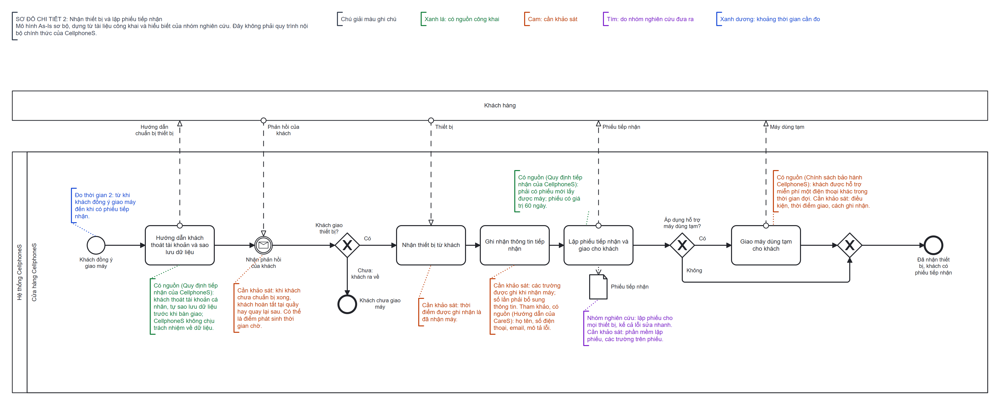

# Mô tả nghiệp vụ As-Is: Quy trình con 2

Tên: Nhận thiết bị và lập phiếu tiếp nhận.

- Tệp sơ đồ: [`bpmn/CellphoneS_AsIs_P2.bpmn`](../bpmn/CellphoneS_AsIs_P2.bpmn)
- Ảnh: [`png/CellphoneS_AsIs_P2.png`](../png/CellphoneS_AsIs_P2.png)

Đây là mô hình As-Is sơ bộ, dựng từ tài liệu công khai và hiểu biết của nhóm nghiên cứu. Đây không phải quy trình nội bộ chính thức của CellphoneS.

## Mô tả quy trình (văn xuôi, dùng cho báo cáo)

Quy trình con này bắt đầu khi khách hàng đồng ý giao máy sau khi được tư vấn tại quầy. Trước khi nhận thiết bị, nhân viên hướng dẫn khách thoát các tài khoản cá nhân và tự sao lưu dữ liệu. Theo quy định công khai, CellphoneS không chịu trách nhiệm về dữ liệu của khách hàng trong mọi trường hợp. Quy trình chờ khách chuẩn bị xong thiết bị; nếu khách chưa thể giao máy và ra về, yêu cầu kết thúc ở trạng thái chưa giao máy.

Khi khách giao thiết bị, nhân viên nhận máy, ghi nhận thông tin tiếp nhận, rồi lập phiếu tiếp nhận và giao cho khách. Phiếu tiếp nhận là chứng từ để khách nhận lại máy: quy định công khai nêu rõ cửa hàng không trả máy nếu khách không có phiếu, và phiếu có giá trị lấy máy trong 60 ngày. Theo nhận định của nhóm nghiên cứu, phiếu được lập cho mọi thiết bị cửa hàng nhận, kể cả trường hợp lỗi sửa nhanh. Nếu chính sách áp dụng, cửa hàng giao cho khách một điện thoại dùng tạm trong thời gian chờ. Quy trình con kết thúc khi thiết bị đã được cửa hàng nhận giữ và khách đã có phiếu tiếp nhận.

Các nội dung cần khảo sát gồm cách xử lý khi khách chưa chuẩn bị xong thiết bị, các trường thông tin được ghi khi nhận máy, phần mềm dùng để lập phiếu, và điều kiện cũng như thời điểm giao máy dùng tạm. Khâu chờ khách chuẩn bị thiết bị có thể là một điểm phát sinh thời gian chờ.

## Mục đích

Nhận giữ thiết bị của khách và tạo chứng từ để khách nhận lại máy.

## Các bên tham gia

- Khách hàng.
- Cửa hàng CellphoneS (nhân viên cửa hàng).

## Điểm bắt đầu

Khách đồng ý giao máy sau khi được tư vấn ở quy trình con 1.

## Diễn biến

1. **Hướng dẫn khách thoát tài khoản và sao lưu dữ liệu.** Quy định công khai yêu cầu khách thoát các tài khoản cá nhân và tự sao lưu dữ liệu trước khi bàn giao. CellphoneS không chịu trách nhiệm về dữ liệu của khách.
2. **Nhận phản hồi của khách.** Quy trình chờ khách chuẩn bị xong thiết bị.
   - Khách giao thiết bị: đi tiếp.
   - Khách chưa giao và ra về: quy trình con kết thúc ở trạng thái khách chưa giao máy.
3. **Nhận thiết bị từ khách.**
4. **Ghi nhận thông tin tiếp nhận.**
5. **Lập phiếu tiếp nhận và giao cho khách.** Phiếu được lập cho mọi thiết bị cửa hàng nhận, kể cả lỗi sửa nhanh. Phiếu là chứng từ để khách lấy lại máy và có giá trị trong 60 ngày.
6. **Xét hỗ trợ máy dùng tạm.**
   - Nếu áp dụng, cửa hàng giao máy dùng tạm cho khách.
   - Nếu không, bỏ qua bước này.

## Các điểm quyết định

| Câu hỏi | Các nhánh |
|---|---|
| Khách giao thiết bị? | Có: nhận thiết bị. Chưa: khách ra về. |
| Áp dụng hỗ trợ máy dùng tạm? | Có: giao máy dùng tạm. Không: bỏ qua. |

## Các kết thúc

1. Đã nhận thiết bị, khách có phiếu tiếp nhận.
2. Khách chưa giao máy.

## Trao đổi với khách hàng

| Khách gửi | Khách nhận |
|---|---|
| Phản hồi của khách | Hướng dẫn chuẩn bị thiết bị |
| Thiết bị | Phiếu tiếp nhận |
| | Máy dùng tạm, nếu áp dụng |

## Chứng từ

- **Phiếu tiếp nhận:** được tạo ở bước lập phiếu và được dùng lại ở quy trình con 5 khi khách đến nhận máy.

## Mức độ chắc chắn của thông tin

- **Có nguồn công khai:**
  - Khách thoát tài khoản và tự sao lưu trước khi bàn giao; CellphoneS không chịu trách nhiệm về dữ liệu (Quy định tiếp nhận của CellphoneS).
  - Phải có phiếu tiếp nhận mới lấy được máy; phiếu có giá trị 60 ngày (Quy định tiếp nhận của CellphoneS).
  - Khách được hỗ trợ miễn phí một điện thoại khác trong thời gian đợi (Chính sách bảo hành CellphoneS).
- **Do nhóm nghiên cứu đưa ra:**
  - Phiếu tiếp nhận được lập cho mọi thiết bị, kể cả lỗi sửa nhanh.
- **Cần khảo sát:**
  - Khi khách chưa chuẩn bị xong, khách hoàn tất tại quầy hay quay lại sau. Đây có thể là điểm phát sinh thời gian chờ.
  - Thời điểm được ghi nhận là đã nhận máy.
  - Các trường được ghi khi nhận máy và số lần phải bổ sung thông tin. Để tham khảo, CareS công bố việc ghi họ tên, số điện thoại, email và mô tả lỗi.
  - Phần mềm lập phiếu và các trường trên phiếu.
  - Điều kiện được mượn máy dùng tạm, thời điểm giao và cách ghi nhận.

## Khoảng thời gian cần đo

- Khoảng 2: từ khi khách đồng ý giao máy đến khi có phiếu tiếp nhận.
