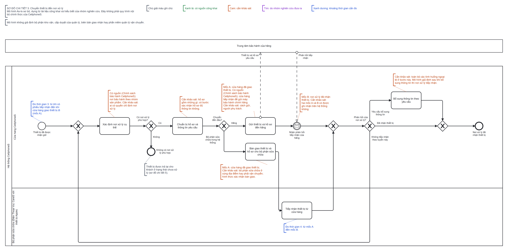

# Mô tả nghiệp vụ As-Is: Quy trình con 3

Tên: Chuyển thiết bị đến nơi xử lý.

- Tệp sơ đồ: [`bpmn/CellphoneS_AsIs_P3.bpmn`](../bpmn/CellphoneS_AsIs_P3.bpmn)
- Ảnh: [`png/CellphoneS_AsIs_P3.png`](../png/CellphoneS_AsIs_P3.png)

Đây là mô hình As-Is sơ bộ, dựng từ tài liệu công khai và hiểu biết của nhóm nghiên cứu. Đây không phải quy trình nội bộ chính thức của CellphoneS.

## Mục đích

Chuyển thiết bị và thông tin yêu cầu từ cửa hàng đến nơi chịu trách nhiệm kiểm tra, sửa chữa.

## Các bên tham gia

- Cửa hàng CellphoneS.
- Bộ phận sửa chữa trong hệ thống (Điện Thoại Vui; CareS với thiết bị Apple).
- Trung tâm bảo hành của hãng.

Khách hàng không tham gia quy trình con này.

## Điểm bắt đầu

Thiết bị đã được cửa hàng nhận giữ và hướng xử lý là sửa chữa trong hệ thống hoặc gửi hãng. Quy trình con này cũng bắt đầu khi cửa hàng không xử lý nhanh được và khách đồng ý chuyển sang sửa chữa.

## Diễn biến

1. **Xác định nơi xử lý cụ thể.**
   - Nếu không có nơi xử lý phù hợp, quy trình con kết thúc và thiết bị được trả lại cho khách ở trạng thái chưa xử lý.
   - Nếu có, đi tiếp.
2. **Chuẩn bị hồ sơ và thông tin yêu cầu.**
3. **Chuyển thiết bị theo một trong hai tuyến:**
   - Tuyến trong hệ thống: cửa hàng bàn giao thiết bị và hồ sơ cho bộ phận sửa chữa. Bộ phận sửa chữa tiếp nhận thiết bị từ cửa hàng.
   - Tuyến hãng: cửa hàng gửi thiết bị và hồ sơ đến trung tâm bảo hành của hãng, rồi chờ hãng phản hồi việc tiếp nhận.
4. **Xem phản hồi của nơi xử lý.**
   - Đã nhận thiết bị: quy trình con kết thúc.
   - Yêu cầu bổ sung thông tin: cửa hàng bổ sung theo yêu cầu, sau đó quy trình con kết thúc.
   - Không tiếp nhận theo tuyến này: cửa hàng quay lại bước 1 để xác định nơi xử lý khác.

## Hai mốc thời gian

- **Mốc A:** cửa hàng đã giao thiết bị.
- **Mốc B:** nơi xử lý đã nhận thiết bị.

Mô hình tách riêng hai mốc này vì khoảng cách giữa chúng là thời gian thiết bị nằm trên đường hoặc nằm chờ được nhận.

## Các điểm quyết định

| Câu hỏi | Các nhánh |
|---|---|
| Có nơi xử lý phù hợp? | Có: chuẩn bị hồ sơ. Không: kết thúc. |
| Chuyển đến đâu? | Bộ phận sửa chữa trong hệ thống. Trung tâm bảo hành của hãng. |
| Phản hồi của nơi xử lý? | Đã nhận thiết bị. Yêu cầu bổ sung thông tin. Không tiếp nhận theo tuyến này. |

Vòng quay lại "xác định nơi xử lý" có lối thoát là nhánh "không có nơi xử lý phù hợp", nên không lặp vô hạn.

## Các kết thúc

1. Nơi xử lý đã nhận thiết bị.
2. Không có nơi xử lý phù hợp.

## Trao đổi với trung tâm bảo hành của hãng

| Cửa hàng gửi | Cửa hàng nhận |
|---|---|
| Thiết bị và hồ sơ yêu cầu | Phản hồi tiếp nhận |

## Mức độ chắc chắn của thông tin

- **Có nguồn công khai:**
  - Nơi bảo hành theo nhóm sản phẩm (Chính sách bảo hành CellphoneS).
  - Cửa hàng tiếp nhận để gửi máy bảo hành chính hãng (Chính sách bảo hành CellphoneS).
- **Cần khảo sát:** gần như toàn bộ quy trình con này là giả thuyết.
  - Ai có quyền chỉ định nơi xử lý.
  - Hồ sơ gồm những gì; có bước xác nhận hồ sơ đủ thông tin không.
  - Bộ phận sửa chữa ở cùng địa điểm với cửa hàng hay phải vận chuyển; hình thức xác nhận bàn giao.
  - Cách gửi máy đến hãng và người phụ trách.
  - Mốc A và mốc B có được ghi nhận trên hệ thống không.
  - Toàn bộ các tình huống ngoại lệ. Mô hình giả định sau khi cửa hàng bổ sung thông tin thì nơi xử lý tiếp nhận.

Mô hình không giả định sự tồn tại của bộ phận kho vận, cấp duyệt của quản lý, biên bản giao nhận hay phần mềm quản lý vận chuyển.

## Khoảng thời gian cần đo

- Khoảng 3: từ khi có phiếu tiếp nhận đến khi cửa hàng giao thiết bị đi (mốc A).
- Khoảng 4: từ mốc A đến mốc B.
