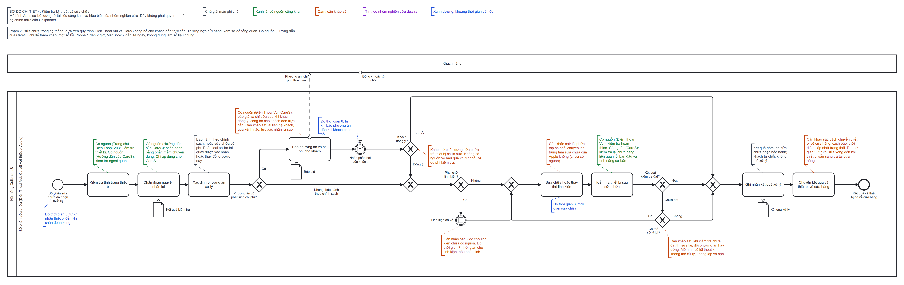

# Mô tả nghiệp vụ As-Is: Quy trình con 4

Tên: Kiểm tra kỹ thuật và sửa chữa.

- Tệp sơ đồ: [`bpmn/CellphoneS_AsIs_P4.bpmn`](../bpmn/CellphoneS_AsIs_P4.bpmn)
- Ảnh: [`png/CellphoneS_AsIs_P4.png`](../png/CellphoneS_AsIs_P4.png)

Đây là mô hình As-Is sơ bộ, dựng từ tài liệu công khai và hiểu biết của nhóm nghiên cứu. Đây không phải quy trình nội bộ chính thức của CellphoneS.

## Mô tả quy trình (văn xuôi, dùng cho báo cáo)

Quy trình con này mô tả trường hợp thiết bị được sửa chữa trong hệ thống CellphoneS, tại Điện Thoại Vui hoặc CareS đối với thiết bị Apple. Quy trình bắt đầu khi bộ phận sửa chữa nhận được thiết bị từ cửa hàng. Kỹ thuật viên kiểm tra tình trạng thiết bị, chẩn đoán nguyên nhân lỗi và xác định phương án xử lý. Kết quả kiểm tra là cơ sở để xác nhận hoặc thay đổi phân loại sơ bộ đã thực hiện tại quầy: thiết bị có thể được bảo hành theo chính sách, hoặc phải sửa chữa có phí.

Khi phương án không phát sinh chi phí, bộ phận sửa chữa tiến hành theo chính sách bảo hành. Khi phương án có phát sinh chi phí, bộ phận sửa chữa báo phương án và chi phí cho khách rồi chờ phản hồi. Việc sửa chữa có phí chỉ được thực hiện khi khách đồng ý; nếu khách từ chối, việc sửa chữa dừng lại và thiết bị được trả ở trạng thái chưa sửa. Trước khi sửa, nếu phải chờ linh kiện, quy trình tạm dừng cho đến khi linh kiện về. Sau khi sửa chữa hoặc thay thế linh kiện, kỹ thuật viên kiểm tra lại thiết bị. Nếu kết quả đạt, kết quả xử lý được ghi nhận. Nếu chưa đạt, thiết bị được xử lý lại khi còn khả năng; khi không thể xử lý, kết quả được ghi nhận là không sửa được. Cuối cùng, bộ phận sửa chữa chuyển kết quả và thiết bị về cửa hàng.

Các bước kiểm tra, báo giá, sửa chữa sau khi khách đồng ý và kiểm tra lại có căn cứ từ quy trình phục vụ do Điện Thoại Vui và CareS công bố. Tuy nhiên, các tài liệu này viết cho khách mang máy đến trực tiếp. Đối với thiết bị nhận qua cửa hàng CellphoneS, người liên hệ với khách, kênh liên hệ và cách lưu xác nhận của khách cần được khảo sát. Việc chờ linh kiện, việc chuyển thiết bị lên trung tâm sửa chữa của Apple khi lỗi phức tạp và cách xử lý khi kiểm tra chưa đạt hiện chưa có nguồn công khai. Trường hợp thiết bị được gửi bảo hành tại hãng không thuộc sơ đồ này, vì không có thông tin về quy trình bên trong của hãng.

## Mục đích

Xác định tình trạng hư hỏng, thống nhất phương án xử lý với khách và thực hiện sửa chữa.

## Phạm vi

Sơ đồ mô tả trường hợp sửa chữa trong hệ thống, dựa trên quy trình Điện Thoại Vui và CareS công bố cho khách đến trực tiếp. Trường hợp gửi bảo hành tại hãng được thể hiện ở sơ đồ tổng quan, vì không có nguồn về quy trình bên trong của hãng.

## Các bên tham gia

- Bộ phận sửa chữa trong hệ thống (Điện Thoại Vui; CareS với thiết bị Apple).
- Khách hàng.

## Điểm bắt đầu

Bộ phận sửa chữa đã nhận thiết bị từ cửa hàng.

## Diễn biến

1. **Kiểm tra tình trạng thiết bị.**
2. **Chẩn đoán nguyên nhân lỗi.** Bước này tạo ra kết quả kiểm tra.
3. **Xác định phương án xử lý.** Phương án là bảo hành theo chính sách, hoặc sửa chữa có phí. Phân loại sơ bộ tại quầy được xác nhận hoặc thay đổi ở bước này.
4. **Xét chi phí.**
   - Phương án không phát sinh chi phí: bảo hành theo chính sách, đi thẳng đến bước 6.
   - Phương án có phát sinh chi phí: sang bước 5.
5. **Báo phương án và chi phí cho khách, rồi chờ khách phản hồi.** Bước này tạo ra báo giá.
   - Khách đồng ý: đi tiếp.
   - Khách từ chối: dừng sửa chữa và chuyển sang bước 10 với kết quả "chưa sửa".
6. **Xét linh kiện.**
   - Phải chờ linh kiện: quy trình chờ đến khi linh kiện về.
   - Không phải chờ: đi tiếp.
7. **Sửa chữa hoặc thay thế linh kiện.**
8. **Kiểm tra thiết bị sau sửa chữa.**
9. **Xét kết quả kiểm tra.**
   - Đạt: đi tiếp.
   - Chưa đạt và có thể xử lý lại: quay lại bước 7.
   - Chưa đạt và không thể xử lý lại: chuyển sang bước 10 với kết quả "không thể xử lý".
10. **Ghi nhận kết quả xử lý.** Kết quả là một trong ba loại: đã sửa chữa hoặc bảo hành; khách từ chối; không thể xử lý.
11. **Chuyển kết quả và thiết bị về cửa hàng.**

## Các điểm quyết định

| Câu hỏi | Các nhánh |
|---|---|
| Phương án có phát sinh chi phí? | Có: báo khách. Không: bảo hành theo chính sách. |
| Khách đồng ý? | Đồng ý: sửa chữa. Từ chối: ghi nhận kết quả chưa sửa. |
| Phải chờ linh kiện? | Có: chờ linh kiện về. Không: sửa chữa. |
| Kết quả kiểm tra đạt? | Đạt: ghi nhận kết quả. Chưa đạt: xét khả năng xử lý lại. |
| Có thể xử lý lại? | Có: sửa lại. Không: ghi nhận kết quả không thể xử lý. |

Vòng sửa lại có lối thoát là nhánh "không thể xử lý lại", nên không lặp vô hạn.

## Kết thúc

Kết quả và thiết bị đã về cửa hàng. Loại kết quả (đã sửa, khách từ chối, không thể xử lý) được ghi trong kết quả xử lý và quyết định cách trả máy ở quy trình con 5.

## Trao đổi với khách hàng

| Khách gửi | Khách nhận |
|---|---|
| Đồng ý hoặc từ chối | Phương án, chi phí, thời gian |

## Chứng từ và dữ liệu

- Kết quả kiểm tra: tạo ở bước chẩn đoán.
- Báo giá: tạo ở bước báo phương án và chi phí.
- Kết quả xử lý: tạo ở bước ghi nhận kết quả.

## Mức độ chắc chắn của thông tin

- **Có nguồn công khai:**
  - Kiểm tra thiết bị (Trang chủ Điện Thoại Vui); kiểm tra ngoại quan (Hướng dẫn của CareS).
  - Chẩn đoán bằng phần mềm chuyên dụng (Hướng dẫn của CareS, chỉ áp dụng cho CareS).
  - Báo giá và chỉ sửa sau khi khách đồng ý (Trang chủ Điện Thoại Vui; Hướng dẫn của CareS). Hai nguồn này viết cho khách đến trực tiếp.
  - Kiểm tra lại sau sửa chữa (Trang chủ Điện Thoại Vui; Hướng dẫn của CareS).
- **Cần khảo sát:**
  - Với thiết bị nhận qua cửa hàng: ai liên hệ khách, qua kênh nào, lưu xác nhận ra sao.
  - Hậu quả khi khách từ chối, ví dụ phí kiểm tra.
  - Việc chờ linh kiện. Hiện chưa có nguồn.
  - Lỗi phức tạp có phải chuyển lên trung tâm sửa chữa của Apple không. Hiện chưa có nguồn.
  - Khi kiểm tra chưa đạt thì sửa lại, đổi phương án hay dừng.
  - Cách chuyển thiết bị về cửa hàng, cách báo, thời điểm cập nhật trạng thái.

CareS có công bố thời gian tham khảo: một số lỗi iPhone 1 đến 2 giờ, MacBook 7 đến 14 ngày. Các con số này chỉ đúng cho CareS và không được dùng làm số liệu chung.

## Khoảng thời gian cần đo

- Khoảng 5: từ khi nhận thiết bị đến khi chẩn đoán xong.
- Khoảng 6: từ khi báo phương án đến khi khách phản hồi.
- Khoảng 7: thời gian chờ linh kiện, nếu phát sinh.
- Khoảng 8: thời gian sửa chữa.
- Khoảng 9: từ khi sửa xong đến khi thiết bị sẵn sàng trả tại cửa hàng.
