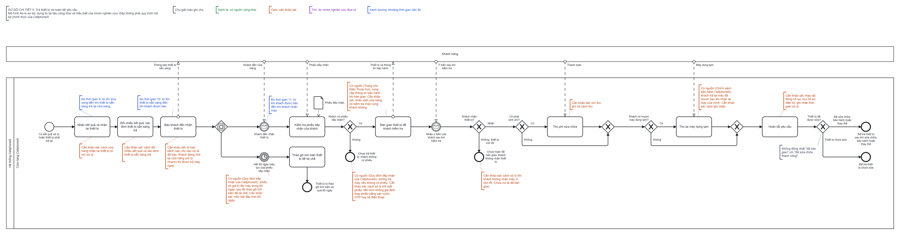

# Mô tả nghiệp vụ As-Is: Quy trình con 5

Tên: Trả thiết bị và hoàn tất yêu cầu.

- Tệp sơ đồ: [`bpmn/CellphoneS_AsIs_P5.bpmn`](../bpmn/CellphoneS_AsIs_P5.bpmn)
- Ảnh: [`png/CellphoneS_AsIs_P5.png`](../png/CellphoneS_AsIs_P5.png)

Đây là mô hình As-Is sơ bộ, dựng từ tài liệu công khai và hiểu biết của nhóm nghiên cứu. Đây không phải quy trình nội bộ chính thức của CellphoneS.

## Mô tả quy trình (văn xuôi, dùng cho báo cáo)

Quy trình con này bắt đầu khi có kết quả xử lý, hoặc khi thiết bị phải được trả lại vì không xử lý được. Cửa hàng nhận kết quả và nhận lại thiết bị, đối chiếu kết quả và xác định thiết bị đã sẵn sàng trả, sau đó báo khách đến nhận. Từ đây quy trình chờ một trong hai sự kiện. Nếu khách đến cửa hàng, việc trả máy được tiếp tục. Nếu hết 60 ngày hiệu lực của phiếu tiếp nhận mà khách không đến, cửa hàng tháo gỡ linh kiện của thiết bị để tái chế theo quy định đã công bố, và yêu cầu kết thúc.

Khi khách đến nhận, nhân viên kiểm tra phiếu tiếp nhận. Theo quy định công khai, cửa hàng không trả máy nếu khách không có phiếu. Cách xử lý khi khách làm mất phiếu chưa được công bố, nên mô hình không giả định một hình thức xác minh thay thế. Khi khách có phiếu, nhân viên bàn giao thiết bị để khách kiểm tra. Nếu khách không nhận vì thiết bị còn lỗi, việc bàn giao chưa được xem là hoàn tất và yêu cầu chuyển sang xử lý ngoại lệ. Nếu khách nhận thiết bị, cửa hàng thu phí sửa chữa khi có phát sinh, thu lại máy dùng tạm nếu khách đã mượn, rồi hoàn tất yêu cầu.

Quy trình phân biệt rõ các kết thúc: thiết bị được trả sau khi sửa chữa, bảo hành hoặc thay thế; thiết bị được trả ở trạng thái chưa sửa; thiết bị bị tháo gỡ linh kiện do quá hạn 60 ngày; và các trường hợp chưa hoàn tất bàn giao. Việc đã bàn giao thiết bị không đồng nghĩa với việc đã sửa chữa thành công. Hạn 60 ngày là điều kiện thời gian duy nhất trong mô hình, vì đây là con số duy nhất có nguồn công khai. Người báo khách và kênh thông báo, cách cửa hàng nhận lại thiết bị từ nơi xử lý, nơi thu phí và thao tác đóng hồ sơ là những nội dung cần khảo sát.

## Mục đích

Trả thiết bị cho khách, giải quyết các nghĩa vụ liên quan và kết thúc yêu cầu.

## Các bên tham gia

- Cửa hàng CellphoneS (nhân viên cửa hàng).
- Khách hàng.

## Điểm bắt đầu

Có kết quả xử lý từ bộ phận sửa chữa, từ hãng hoặc từ nhánh xử lý nhanh tại cửa hàng; hoặc thiết bị phải trả lại vì không xử lý được.

## Diễn biến

1. **Nhận kết quả và nhận lại thiết bị.**
2. **Đối chiếu kết quả, xác định thiết bị sẵn sàng trả.**
3. **Báo khách đến nhận thiết bị.** Nếu khách đang chờ tại cửa hàng, như ở nhánh xử lý nhanh, khách được trả máy ngay.
4. **Chờ một trong hai sự kiện:**
   - Khách đến nhận thiết bị: sang bước 5.
   - Hết 60 ngày hiệu lực của phiếu tiếp nhận: cửa hàng tháo gỡ linh kiện thiết bị để tái chế, quy trình con kết thúc.
5. **Kiểm tra phiếu tiếp nhận của khách.**
   - Khách có phiếu: đi tiếp.
   - Khách không có phiếu: cửa hàng không trả thiết bị, quy trình con kết thúc ở trạng thái chưa trả.
6. **Bàn giao thiết bị để khách kiểm tra, rồi nhận ý kiến của khách.**
   - Khách nhận thiết bị: đi tiếp.
   - Khách không nhận vì thiết bị còn lỗi: việc bàn giao chưa hoàn tất, quy trình con kết thúc.
7. **Thu phí sửa chữa**, nếu có phát sinh phí.
8. **Thu lại máy dùng tạm**, nếu khách có mượn.
9. **Hoàn tất yêu cầu.**
10. **Phân loại kết thúc** theo việc thiết bị đã được sửa hay chưa.

## Các điểm quyết định

| Câu hỏi | Các nhánh |
|---|---|
| Khách đến nhận, hay hết 60 ngày? | Khách đến: kiểm tra phiếu. Hết 60 ngày: tháo gỡ linh kiện. |
| Khách có phiếu tiếp nhận? | Có: bàn giao. Không: chưa trả thiết bị. |
| Khách nhận thiết bị? | Nhận: đi tiếp. Không, thiết bị còn lỗi: chưa hoàn tất bàn giao. |
| Có phát sinh phí? | Có: thu phí. Không: bỏ qua. |
| Khách có mượn máy dùng tạm? | Có: thu lại. Không: bỏ qua. |
| Thiết bị đã được sửa? | Đã sửa chữa, bảo hành hoặc thay thế. Thiết bị chưa sửa. |

Hạn 60 ngày là điều kiện thời gian duy nhất trong toàn bộ mô hình, vì đây là con số duy nhất có nguồn công khai.

## Các kết thúc

1. Đã trả thiết bị sau khi sửa chữa, bảo hành hoặc thay thế.
2. Đã trả thiết bị chưa sửa.
3. Thiết bị bị tháo gỡ linh kiện do quá 60 ngày.
4. Chưa trả thiết bị: khách không có phiếu.
5. Chưa hoàn tất bàn giao: khách không nhận thiết bị.

Hai kết thúc cuối được gộp thành "chưa hoàn tất bàn giao, chuyển xử lý ngoại lệ" ở sơ đồ tổng quan. Mô hình không đồng nhất "đã bàn giao" với "đã sửa chữa thành công".

## Trao đổi với khách hàng

| Khách gửi | Khách nhận |
|---|---|
| Khách đến cửa hàng | Thông báo thiết bị sẵn sàng |
| Phiếu tiếp nhận | Thiết bị và thông tin bảo hành |
| Ý kiến sau khi kiểm tra | |
| Thanh toán, nếu có phí | |
| Máy dùng tạm, nếu có mượn | |

## Chứng từ

- **Phiếu tiếp nhận:** được lập ở quy trình con 2, dùng làm căn cứ trả máy ở bước 5.

## Mức độ chắc chắn của thông tin

- **Có nguồn công khai:**
  - Phải có phiếu tiếp nhận mới được trả máy (Quy định tiếp nhận của CellphoneS).
  - Phiếu có giá trị lấy máy trong 60 ngày; sau đó thiết bị bị tháo gỡ linh kiện để tái chế (Quy định tiếp nhận của CellphoneS).
  - Cung cấp thông tin bảo hành khi bàn giao (Trang chủ Điện Thoại Vui).
  - Khách trả lại máy đã mượn sau khi nhận lại máy của mình (Chính sách bảo hành CellphoneS).
- **Cần khảo sát:**
  - Cách cửa hàng nhận lại thiết bị từ nơi xử lý.
  - Cách đối chiếu kết quả và xác định thiết bị sẵn sàng trả.
  - Ai báo khách, qua kênh nào, khi nào coi là đã báo.
  - Mốc bắt đầu tính 60 ngày.
  - Cách xử lý khi khách mất phiếu. Mô hình không giả định có thể thay phiếu bằng căn cước, mã OTP hay số điện thoại.
  - Nhân viên cửa hàng có kiểm tra máy cùng khách không.
  - Cách xử lý khi khách không nhận máy vì còn lỗi.
  - Nơi thu phí và cách thu.
  - Cách ghi nhận việc trả máy dùng tạm.
  - Thao tác đóng hồ sơ, lưu hồ sơ điện tử, ghi nhận thời gian xử lý.

## Khoảng thời gian cần đo

- Khoảng 9: từ khi sửa xong đến khi thiết bị sẵn sàng trả tại cửa hàng.
- Khoảng 10: từ khi thiết bị sẵn sàng đến khi khách được báo.
- Khoảng 11: từ khi khách được báo đến khi khách nhận máy.
