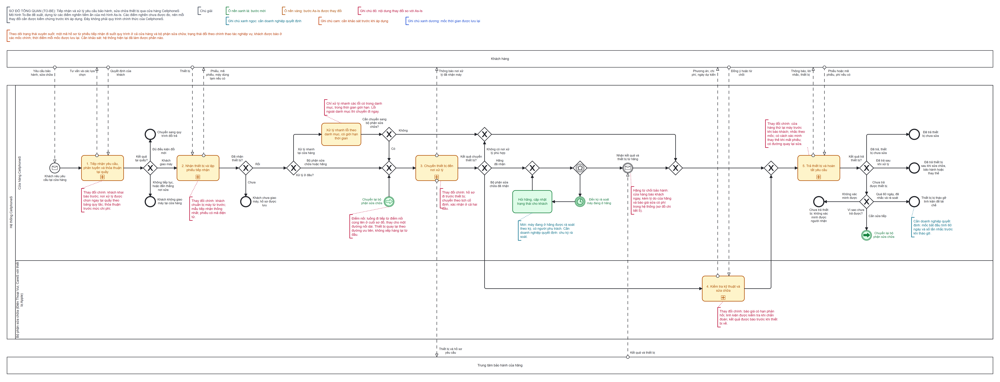

# Mô tả nghiệp vụ To-Be: Sơ đồ tổng quan

Quy trình: Tiếp nhận và xử lý yêu cầu bảo hành, sửa chữa thiết bị qua cửa hàng CellphoneS.

- Tệp sơ đồ To-Be: [`bpmn/CellphoneS_ToBe_Level0.bpmn`](../bpmn/CellphoneS_ToBe_Level0.bpmn)
- Ảnh: [`png/CellphoneS_ToBe_Level0.png`](../png/CellphoneS_ToBe_Level0.png)
- Mô tả As-Is tương ứng: [`CPS_asis_Level0.md`](CPS_asis_Level0.md)
- Các điểm nghẽn làm căn cứ: [`bottle_neck/CPS_bottleneck_Level0.md`](../bottle_neck/CPS_bottleneck_Level0.md)

Đây là mô hình To-Be đề xuất, dựng từ các điểm nghẽn tiềm ẩn của mô hình As-Is. Các điểm nghẽn đó chưa được đo, nên mỗi thay đổi cần được kiểm chứng trước khi áp dụng. Đây không phải quy trình chính thức của CellphoneS.

## Cách đọc sáu sơ đồ To-Be

- **Ô nền xanh lá:** bước mới, không có trong sơ đồ As-Is.
- **Ô nền vàng:** bước có trong sơ đồ As-Is nhưng được thay đổi nội dung.
- **Ô nền trắng:** bước giữ nguyên như As-Is.
- **Ghi chú màu đỏ:** giải thích nội dung thay đổi.
- **Ghi chú màu xanh ngọc:** điều cần doanh nghiệp quyết định, ví dụ một thời hạn hoặc một quy định.
- **Ghi chú màu cam:** điều cần khảo sát trước khi áp dụng.
- **Ghi chú màu xanh dương:** mốc thời gian được lưu lại để đo.
- **Hình tròn viền kép có đồng hồ:** một thời hạn. Sơ đồ không ghi con số, vì các thời hạn này do doanh nghiệp đặt. Riêng hạn 60 ngày của phiếu tiếp nhận là con số có nguồn.
- **Hình tròn viền kép có mũi tên (chỉ có ở sơ đồ tổng quan):** điểm nối. Luồng đi tiếp từ điểm nối cùng tên ở chỗ khác trên sơ đồ, thay cho một đường nối dài.

## Mô tả quy trình (văn xuôi, dùng cho báo cáo)

Mô hình To-Be giữ nguyên ba bên tham gia và năm quy trình con của mô hình As-Is, để hai mô hình so sánh được với nhau. Khách hàng vẫn mang thiết bị đến cửa hàng CellphoneS, cửa hàng vẫn là nơi nhận và trả thiết bị, bộ phận sửa chữa vẫn gồm Điện Thoại Vui và CareS, và trung tâm bảo hành của hãng vẫn là bên ngoài duy nhất. Thay đổi nằm ở cách các bước được sắp xếp bên trong từng quy trình con, và ở bốn điểm của sơ đồ tổng quan.

Thứ nhất, nhiều quyết định được đưa lên sớm hơn. Ngay tại quầy, nhân viên xác định nơi xử lý cụ thể theo bảng quy tắc phân tuyến, nói trước với khách về khả năng phát sinh chi phí, và ghi lại mức chi phí khách chấp nhận sửa mà không cần hỏi lại. Khách cũng được nhắc chuẩn bị máy từ đầu, và có thêm lựa chọn mang máy thẳng đến nơi sửa chữa theo lịch do cửa hàng đặt hộ. Nhờ vậy các khâu sau ít phải làm lại và ít phải chờ khách.

Thứ hai, mỗi lần thiết bị đổi tay đều có xác nhận và có mốc thời gian. Hồ sơ được gửi cho bộ phận sửa chữa trước khi thiết bị rời cửa hàng. Thiết bị được chuyển theo lịch cố định, người giao và người nhận đều xác nhận, và khách được báo khi nơi xử lý đã nhận máy. Khi sửa xong, kết quả được báo cho cửa hàng và khách ngay, trước khi thiết bị về đến cửa hàng.

Thứ ba, các khoảng chờ đều có giới hạn hoặc có người theo dõi. Báo giá gửi cho khách có hạn phản hồi. Máy đang ở trung tâm bảo hành của hãng được cửa hàng rà soát theo kỳ, và khách được cập nhật. Khách được nhắc đến nhận máy theo các mốc, và việc tháo gỡ linh kiện sau 60 ngày chỉ diễn ra sau khi đã rà soát việc nhắc khách.

Thứ tư, các lối cụt của mô hình As-Is được thay bằng đường đi tiếp. Khách mất phiếu tiếp nhận được xác minh theo cách thay thế. Thiết bị còn lỗi khi về đến cửa hàng, hoặc khách không nhận vì còn lỗi, được chuyển lại bộ phận sửa chữa theo đường ưu tiên. Khách chưa chuẩn bị xong máy thì hồ sơ được lưu, để lần sau không phải làm lại từ đầu.

Một số thay đổi đòi hỏi doanh nghiệp quyết định về thời hạn hoặc về quy định đã công bố. Các điểm đó được liệt kê ở cuối tệp này, và được đánh dấu bằng ghi chú màu xanh ngọc trên sơ đồ.

## Thay đổi so với As-Is ở sơ đồ tổng quan

| Thay đổi | Vị trí trên sơ đồ To-Be | Điểm nghẽn được giải quyết |
|---|---|---|
| Xử lý nhanh chỉ áp dụng cho lỗi có trong danh mục và có giới hạn thời gian | Ô "Xử lý nhanh lỗi theo danh mục, có giới hạn thời gian" | [Xử lý nhanh tại cửa hàng không thành rồi mới chuyển đi](../bottle_neck/CPS_bottleneck_Level0.md) |
| Máy đang ở hãng được rà soát theo kỳ, khách được cập nhật | Sự kiện hẹn giờ "Đến kỳ rà soát máy đang ở hãng" và ô "Hỏi hãng, cập nhật trạng thái cho khách" | [Chờ trung tâm bảo hành của hãng mà không có giới hạn thời gian và không có thông tin](../bottle_neck/CPS_bottleneck_Level0.md) |
| Có đường quay lại sửa cho thiết bị còn lỗi | Hai điểm nối "Chuyển lại bộ phận sửa chữa" | [Khách không nhận máy vì còn lỗi, chưa có đường quay lại sửa](../bottle_neck/CPS_bottleneck_P5.md) |
| Kết thúc "chuyển xử lý ngoại lệ" được thay bằng một kết thúc hẹp hơn | Kết thúc "Chưa trả thiết bị: không xác minh được người nhận" | [Khách mất phiếu tiếp nhận thì không có lối đi tiếp](../bottle_neck/CPS_bottleneck_P5.md) |
| Khách được báo ở các mốc chính | Các đường nét đứt đi từ quy trình con 3, 4 và 5 lên khối Khách hàng | [Trạng thái của yêu cầu chưa rõ ai cập nhật, khách có thể phải tự hỏi](../bottle_neck/CPS_bottleneck_Level0.md) |
| Cả năm quy trình con đều thay đổi bên trong | Năm ô có dấu cộng, nền vàng | Xem mô tả To-Be của từng quy trình con |

## Diễn biến

1. **Quy trình con 1: Tiếp nhận yêu cầu, phân tuyến và thỏa thuận tại quầy.** Kết quả tại quầy là một trong ba trường hợp:
   - Khách giao máy: yêu cầu đi tiếp.
   - Thiết bị đủ điều kiện đổi mới: yêu cầu chuyển sang quy trình đổi trả.
   - Khách không giao máy tại cửa hàng: khách không tiếp tục, hoặc khách chọn mang máy thẳng đến nơi sửa theo lịch cửa hàng đặt hộ.
2. **Quy trình con 2: Nhận thiết bị và lập phiếu tiếp nhận.** Nếu khách chưa giao máy, yêu cầu kết thúc và hồ sơ được lưu.
3. **Chọn nơi xử lý.** Nơi xử lý đã được xác định tại quầy, nên ở đây thiết bị chỉ rẽ theo hướng đã chọn: xử lý nhanh tại cửa hàng, hoặc chuyển đến bộ phận sửa chữa hay trung tâm bảo hành của hãng.
4. **Xử lý nhanh lỗi theo danh mục, có giới hạn thời gian.** Nếu không xử lý được và khách đồng ý chuyển, thiết bị sang quy trình con 3. Nếu đã xử lý xong, hoặc khách không tiếp tục, thiết bị sang quy trình con 5.
5. **Quy trình con 3: Chuyển thiết bị đến nơi xử lý.** Kết quả là một trong ba trường hợp:
   - Bộ phận sửa chữa đã nhận: sang quy trình con 4.
   - Hãng đã nhận: cửa hàng chờ kết quả từ hãng.
   - Không có nơi xử lý phù hợp: sang quy trình con 5. Trường hợp này được phát hiện khi thiết bị còn ở cửa hàng.
6. **Chờ kết quả từ hãng, có rà soát theo kỳ.** Trong lúc chờ, mỗi khi đến kỳ rà soát, cửa hàng hỏi hãng và cập nhật trạng thái cho khách, rồi tiếp tục chờ. Khi nhận được kết quả và thiết bị từ hãng, yêu cầu sang quy trình con 5. Nếu hãng từ chối bảo hành, cách xử lý nằm ở quy trình con 5.
7. **Quy trình con 4: Kiểm tra kỹ thuật và sửa chữa.**
8. **Quy trình con 5: Trả thiết bị và hoàn tất yêu cầu.** Kết quả là một trong năm trường hợp:
   - Đã trả sau khi xử lý.
   - Đã trả, thiết bị chưa sửa.
   - Quá 60 ngày khách không đến nhận, sau khi đã nhắc và rà soát.
   - Không xác minh được người nhận.
   - Cần sửa tiếp: thiết bị đi theo điểm nối "Chuyển lại bộ phận sửa chữa" về trước quy trình con 3.

## Các kết thúc

1. Chuyển sang quy trình đổi trả.
2. Khách không giao máy tại cửa hàng.
3. Khách chưa giao máy, hồ sơ được lưu.
4. Đã trả thiết bị sau khi sửa chữa, bảo hành hoặc thay thế.
5. Đã trả thiết bị chưa sửa.
6. Thiết bị bị tháo gỡ linh kiện để tái chế.
7. Chưa trả thiết bị: không xác minh được người nhận.

Điểm nối "Chuyển lại bộ phận sửa chữa" không phải là kết thúc: yêu cầu vẫn đang được xử lý. Mô hình vẫn không đồng nhất "đã bàn giao" với "đã sửa chữa thành công".

## Trao đổi với bên ngoài

**Với khách hàng:**

| Thời điểm | Khách gửi | Khách nhận |
|---|---|---|
| Bắt đầu | Yêu cầu bảo hành, sửa chữa | |
| Quy trình con 1 | Quyết định của khách | Tư vấn và các lựa chọn |
| Quy trình con 2 | Thiết bị | Phiếu tiếp nhận, mã phiếu, máy dùng tạm nếu có |
| Quy trình con 3 | | Thông báo nơi xử lý đã nhận máy |
| Quy trình con 4 | Đồng ý hoặc từ chối | Phương án, chi phí, ngày dự kiến |
| Quy trình con 5 | Phiếu hoặc mã phiếu, phí nếu có | Thông báo, lời nhắc, thiết bị |

**Với trung tâm bảo hành của hãng:** cửa hàng gửi thiết bị và hồ sơ yêu cầu, sau đó nhận lại kết quả và thiết bị. Việc cửa hàng hỏi hãng theo kỳ không được vẽ thành đường nét đứt, vì chưa biết hãng có kênh trả lời nào.

## Theo dõi trạng thái

Theo dõi trạng thái vẫn là việc xuyên suốt, không phải một quy trình con riêng. Mô hình To-Be đề xuất bốn điều:

- Một mã hồ sơ từ phiếu tiếp nhận đi suốt quy trình, ở cả cửa hàng và bộ phận sửa chữa.
- Trạng thái đổi theo chính thao tác nghiệp vụ, ví dụ xác nhận giao máy hoặc gửi báo giá, không cần một thao tác cập nhật riêng.
- Khách được báo ở các mốc chính, thay vì phải tự tra cứu.
- Thời điểm của mỗi mốc được lưu lại, làm số liệu cho các khoảng thời gian cần đo.

Hệ thống hiện tại của CellphoneS đã làm được phần nào trong bốn điều này là nội dung cần khảo sát.

## Đề xuất chưa được vẽ thành bước trên sơ đồ

Một số đề xuất trong thư mục `bottle_neck/` thay đổi năng lực hoặc cách tổ chức, không thay đổi thứ tự các bước, nên không xuất hiện thành một ô trên sơ đồ:

- Mở rộng danh mục lỗi cửa hàng được tự xử lý tại chỗ.
- Bố trí kỹ thuật viên của bộ phận sửa chữa làm việc tại cửa hàng theo ngày cố định.
- Giao rõ người và khung giờ cho việc giao nhận máy và báo khách.
- Dự trữ sẵn các linh kiện hay dùng.
- Cho thiết bị Apple đi qua CareS thay vì gửi ra ngoài. Điều này phụ thuộc vào kết quả khảo sát cách phân tuyến thiết bị Apple.

Ba đề xuất khác chỉ được ghi trong ghi chú của sơ đồ chi tiết, vì là lựa chọn thêm chứ không phải đường đi chính: giữ chỗ linh kiện trong lúc chờ khách trả lời, cho khách nhận lại máy trong lúc chờ linh kiện, và cho khách thanh toán trước qua kênh trực tuyến.

## Điều cần doanh nghiệp quyết định

Danh sách này gom các điểm được đánh dấu màu xanh ngọc trên cả sáu sơ đồ.

1. Ai được kết luận lỗi thuộc nhà sản xuất tại cửa hàng khi xét đổi mới, và mốc 30 ngày có tính đến ngày khách báo lỗi hay không. ([Sơ đồ chi tiết 1](CPS_tobe_P1.md))
2. Cách làm khi thiết bị hỏng đến mức khách không thể tự sao lưu hay thoát tài khoản. ([Sơ đồ chi tiết 2](CPS_tobe_P2.md))
3. Số chuyến chuyển thiết bị mỗi ngày và giờ chốt của từng chuyến. ([Sơ đồ chi tiết 3](CPS_tobe_P3.md))
4. Hạn phản hồi báo giá và số lần nhắc. Hết hạn thì thiết bị được trả ở trạng thái chưa sửa. ([Sơ đồ chi tiết 4](CPS_tobe_P4.md))
5. Số lần sửa lại tối đa trước khi chuyển cho người có kinh nghiệm hơn. ([Sơ đồ chi tiết 4](CPS_tobe_P4.md))
6. Chu kỳ rà soát các máy đang ở trung tâm bảo hành của hãng. (Sơ đồ tổng quan)
7. Số lần nhắc khách đến nhận máy, mốc bắt đầu tính 60 ngày, và việc rà soát trước khi tháo gỡ linh kiện. ([Sơ đồ chi tiết 5](CPS_tobe_P5.md))
8. Cách xác minh thay thế khi khách mất phiếu tiếp nhận. Điểm này thay đổi một quy định đã công bố. ([Sơ đồ chi tiết 5](CPS_tobe_P5.md))

## Kết quả kiểm tra kỹ thuật

Các kiểm tra sau đã được chạy trên cả sáu tệp To-Be ngày 18/11/2026, bằng cùng bộ công cụ đã dùng cho bản As-Is, và đều đạt:

| Kiểm tra | Kết quả |
|---|---|
| Đọc lại tệp XML bằng bpmn-moddle | Không có cảnh báo |
| Đối chiếu với lược đồ XSD BPMN 2.0 của OMG | Cả sáu tệp hợp lệ |
| Mở tệp và vẽ sơ đồ bằng bpmn-js | Mở được, không có cảnh báo khi nhập |
| Bộ quy tắc bpmnlint:recommended | Không có lỗi ở năm sơ đồ chi tiết; sơ đồ tổng quan có 10 ghi nhận đã biết, cùng loại với bản As-Is |
| Kiểm tra cấu trúc bằng `tools/check.mjs --tobe` | Đạt |

Giới hạn của việc kiểm tra:

- Mười ghi nhận ở sơ đồ tổng quan là do năm quy trình con thu gọn không có nội dung bên trong; nội dung nằm ở năm tệp chi tiết.
- Tệp chưa được mở thử bằng chính ứng dụng Camunda Modeler.
- Có một số điểm đường nét đứt cắt qua đường luồng: bốn điểm ở sơ đồ tổng quan, hai điểm ở sơ đồ chi tiết 3, hai điểm ở sơ đồ chi tiết 4. Không đường nào đi xuyên qua một phần tử.
- Bản As-Is chỉ dùng một sự kiện hẹn giờ là hạn 60 ngày, vì đó là con số duy nhất có nguồn. Bản To-Be dùng thêm ba sự kiện hẹn giờ cho các thời hạn do doanh nghiệp tự đặt, và sơ đồ không ghi con số cho các thời hạn này.
- Các kiểm tra xác nhận tệp đúng ký pháp và logic luồng. Chúng không xác nhận các thay đổi sẽ có hiệu quả; điều đó phụ thuộc vào việc đo và khảo sát.

## Sơ đồ chi tiết

- [Quy trình con 1](CPS_tobe_P1.md)
- [Quy trình con 2](CPS_tobe_P2.md)
- [Quy trình con 3](CPS_tobe_P3.md)
- [Quy trình con 4](CPS_tobe_P4.md)
- [Quy trình con 5](CPS_tobe_P5.md)
