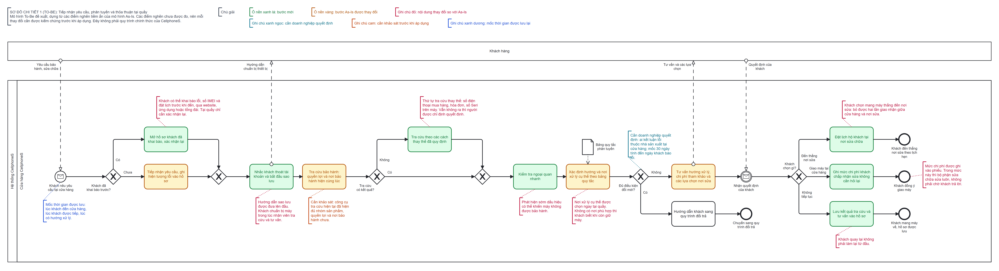

# Mô tả nghiệp vụ To-Be: Quy trình con 1

Tên: Tiếp nhận yêu cầu, phân tuyến và thỏa thuận tại quầy.

- Tệp sơ đồ To-Be: [`bpmn/CellphoneS_ToBe_P1.bpmn`](../bpmn/CellphoneS_ToBe_P1.bpmn)
- Ảnh: [`png/CellphoneS_ToBe_P1.png`](../png/CellphoneS_ToBe_P1.png)
- Mô tả As-Is tương ứng: [`CPS_asis_P1.md`](CPS_asis_P1.md)
- Các điểm nghẽn làm căn cứ: [`bottle_neck/CPS_bottleneck_P1.md`](../bottle_neck/CPS_bottleneck_P1.md)
- Cách đọc màu trên sơ đồ: [`CPS_tobe_Level0.md`](CPS_tobe_Level0.md)

Đây là mô hình To-Be đề xuất, dựng từ các điểm nghẽn tiềm ẩn của mô hình As-Is. Các điểm nghẽn đó chưa được đo, nên mỗi thay đổi cần được kiểm chứng trước khi áp dụng. Đây không phải quy trình chính thức của CellphoneS.

## Mô tả quy trình (văn xuôi, dùng cho báo cáo)

Quy trình con này vẫn bắt đầu khi khách hàng mang thiết bị gặp lỗi đến cửa hàng CellphoneS. Điểm khác đầu tiên là khách có thể đã khai báo từ trước: hiện tượng lỗi, số IMEI và lịch hẹn, qua website, ứng dụng hoặc tổng đài. Khi đó nhân viên chỉ mở hồ sơ đã có và xác nhận lại với khách. Với khách chưa khai báo, nhân viên tiếp nhận yêu cầu và ghi hiện tượng lỗi vào hồ sơ như trước.

Ngay sau khi tiếp nhận, nhân viên nhắc khách thoát tài khoản và bắt đầu sao lưu dữ liệu. Ở mô hình As-Is, khách chỉ được hướng dẫn việc này sau khi đã đồng ý giao máy. Ở mô hình To-Be, khách chuẩn bị máy trong lúc nhân viên tra cứu và tư vấn, nên hai việc diễn ra cùng lúc. Việc tra cứu bảo hành trả về luôn nhóm sản phẩm, quyền lợi và nơi bảo hành, thay cho hai bước tách rời. Nếu tra cứu không ra kết quả, nhân viên tra theo các cách thay thế đã được quy định sẵn.

Tiếp theo, nhân viên kiểm tra ngoại quan nhanh để sớm nhận ra dấu hiệu có thể khiến thiết bị không được bảo hành, rồi xác định hướng xử lý và nơi xử lý cụ thể theo bảng quy tắc phân tuyến. Nếu thiết bị đủ điều kiện đổi mới, khách được hướng dẫn sang quy trình đổi trả. Trong các trường hợp còn lại, nhân viên tư vấn hướng xử lý, khoảng chi phí tham khảo và các lựa chọn nơi sửa, rồi chờ khách quyết định.

Khách có ba lựa chọn. Nếu khách giao máy tại cửa hàng, nhân viên ghi lại mức chi phí mà khách chấp nhận cho sửa mà không cần hỏi lại. Nếu khách muốn mang máy thẳng đến nơi sửa chữa, nhân viên đặt lịch hộ. Nếu khách không tiếp tục, kết quả tra cứu và tư vấn được lưu vào hồ sơ, để khi khách quay lại không phải làm lại từ đầu.

Lời tư vấn tại quầy vẫn chỉ là phân loại sơ bộ. Kết luận sửa miễn phí hay có phí vẫn chỉ có sau khi kiểm tra kỹ thuật.

## Thay đổi so với As-Is

| Thay đổi | Bước trên sơ đồ To-Be | Điểm nghẽn được giải quyết |
|---|---|---|
| Khách khai báo và đặt lịch trước khi đến | Điểm quyết định "Khách đã khai báo trước?" và ô "Mở hồ sơ khách đã khai báo, xác nhận lại" | Khách xếp hàng chờ tại quầy |
| Hướng dẫn sao lưu được đưa lên đầu | Ô "Nhắc khách thoát tài khoản và bắt đầu sao lưu" | Chờ khách thoát tài khoản và sao lưu dữ liệu, ở [khâu nhận thiết bị](../bottle_neck/CPS_bottleneck_P2.md) |
| Gộp tra cứu và xác định quyền lợi | Ô "Tra cứu bảo hành: quyền lợi và nơi bảo hành hiện cùng lúc" | Khách xếp hàng chờ tại quầy |
| Có cách xử lý khi tra cứu không ra | Điểm quyết định "Tra cứu có kết quả?" và ô "Tra cứu theo các cách thay thế đã quy định" | Tra cứu không ra thông tin bảo hành thì chưa có cách xử lý |
| Kiểm tra ngoại quan tại quầy | Ô "Kiểm tra ngoại quan nhanh" | Phân loại tại quầy chỉ là sơ bộ, nhưng tuyến xử lý được chọn theo phân loại đó |
| Nơi xử lý cụ thể được chọn tại quầy, theo bảng quy tắc | Ô "Xác định hướng và nơi xử lý cụ thể theo bảng quy tắc" và tài liệu "Bảng quy tắc phân tuyến" | Phân loại tại quầy chỉ là sơ bộ; sau khi đã nhận máy mới biết không có nơi xử lý phù hợp |
| Nói trước về chi phí và các lựa chọn | Ô "Tư vấn hướng xử lý, chi phí tham khảo và các lựa chọn nơi sửa" | Chờ khách phản hồi phương án và chi phí, ở [khâu sửa chữa](../bottle_neck/CPS_bottleneck_P4.md) |
| Thỏa thuận trước mức chi phí | Ô "Ghi mức chi phí khách chấp nhận sửa không cần hỏi lại" | Chờ khách phản hồi phương án và chi phí |
| Khách có thể đến thẳng nơi sửa | Ô "Đặt lịch hộ khách tại nơi sửa chữa" | Thiết bị phải qua nhiều lần giao nhận, ở [sơ đồ tổng quan](../bottle_neck/CPS_bottleneck_Level0.md) |
| Lưu hồ sơ khi khách chưa quyết định | Ô "Lưu kết quả tra cứu và tư vấn vào hồ sơ" | Khách quay lại phải làm lại từ đầu |

## Diễn biến

1. **Xét việc khai báo trước.**
   - Khách đã khai báo: nhân viên mở hồ sơ khách đã khai báo và xác nhận lại.
   - Khách chưa khai báo: nhân viên tiếp nhận yêu cầu và ghi hiện tượng lỗi vào hồ sơ.
2. **Nhắc khách thoát tài khoản và bắt đầu sao lưu.** Khách làm việc này trong lúc các bước sau diễn ra.
3. **Tra cứu bảo hành.** Kết quả hiện cùng lúc nhóm sản phẩm, quyền lợi và nơi bảo hành.
   - Có kết quả: đi tiếp.
   - Không có kết quả: nhân viên tra cứu theo các cách thay thế đã quy định, rồi đi tiếp.
4. **Kiểm tra ngoại quan nhanh.**
5. **Xác định hướng và nơi xử lý cụ thể theo bảng quy tắc.**
6. **Xét điều kiện đổi mới.**
   - Đủ điều kiện: nhân viên hướng dẫn khách sang quy trình đổi trả, quy trình con kết thúc.
   - Không đủ: sang bước tư vấn.
7. **Tư vấn hướng xử lý, chi phí tham khảo và các lựa chọn nơi sửa.**
8. **Nhận quyết định của khách.**
   - Giao máy tại cửa hàng: nhân viên ghi mức chi phí khách chấp nhận sửa không cần hỏi lại. Sang quy trình con 2.
   - Đến thẳng nơi sửa: nhân viên đặt lịch hộ khách tại nơi sửa chữa.
   - Không tiếp tục: nhân viên lưu kết quả tra cứu và tư vấn vào hồ sơ.

## Các điểm quyết định

| Câu hỏi | Các nhánh |
|---|---|
| Khách đã khai báo trước? | Có: mở hồ sơ đã có. Chưa: tiếp nhận tại quầy. |
| Tra cứu có kết quả? | Có: đi tiếp. Không: tra cứu theo cách thay thế. |
| Đủ điều kiện đổi mới? | Có: hướng dẫn sang quy trình đổi trả. Không: tư vấn. |
| Khách chọn gì? | Giao máy tại cửa hàng. Đến thẳng nơi sửa. Không tiếp tục. |

## Các kết thúc

1. Khách đồng ý giao máy.
2. Khách đến thẳng nơi sửa theo lịch hẹn.
3. Khách mang máy về, hồ sơ được lưu.
4. Chuyển sang quy trình đổi trả.

Ở sơ đồ tổng quan, kết thúc thứ hai và thứ ba được gộp thành "Khách không giao máy tại cửa hàng".

## Trao đổi với khách hàng

| Khách gửi | Khách nhận |
|---|---|
| Yêu cầu bảo hành, sửa chữa | Hướng dẫn chuẩn bị thiết bị |
| Quyết định của khách | Tư vấn và các lựa chọn |

## Điều cần doanh nghiệp quyết định

- Ai được kết luận lỗi thuộc nhà sản xuất tại cửa hàng khi xét đổi mới.
- Mốc 30 ngày có tính đến ngày khách báo lỗi tại cửa hàng hay không.
- Nội dung của bảng quy tắc phân tuyến, và danh mục lỗi cửa hàng được xử lý nhanh.

## Điều cần khảo sát trước khi áp dụng

- Công cụ tra cứu hiện tại đã hiện đủ nhóm sản phẩm, quyền lợi và nơi bảo hành chưa.
- Dữ liệu nào đang có để tra cứu thay thế, ví dụ số điện thoại mua hàng hoặc hóa đơn.
- Kiểm tra ngoại quan làm thời gian phục vụ mỗi khách tại quầy dài thêm bao nhiêu, so với số lần làm lại giảm được.

## Mốc thời gian được lưu

- Lúc khách đến cửa hàng.
- Lúc khách được nhân viên tiếp.
- Lúc có hướng xử lý.

Ba mốc này cho phép đo riêng thời gian khách chờ đến lượt, là số liệu mà mô hình As-Is chưa đo.
