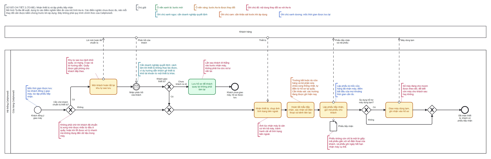

# Mô tả nghiệp vụ To-Be: Quy trình con 2

Tên: Nhận thiết bị và lập phiếu tiếp nhận.

- Tệp sơ đồ To-Be: [`bpmn/CellphoneS_ToBe_P2.bpmn`](../bpmn/CellphoneS_ToBe_P2.bpmn)
- Ảnh: [`png/CellphoneS_ToBe_P2.png`](../png/CellphoneS_ToBe_P2.png)
- Mô tả As-Is tương ứng: [`CPS_asis_P2.md`](CPS_asis_P2.md)
- Các điểm nghẽn làm căn cứ: [`bottle_neck/CPS_bottleneck_P2.md`](../bottle_neck/CPS_bottleneck_P2.md)
- Cách đọc màu trên sơ đồ: [`CPS_tobe_Level0.md`](CPS_tobe_Level0.md)

Đây là mô hình To-Be đề xuất, dựng từ các điểm nghẽn tiềm ẩn của mô hình As-Is. Các điểm nghẽn đó chưa được đo, nên mỗi thay đổi cần được kiểm chứng trước khi áp dụng. Đây không phải quy trình chính thức của CellphoneS.

## Mô tả quy trình (văn xuôi, dùng cho báo cáo)

Quy trình con này bắt đầu khi khách hàng đồng ý giao máy. Ở mô hình As-Is, đây là lúc khách mới được hướng dẫn thoát tài khoản và sao lưu dữ liệu, rồi quy trình chờ khách. Ở mô hình To-Be, khách đã được nhắc việc này ngay từ lúc tiếp nhận yêu cầu tại quầy. Vì vậy quy trình chỉ xét một câu hỏi: có cần chờ khách chuẩn bị thiết bị nữa hay không.

Trong đa số trường hợp, câu trả lời là không. Khách đã chuẩn bị xong trong lúc được tra cứu và tư vấn, hoặc lỗi thuộc diện xử lý nhanh và không đụng đến dữ liệu trong máy. Khi đó nhân viên đi thẳng vào việc nhận máy. Trong trường hợp còn lại, nhân viên mời khách hoàn tất tại khu tự sao lưu, là một chỗ tách khỏi quầy, để quầy tiếp tục phục vụ khách khác. Nếu cuối cùng khách vẫn chưa giao được máy và ra về, hồ sơ được lưu lại, để lần sau khách đi thẳng vào bước nhận máy.

Khi nhận thiết bị, nhân viên chụp ảnh tình trạng bên ngoài của máy. Sau đó nhân viên hoàn tất mẫu tiếp nhận. Mẫu này có các trường bắt buộc do cửa hàng và bộ phận sửa chữa cùng thống nhất, và phần lớn được tự điền từ hồ sơ đã lập tại quầy. Nhân viên cũng xác nhận lại số điện thoại và kênh liên lạc mà khách muốn dùng, vì việc báo giá và báo nhận máy về sau đều phụ thuộc vào thông tin này.

Phiếu tiếp nhận vẫn là chứng từ để khách nhận lại máy. Điểm khác là mã phiếu được gửi cho khách qua tin nhắn hoặc tài khoản thành viên ngay khi lập, và phiếu ghi ngày hết hạn nhận máy cụ thể. Phiếu vì thế không còn chỉ tồn tại trên một tờ giấy. Nếu chính sách áp dụng, cửa hàng giao máy dùng tạm cho khách và ghi nhận vào hồ sơ, để theo dõi được số máy đang cho mượn.

## Thay đổi so với As-Is

| Thay đổi | Bước trên sơ đồ To-Be | Điểm nghẽn được giải quyết |
|---|---|---|
| Không phải chờ khi khách đã chuẩn bị xong, hoặc khi xử lý nhanh không đụng đến dữ liệu | Điểm quyết định "Cần chờ khách chuẩn bị thiết bị?" | Chờ khách thoát tài khoản và sao lưu dữ liệu; thủ tục đầy đủ áp dụng cả cho lỗi sửa nhanh |
| Khách chuẩn bị máy ở một chỗ tách khỏi quầy | Ô "Mời khách hoàn tất tại khu tự sao lưu" | Chờ khách thoát tài khoản và sao lưu dữ liệu |
| Hồ sơ được lưu khi khách ra về | Ô "Lưu hồ sơ để khách quay lại không phải làm lại" | Khách phải đến hai lần và làm lại từ đầu |
| Chụp ảnh tình trạng máy khi nhận | Ô "Nhận thiết bị, chụp ảnh tình trạng bên ngoài" | Thông tin tiếp nhận thiếu; tranh cãi khi trả máy |
| Mẫu tiếp nhận thống nhất, tự điền, có xác nhận kênh liên lạc | Ô "Hoàn tất mẫu tiếp nhận, xác nhận số điện thoại và kênh liên lạc" | Thông tin tiếp nhận thiếu hoặc phải nhập lại |
| Phiếu có mã điện tử và ghi ngày hết hạn | Ô "Lập phiếu tiếp nhận, gửi mã phiếu cho khách" | Phiếu tiếp nhận là căn cứ duy nhất để lấy máy |
| Ghi nhận việc cho mượn máy | Ô "Giao máy dùng tạm, ghi nhận vào hồ sơ" | Máy dùng tạm: số lượng chưa rõ |

## Diễn biến

1. **Xét việc chờ khách chuẩn bị thiết bị.**
   - Không cần chờ: đi thẳng đến bước 4.
   - Cần chờ: sang bước 2.
2. **Mời khách hoàn tất tại khu tự sao lưu.**
3. **Nhận phản hồi của khách.**
   - Khách giao thiết bị: đi tiếp.
   - Khách chưa giao và ra về: nhân viên lưu hồ sơ, quy trình con kết thúc.
4. **Nhận thiết bị, chụp ảnh tình trạng bên ngoài.**
5. **Hoàn tất mẫu tiếp nhận, xác nhận số điện thoại và kênh liên lạc.**
6. **Lập phiếu tiếp nhận, gửi mã phiếu cho khách.**
7. **Xét hỗ trợ máy dùng tạm.**
   - Áp dụng: giao máy dùng tạm và ghi nhận vào hồ sơ.
   - Không áp dụng: bỏ qua.

## Các điểm quyết định

| Câu hỏi | Các nhánh |
|---|---|
| Cần chờ khách chuẩn bị thiết bị? | Không: nhận máy ngay. Có: mời khách hoàn tất tại khu tự sao lưu. |
| Khách giao thiết bị? | Có: nhận máy. Chưa: khách ra về, hồ sơ được lưu. |
| Áp dụng hỗ trợ máy dùng tạm? | Có: giao máy dùng tạm. Không: bỏ qua. |

## Các kết thúc

1. Đã nhận thiết bị, khách có phiếu tiếp nhận.
2. Khách chưa giao máy, hồ sơ được lưu.

## Trao đổi với khách hàng

| Khách gửi | Khách nhận |
|---|---|
| Phản hồi của khách | Lời mời hoàn tất chuẩn bị |
| Thiết bị | Phiếu tiếp nhận và mã phiếu |
| | Máy dùng tạm, nếu áp dụng |

## Chứng từ

- **Phiếu tiếp nhận:** gồm bản giao cho khách và mã phiếu gắn với số điện thoại của khách. Phiếu ghi mức chi phí khách chấp nhận sửa không cần hỏi lại, và ngày hết hạn nhận máy.

## Điều cần doanh nghiệp quyết định

- Cách làm khi thiết bị hỏng đến mức khách không thể tự sao lưu hay thoát tài khoản, ví dụ hướng dẫn khách gỡ thiết bị khỏi tài khoản từ một thiết bị khác.
- Thủ tục rút gọn áp dụng cho những việc xử lý nhanh nào.
- Các trường bắt buộc trên mẫu tiếp nhận.

Quy định về trách nhiệm đối với dữ liệu của khách không thay đổi. Mô hình To-Be chỉ thay đổi thời điểm khách biết về yêu cầu này và nơi khách thực hiện.

## Điều cần khảo sát trước khi áp dụng

- Các trường đang được ghi trên phiếu tiếp nhận hiện nay, và phần mềm lập phiếu.
- Phiếu hiện là giấy hay đã có bản điện tử.
- Điều kiện được mượn máy dùng tạm và số máy đang có.

## Mốc thời gian được lưu

- Lúc khách đồng ý giao máy.
- Lúc lập phiếu tiếp nhận. Đây là mốc "cửa hàng đã nhận máy", điểm bắt đầu của mọi khoảng thời gian cần đo về sau.
