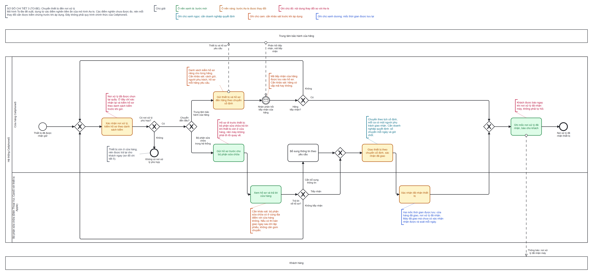

# Mô tả nghiệp vụ To-Be: Quy trình con 3

Tên: Chuyển thiết bị đến nơi xử lý.

- Tệp sơ đồ To-Be: [`bpmn/CellphoneS_ToBe_P3.bpmn`](../bpmn/CellphoneS_ToBe_P3.bpmn)
- Ảnh: [`png/CellphoneS_ToBe_P3.png`](../png/CellphoneS_ToBe_P3.png)
- Mô tả As-Is tương ứng: [`CPS_asis_P3.md`](CPS_asis_P3.md)
- Các điểm nghẽn làm căn cứ: [`bottle_neck/CPS_bottleneck_P3.md`](../bottle_neck/CPS_bottleneck_P3.md)
- Cách đọc màu trên sơ đồ: [`CPS_tobe_Level0.md`](CPS_tobe_Level0.md)

Đây là mô hình To-Be đề xuất, dựng từ các điểm nghẽn tiềm ẩn của mô hình As-Is. Các điểm nghẽn đó chưa được đo, nên mỗi thay đổi cần được kiểm chứng trước khi áp dụng. Đây không phải quy trình chính thức của CellphoneS.

Đây là quy trình con mà mô hình As-Is có ít căn cứ nhất, nên cũng là quy trình con mà mô hình To-Be phụ thuộc nhiều nhất vào kết quả khảo sát.

## Mô tả quy trình (văn xuôi, dùng cho báo cáo)

Quy trình con này bắt đầu khi thiết bị đã được cửa hàng nhận giữ. Ở mô hình To-Be, nơi xử lý đã được chọn ngay tại quầy theo bảng quy tắc phân tuyến. Vì vậy bước đầu tiên chỉ là xác nhận lại nơi xử lý và kiểm hồ sơ theo danh sách kiểm, để hồ sơ không bị trả lại vì thiếu thông tin.

Với tuyến trong hệ thống, thay đổi lớn nhất là hồ sơ đi trước thiết bị. Cửa hàng gửi hồ sơ cho bộ phận sửa chữa trước. Bộ phận sửa chữa xem hồ sơ và trả lời trong lúc thiết bị còn ở cửa hàng. Nếu bộ phận sửa chữa tiếp nhận, cửa hàng giao thiết bị theo chuyến chuyển cố định và xác nhận đã giao. Nếu cần bổ sung thông tin, cửa hàng bổ sung rồi mới giao. Nếu bộ phận sửa chữa không tiếp nhận, cửa hàng xác định lại nơi xử lý mà thiết bị không phải đi rồi quay về. Khi không còn nơi nào phù hợp, thiết bị được trả lại cho khách ngay, vì thiết bị vẫn đang ở cửa hàng.

Với tuyến hãng, cửa hàng kiểm hồ sơ theo danh sách kiểm riêng của từng hãng, gửi thiết bị và hồ sơ theo chuyến cố định, rồi chờ hãng phản hồi. Mã tiếp nhận của hãng, nếu hãng có cấp, được lưu vào hồ sơ. Nếu hãng không tiếp nhận, cửa hàng xác định lại nơi xử lý.

Ở cả hai tuyến, việc giao và việc nhận đều được xác nhận, và hai thời điểm này đều được lưu. Khi nơi xử lý đã nhận thiết bị, cửa hàng ghi mốc và báo cho khách. Khách vì thế tham gia quy trình con này, khác với mô hình As-Is.

## Thay đổi so với As-Is

| Thay đổi | Bước trên sơ đồ To-Be | Điểm nghẽn được giải quyết |
|---|---|---|
| Nơi xử lý đã chọn tại quầy; hồ sơ được kiểm trước khi gửi | Ô "Xác nhận nơi xử lý, kiểm hồ sơ theo danh sách kiểm" | Nơi xử lý yêu cầu bổ sung thông tin hoặc không tiếp nhận |
| Hồ sơ đi trước thiết bị | Ô "Gửi hồ sơ trước cho bộ phận sửa chữa" và ô "Xem hồ sơ và trả lời cửa hàng" | Nơi xử lý yêu cầu bổ sung thông tin hoặc không tiếp nhận |
| Chuyển theo lịch cố định, có xác nhận đã giao | Ô "Giao thiết bị theo chuyến cố định, xác nhận đã giao" | Thiết bị nằm chờ tại cửa hàng trước khi được chuyển đi |
| Nơi xử lý xác nhận đã nhận | Ô "Xác nhận đã nhận thiết bị" | Khoảng trống giữa lúc cửa hàng giao và lúc nơi xử lý nhận |
| Gửi hãng theo chuyến cố định, có danh sách kiểm theo hãng | Ô "Gửi thiết bị và hồ sơ đến hãng theo chuyến cố định" | Gửi hãng: chờ bên ngoài phản hồi việc tiếp nhận |
| Khách được báo khi nơi xử lý đã nhận máy | Ô "Ghi mốc nơi xử lý đã nhận, báo cho khách" | Trạng thái của yêu cầu chưa rõ ai cập nhật, ở [sơ đồ tổng quan](../bottle_neck/CPS_bottleneck_Level0.md) |

Trường hợp "Không có nơi xử lý phù hợp" vẫn còn trên sơ đồ. Điểm khác là nó được phát hiện khi thiết bị còn ở cửa hàng, không phải sau khi thiết bị đã được chuyển đi.

## Diễn biến

1. **Xác nhận nơi xử lý, kiểm hồ sơ theo danh sách kiểm.**
   - Không có nơi xử lý phù hợp: quy trình con kết thúc, thiết bị được trả lại cho khách.
   - Có: đi tiếp.
2. **Chọn tuyến.**
   - Bộ phận sửa chữa trong hệ thống: sang bước 3.
   - Trung tâm bảo hành của hãng: sang bước 7.
3. **Gửi hồ sơ trước cho bộ phận sửa chữa.**
4. **Bộ phận sửa chữa xem hồ sơ và trả lời cửa hàng.**
   - Tiếp nhận: sang bước 5.
   - Cần bổ sung thông tin: cửa hàng bổ sung thông tin theo yêu cầu, rồi sang bước 5.
   - Không tiếp nhận: quay lại bước 1 để xác định nơi xử lý khác.
5. **Giao thiết bị theo chuyến cố định, xác nhận đã giao.**
6. **Bộ phận sửa chữa xác nhận đã nhận thiết bị.** Sang bước 9.
7. **Gửi thiết bị và hồ sơ đến hãng theo chuyến cố định.**
8. **Nhận phản hồi tiếp nhận của hãng.**
   - Hãng tiếp nhận: sang bước 9.
   - Hãng không tiếp nhận: quay lại bước 1.
9. **Ghi mốc nơi xử lý đã nhận, báo cho khách.**

## Các điểm quyết định

| Câu hỏi | Các nhánh |
|---|---|
| Có nơi xử lý phù hợp? | Có: chọn tuyến. Không: kết thúc. |
| Chuyển đến đâu? | Bộ phận sửa chữa trong hệ thống. Trung tâm bảo hành của hãng. |
| Trả lời về hồ sơ? | Tiếp nhận. Cần bổ sung thông tin. Không tiếp nhận. |
| Hãng tiếp nhận? | Có: ghi mốc và báo khách. Không: xác định lại nơi xử lý. |

Hai đường quay lại bước xác nhận nơi xử lý đều có lối thoát là nhánh "không có nơi xử lý phù hợp", nên không lặp vô hạn.

## Các kết thúc

1. Nơi xử lý đã nhận thiết bị.
2. Không có nơi xử lý phù hợp.

## Trao đổi với bên ngoài

| Bên | Cửa hàng gửi | Cửa hàng nhận |
|---|---|---|
| Trung tâm bảo hành của hãng | Thiết bị và hồ sơ yêu cầu | Phản hồi tiếp nhận, mã tiếp nhận |
| Khách hàng | Thông báo: nơi xử lý đã nhận máy | |

## Điều cần doanh nghiệp quyết định

- Số chuyến chuyển thiết bị mỗi ngày và giờ chốt của từng chuyến.
- Ai là người phụ trách giao nhận trong mỗi ca.
- Cách xác nhận giao và nhận, ví dụ quét mã trên phiếu tiếp nhận.

## Điều cần khảo sát trước khi áp dụng

- Bộ phận sửa chữa có ở cùng địa điểm với cửa hàng không. Nếu có, thiết bị được bàn giao ngay sau khi lập phiếu, và phần chuyển theo chuyến không còn cần thiết.
- Bộ phận sửa chữa có trả lời hồ sơ đủ nhanh hay không. Việc gửi hồ sơ trước chỉ có lợi khi câu trả lời đến trước chuyến chuyển kế tiếp.
- Tỷ lệ hồ sơ bị yêu cầu bổ sung hoặc không được tiếp nhận hiện nay. Nếu tỷ lệ này rất thấp thì không cần bước gửi hồ sơ trước.
- Cách gửi máy đến hãng, người phụ trách, hồ sơ mỗi hãng yêu cầu, và hãng có cấp mã tiếp nhận hay không.

## Mốc thời gian được lưu

- Lúc cửa hàng giao thiết bị đi.
- Lúc nơi xử lý nhận thiết bị.

Máy đã giao mà chưa có xác nhận nhận được người phụ trách rà soát mỗi ngày. Nhờ hai mốc này, thời gian thiết bị chờ ở cửa hàng và thời gian thiết bị ở trên đường được đo riêng.
