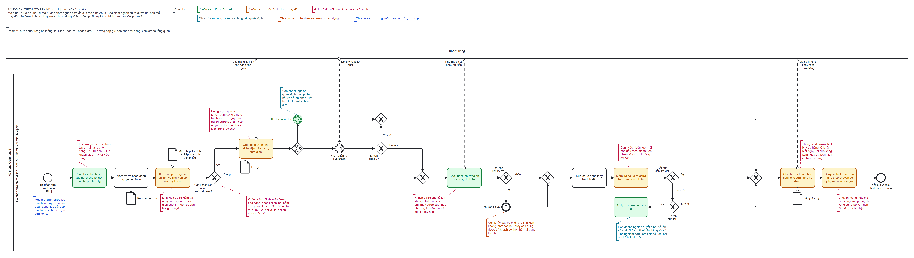

# Mô tả nghiệp vụ To-Be: Quy trình con 4

Tên: Kiểm tra kỹ thuật và sửa chữa.

- Tệp sơ đồ To-Be: [`bpmn/CellphoneS_ToBe_P4.bpmn`](../bpmn/CellphoneS_ToBe_P4.bpmn)
- Ảnh: [`png/CellphoneS_ToBe_P4.png`](../png/CellphoneS_ToBe_P4.png)
- Mô tả As-Is tương ứng: [`CPS_asis_P4.md`](CPS_asis_P4.md)
- Các điểm nghẽn làm căn cứ: [`bottle_neck/CPS_bottleneck_P4.md`](../bottle_neck/CPS_bottleneck_P4.md)
- Cách đọc màu trên sơ đồ: [`CPS_tobe_Level0.md`](CPS_tobe_Level0.md)

Đây là mô hình To-Be đề xuất, dựng từ các điểm nghẽn tiềm ẩn của mô hình As-Is. Các điểm nghẽn đó chưa được đo, nên mỗi thay đổi cần được kiểm chứng trước khi áp dụng. Đây không phải quy trình chính thức của CellphoneS.

Sơ đồ chỉ mô tả trường hợp sửa chữa trong hệ thống, tại Điện Thoại Vui hoặc CareS. Trường hợp gửi bảo hành tại hãng nằm ở sơ đồ tổng quan.

## Mô tả quy trình (văn xuôi, dùng cho báo cáo)

Quy trình con này bắt đầu khi bộ phận sửa chữa nhận được thiết bị. Việc đầu tiên là phân loại nhanh: thiết bị được xếp vào hàng chờ lỗi đơn giản hoặc hàng chờ lỗi phức tạp, để máy lỗi đơn giản không phải chờ sau máy lỗi khó. Thứ tự trong mỗi hàng chờ được tính từ lúc khách giao máy tại cửa hàng. Sau đó kỹ thuật viên kiểm tra và chẩn đoán nguyên nhân lỗi.

Khi xác định phương án, kỹ thuật viên xác định luôn chi phí và việc linh kiện có sẵn hay không. Ở mô hình As-Is, linh kiện chỉ được xét sau khi khách đã đồng ý, nên có hai khoảng chờ nối tiếp nhau. Ở mô hình To-Be, thời gian chờ linh kiện đã có sẵn khi báo cho khách.

Tiếp theo, quy trình xét có cần khách xác nhận trước khi sửa hay không. Không cần hỏi khi thiết bị được bảo hành, hoặc khi chi phí nằm trong mức khách đã chấp nhận tại quầy và đã ghi trên phiếu tiếp nhận. Chỉ khi chi phí vượt mức đó, bộ phận sửa chữa mới gửi báo giá, gồm chi phí, điều kiện bảo hành và thời gian. Khoảng chờ khách trả lời có giới hạn: nếu hết hạn phản hồi mà khách chưa trả lời, yêu cầu được xử lý như trường hợp khách từ chối, và thiết bị được trả ở trạng thái chưa sửa.

Trước khi sửa, khách được báo phương án đang thực hiện và ngày dự kiến, kể cả khi không phát sinh chi phí. Nếu phải chờ linh kiện, quy trình tạm dừng đến khi linh kiện về. Sau khi sửa, kỹ thuật viên kiểm tra theo danh sách kiểm, gồm lỗi ban đầu theo mô tả trên phiếu và các tính năng cơ bản. Nếu chưa đạt và còn có thể sửa lại, kỹ thuật viên ghi lý do rồi sửa lại. Số lần sửa lại có giới hạn.

Khi có kết quả, bộ phận sửa chữa ghi nhận và báo ngay cho cửa hàng và khách, kèm ngày dự kiến thiết bị có tại cửa hàng. Thông tin vì thế đi trước thiết bị. Thiết bị được chuyển về cửa hàng theo chuyến cố định, và việc giao được xác nhận.

## Thay đổi so với As-Is

| Thay đổi | Bước trên sơ đồ To-Be | Điểm nghẽn được giải quyết |
|---|---|---|
| Tách hàng chờ lỗi đơn giản và lỗi phức tạp | Ô "Phân loại nhanh, xếp vào hàng chờ lỗi đơn giản hoặc phức tạp" | Thiết bị chờ đến lượt kiểm tra và chẩn đoán |
| Linh kiện được kiểm tra ngay khi xác định phương án | Ô "Xác định phương án, chi phí và linh kiện có sẵn hay không" | Chờ linh kiện |
| Không hỏi lại khi chi phí trong mức khách đã chấp nhận | Điểm quyết định "Cần khách xác nhận trước khi sửa?" và tài liệu "Mức chi phí khách đã chấp nhận, ghi trên phiếu" | Chờ khách phản hồi phương án và chi phí |
| Báo giá đủ ba thông tin, qua kênh trả lời được ngay | Ô "Gửi báo giá: chi phí, điều kiện bảo hành, thời gian" | Chờ khách phản hồi phương án và chi phí |
| Khoảng chờ khách có hạn | Sự kiện hẹn giờ "Hết hạn phản hồi" | Chờ khách phản hồi phương án và chi phí |
| Khách được báo cả khi không phát sinh chi phí | Ô "Báo khách phương án và ngày dự kiến" | Khách không biết máy đang được xử lý thế nào |
| Kiểm tra sau sửa theo danh sách kiểm | Ô "Kiểm tra sau sửa chữa theo danh sách kiểm" | Sửa lại khi kiểm tra sau sửa chữa chưa đạt; khách không nhận máy vì còn lỗi |
| Ghi lý do chưa đạt, giới hạn số lần sửa lại | Ô "Ghi lý do chưa đạt, sửa lại" và điểm quyết định "Có thể sửa lại?" | Sửa lại khi kiểm tra sau sửa chữa chưa đạt |
| Kết quả được báo trước khi thiết bị về | Ô "Ghi nhận kết quả, báo ngay cho cửa hàng và khách" | Sửa xong nhưng kết quả và thiết bị chưa về đến cửa hàng |
| Chuyển về theo lịch cố định, có xác nhận | Ô "Chuyển thiết bị về cửa hàng theo chuyến cố định, xác nhận đã giao" | Sửa xong nhưng kết quả và thiết bị chưa về đến cửa hàng |

Hai bước "Kiểm tra tình trạng thiết bị" và "Chẩn đoán nguyên nhân lỗi" của sơ đồ As-Is được vẽ gộp thành một ô để sơ đồ gọn hơn. Nội dung của hai bước không thay đổi.

## Diễn biến

1. **Phân loại nhanh, xếp vào hàng chờ lỗi đơn giản hoặc phức tạp.**
2. **Kiểm tra và chẩn đoán nguyên nhân lỗi.** Bước này tạo ra kết quả kiểm tra.
3. **Xác định phương án, chi phí và linh kiện có sẵn hay không.** Bước này dùng mức chi phí khách đã chấp nhận, ghi trên phiếu.
4. **Xét việc cần khách xác nhận.**
   - Không cần: đi thẳng đến bước 7.
   - Cần: sang bước 5.
5. **Gửi báo giá: chi phí, điều kiện bảo hành, thời gian.** Bước này tạo ra báo giá.
6. **Chờ một trong hai sự kiện.**
   - Nhận phản hồi của khách. Khách đồng ý: sang bước 7. Khách từ chối: sang bước 12 với kết quả chưa sửa.
   - Hết hạn phản hồi: sang bước 12 với kết quả chưa sửa.
7. **Báo khách phương án và ngày dự kiến.**
8. **Xét linh kiện.**
   - Phải chờ: quy trình chờ đến khi linh kiện về.
   - Không phải chờ: đi tiếp.
9. **Sửa chữa hoặc thay thế linh kiện.**
10. **Kiểm tra sau sửa chữa theo danh sách kiểm.**
11. **Xét kết quả kiểm tra.**
    - Đạt: sang bước 12.
    - Chưa đạt và có thể sửa lại: ghi lý do chưa đạt, quay lại bước 9.
    - Chưa đạt và không thể sửa lại: sang bước 12 với kết quả không thể xử lý.
12. **Ghi nhận kết quả, báo ngay cho cửa hàng và khách.** Bước này tạo ra kết quả xử lý.
13. **Chuyển thiết bị về cửa hàng theo chuyến cố định, xác nhận đã giao.**

## Các điểm quyết định

| Câu hỏi | Các nhánh |
|---|---|
| Cần khách xác nhận trước khi sửa? | Có: gửi báo giá. Không: báo khách và sửa. |
| Khách đồng ý? | Đồng ý: sửa. Từ chối: ghi nhận kết quả chưa sửa. |
| Phải chờ linh kiện? | Có: chờ linh kiện về. Không: sửa. |
| Kết quả kiểm tra đạt? | Đạt: ghi nhận kết quả. Chưa đạt: xét khả năng sửa lại. |
| Có thể sửa lại? | Có: ghi lý do và sửa lại. Không: ghi nhận kết quả không thể xử lý. |

"Có thể sửa lại" nghĩa là còn trong số lần sửa lại cho phép và còn cách xử lý. Vòng sửa lại vì thế luôn có lối thoát.

## Kết thúc

Kết quả và thiết bị đã về cửa hàng. Loại kết quả gồm: đã sửa chữa hoặc bảo hành; khách từ chối hoặc không phản hồi trong hạn; không thể xử lý.

## Trao đổi với khách hàng

| Khách gửi | Khách nhận |
|---|---|
| Đồng ý hoặc từ chối | Báo giá, điều kiện bảo hành, thời gian |
| | Phương án và ngày dự kiến |
| | Thông báo đã xử lý xong, ngày có tại cửa hàng |

## Chứng từ và dữ liệu

- Mức chi phí khách đã chấp nhận, ghi trên phiếu tiếp nhận: dùng ở bước xác định phương án.
- Kết quả kiểm tra: tạo ở bước kiểm tra và chẩn đoán.
- Báo giá: tạo ở bước gửi báo giá.
- Kết quả xử lý: tạo ở bước ghi nhận kết quả.

## Điều cần doanh nghiệp quyết định

- Hạn phản hồi báo giá và số lần nhắc khách trong thời gian đó.
- Điều gì xảy ra khi khách từ chối hoặc không phản hồi, ví dụ có thu phí kiểm tra hay không. Khách cần được biết điều này ngay từ quầy.
- Số lần sửa lại tối đa, và ai xem xét khi hết số lần.
- Thứ tự ưu tiên giữa máy chuyển từ cửa hàng và máy của khách đến trực tiếp.

## Điều cần khảo sát trước khi áp dụng

- Có phải chờ linh kiện không, với loại linh kiện nào và chờ bao lâu.
- Lỗi phức tạp có phải chuyển lên trung tâm sửa chữa của Apple không. Sơ đồ To-Be chưa vẽ trường hợp này, vì chưa có nguồn.
- Ai đang liên hệ khách để báo giá, qua kênh nào. Sơ đồ To-Be vẽ bộ phận sửa chữa liên hệ trực tiếp với khách, giống sơ đồ As-Is.

## Mốc thời gian được lưu

- Lúc bộ phận sửa chữa nhận máy.
- Lúc chẩn đoán xong.
- Lúc gửi báo giá và lúc khách trả lời.
- Lúc sửa xong.
- Lúc giao thiết bị về cửa hàng.
