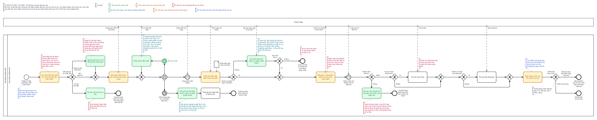

# Mô tả nghiệp vụ To-Be: Quy trình con 5

Tên: Trả thiết bị và hoàn tất yêu cầu.

- Tệp sơ đồ To-Be: [`bpmn/CellphoneS_ToBe_P5.bpmn`](../bpmn/CellphoneS_ToBe_P5.bpmn)
- Ảnh: [`png/CellphoneS_ToBe_P5.png`](../png/CellphoneS_ToBe_P5.png)
- Mô tả As-Is tương ứng: [`CPS_asis_P5.md`](CPS_asis_P5.md)
- Các điểm nghẽn làm căn cứ: [`bottle_neck/CPS_bottleneck_P5.md`](../bottle_neck/CPS_bottleneck_P5.md)
- Cách đọc màu trên sơ đồ: [`CPS_tobe_Level0.md`](CPS_tobe_Level0.md)

Đây là mô hình To-Be đề xuất, dựng từ các điểm nghẽn tiềm ẩn của mô hình As-Is. Các điểm nghẽn đó chưa được đo, nên mỗi thay đổi cần được kiểm chứng trước khi áp dụng. Đây không phải quy trình chính thức của CellphoneS.

## Mô tả quy trình (văn xuôi, dùng cho báo cáo)

Quy trình con này bắt đầu khi thiết bị về đến cửa hàng, hoặc khi thiết bị phải được trả lại vì không xử lý được. Nhân viên xác nhận đã nhận thiết bị và thử lại đúng lỗi ban đầu theo mô tả trên phiếu. Ở mô hình As-Is, cửa hàng chỉ đối chiếu kết quả, và lỗi còn lại chỉ được phát hiện khi khách đến nhận. Ở mô hình To-Be, lỗi còn lại được phát hiện sớm hơn một bước.

Sau khi thử máy, có ba trường hợp. Nếu thiết bị còn lỗi ban đầu, cửa hàng mở yêu cầu sửa lại ưu tiên và thiết bị quay lại bộ phận sửa chữa, khách không phải đến vô ích. Nếu kết quả là hãng từ chối bảo hành, cửa hàng lập báo giá sửa có phí trong hệ thống để gửi kèm thông báo, nhờ đó khách quyết định được trong một lần liên hệ. Trong các trường hợp còn lại, thiết bị sẵn sàng trả.

Cửa hàng báo khách đến nhận và ghi nhận việc báo đã thành công. Từ đây quy trình chờ một trong ba sự kiện. Nếu đến mốc nhắc mà khách chưa đến, cửa hàng nhắc khách rồi tiếp tục chờ. Nếu hết 60 ngày hiệu lực của phiếu tiếp nhận, người có thẩm quyền rà soát việc đã nhắc khách và duyệt, sau đó cửa hàng mới tháo gỡ linh kiện thiết bị để tái chế. Nếu khách đến, việc trả máy được tiếp tục.

Khi khách đến, nhân viên kiểm tra phiếu tiếp nhận hoặc mã phiếu. Nếu khách không có cả hai, cửa hàng xác minh theo cách thay thế và người có thẩm quyền duyệt. Chỉ khi không xác minh được người nhận, thiết bị mới chưa được trả. Tiếp theo, nhân viên bàn giao và cùng khách kiểm tra theo danh sách ngắn. Nếu khách không nhận, vì thiết bị còn lỗi hoặc vì khách chọn sửa có phí sau khi hãng từ chối, cửa hàng mở yêu cầu chuyển lại bộ phận sửa chữa và hẹn ngày mới với khách.

Nếu khách nhận thiết bị, cửa hàng thu phần phí chưa thanh toán, thu lại máy dùng tạm nếu khách có mượn, rồi hoàn tất yêu cầu và lưu thời điểm của các mốc. Mô hình vẫn phân biệt thiết bị được trả sau khi sửa với thiết bị được trả ở trạng thái chưa sửa.

## Thay đổi so với As-Is

| Thay đổi | Bước trên sơ đồ To-Be | Điểm nghẽn được giải quyết |
|---|---|---|
| Cửa hàng thử lại lỗi ban đầu khi nhận máy về | Ô "Xác nhận đã nhận thiết bị, thử lại lỗi ban đầu theo phiếu" và điểm quyết định "Kết quả sau khi nhận lại?" | Khách không nhận máy vì còn lỗi, chưa có đường quay lại sửa |
| Có đường sửa lại ưu tiên | Ô "Mở yêu cầu sửa lại ưu tiên" và ô "Mở yêu cầu chuyển lại bộ phận sửa chữa, hẹn ngày mới" | Khách không nhận máy vì còn lỗi, chưa có đường quay lại sửa |
| Có cách xử lý khi hãng từ chối bảo hành | Ô "Lập báo giá sửa có phí để gửi kèm thông báo" | Chờ trung tâm bảo hành của hãng, ở [sơ đồ tổng quan](../bottle_neck/CPS_bottleneck_Level0.md) |
| Báo khách có ghi nhận đã báo thành công | Ô "Báo khách đến nhận, ghi nhận đã báo thành công" | Thiết bị đã sẵn sàng nhưng khách chưa được báo |
| Nhắc khách theo mốc | Sự kiện hẹn giờ "Đến mốc nhắc" và ô "Nhắc khách đến nhận" | Khách chậm đến nhận, thiết bị tồn tại cửa hàng đến 60 ngày |
| Rà soát trước khi tháo gỡ linh kiện | Ô "Rà soát việc đã nhắc khách, người có thẩm quyền duyệt" | Khách chậm đến nhận, thiết bị tồn tại cửa hàng đến 60 ngày |
| Chấp nhận mã phiếu thay cho phiếu giấy | Ô "Kiểm tra phiếu tiếp nhận hoặc mã phiếu" | Khách mất phiếu tiếp nhận thì không có lối đi tiếp |
| Có cách xác minh thay thế khi mất phiếu | Ô "Xác minh thay thế, người có thẩm quyền duyệt" và điểm quyết định "Xác minh được?" | Khách mất phiếu tiếp nhận thì không có lối đi tiếp |
| Kiểm tra cùng khách theo danh sách ngắn | Ô "Bàn giao, cùng khách kiểm tra theo danh sách ngắn" | Khách không nhận máy vì còn lỗi |
| Chỉ thu phần phí chưa thanh toán | Điểm quyết định "Còn phí chưa thanh toán?" | Nhiều thủ tục nối tiếp tại quầy lúc trả máy |
| Lưu thời điểm các mốc khi đóng hồ sơ | Ô "Hoàn tất yêu cầu, lưu thời điểm các mốc" | Chưa có số liệu để biết khâu nào chậm |

Hai bước "Nhận kết quả và nhận lại thiết bị" và "Đối chiếu kết quả, xác định thiết bị sẵn sàng trả" của sơ đồ As-Is được gộp thành một bước, vì nhân viên nhận máy thì thử máy luôn.

## Diễn biến

1. **Xác nhận đã nhận thiết bị, thử lại lỗi ban đầu theo phiếu.**
2. **Xét kết quả sau khi nhận lại.**
   - Còn lỗi ban đầu: mở yêu cầu sửa lại ưu tiên, quy trình con kết thúc và thiết bị chuyển lại bộ phận sửa chữa.
   - Hãng từ chối bảo hành: lập báo giá sửa có phí để gửi kèm thông báo, rồi sang bước 3.
   - Sẵn sàng trả: sang bước 3.
3. **Báo khách đến nhận, ghi nhận đã báo thành công.** Nếu khách đang chờ tại cửa hàng, như ở nhánh xử lý nhanh, khách được trả máy ngay.
4. **Chờ một trong ba sự kiện.**
   - Đến mốc nhắc: nhắc khách đến nhận, rồi tiếp tục chờ.
   - Hết 60 ngày hiệu lực của phiếu tiếp nhận: rà soát việc đã nhắc khách và người có thẩm quyền duyệt; sau đó tháo gỡ linh kiện thiết bị để tái chế, quy trình con kết thúc.
   - Khách đến nhận thiết bị: sang bước 5.
5. **Kiểm tra phiếu tiếp nhận hoặc mã phiếu.**
   - Khách có phiếu hoặc mã phiếu: sang bước 6.
   - Khách không có: xác minh thay thế, người có thẩm quyền duyệt. Xác minh được thì sang bước 6. Không xác minh được thì chưa trả thiết bị, quy trình con kết thúc.
6. **Bàn giao, cùng khách kiểm tra theo danh sách ngắn, rồi nhận ý kiến của khách.**
   - Khách nhận thiết bị: sang bước 7.
   - Khách không nhận: mở yêu cầu chuyển lại bộ phận sửa chữa và hẹn ngày mới, quy trình con kết thúc.
7. **Thu phí sửa chữa**, nếu còn phí chưa thanh toán.
8. **Thu lại máy dùng tạm**, nếu khách có mượn.
9. **Hoàn tất yêu cầu, lưu thời điểm các mốc.**
10. **Phân loại kết thúc** theo việc thiết bị đã được sửa hay chưa.

## Các điểm quyết định

| Câu hỏi | Các nhánh |
|---|---|
| Kết quả sau khi nhận lại? | Sẵn sàng trả. Hãng từ chối bảo hành. Còn lỗi ban đầu. |
| Khách đến, đến mốc nhắc, hay hết 60 ngày? | Khách đến: kiểm tra phiếu. Đến mốc nhắc: nhắc khách. Hết 60 ngày: rà soát rồi tháo gỡ linh kiện. |
| Khách có phiếu hoặc mã phiếu? | Có: bàn giao. Không: xác minh thay thế. |
| Xác minh được? | Có: bàn giao. Không: chưa trả thiết bị. |
| Khách nhận thiết bị? | Nhận: đi tiếp. Không: chuyển lại bộ phận sửa chữa. |
| Còn phí chưa thanh toán? | Có: thu phí. Không: bỏ qua. |
| Khách có mượn máy dùng tạm? | Có: thu lại. Không: bỏ qua. |
| Thiết bị đã được sửa? | Đã sửa chữa, bảo hành hoặc thay thế. Thiết bị chưa sửa. |

Vòng nhắc khách luôn có lối thoát: khách đến nhận, hoặc hết 60 ngày.

## Các kết thúc

1. Đã trả thiết bị sau khi sửa chữa, bảo hành hoặc thay thế.
2. Đã trả thiết bị chưa sửa.
3. Thiết bị bị tháo gỡ linh kiện do quá 60 ngày.
4. Chưa trả thiết bị: không xác minh được người nhận.
5. Chuyển lại bộ phận sửa chữa: cửa hàng phát hiện còn lỗi.
6. Chuyển lại bộ phận sửa chữa: theo ý kiến của khách.

Hai kết thúc cuối không đóng yêu cầu. Ở sơ đồ tổng quan, chúng nối về trước quy trình con chuyển thiết bị, qua điểm nối "Chuyển lại bộ phận sửa chữa". Hai kết thúc này được tách riêng để đếm được số lần làm lại do cửa hàng phát hiện và số lần do khách phát hiện.

## Trao đổi với khách hàng

| Khách gửi | Khách nhận |
|---|---|
| Khách đến cửa hàng | Thông báo thiết bị sẵn sàng |
| Phiếu hoặc mã phiếu | Lời nhắc đến nhận |
| Mã xác nhận, giấy tờ tùy thân, khi không có phiếu | Thiết bị và thông tin bảo hành |
| Ý kiến sau khi kiểm tra | |
| Thanh toán, nếu còn phí | |
| Máy dùng tạm, nếu có mượn | |

## Chứng từ

- **Phiếu tiếp nhận hoặc mã phiếu:** được lập ở quy trình con 2, dùng làm căn cứ trả máy ở bước 5.

## Điều cần doanh nghiệp quyết định

- Số lần nhắc khách và khoảng cách giữa các lần nhắc.
- Mốc bắt đầu tính 60 ngày. Mô hình đề xuất tính từ lúc báo khách thành công, để thời gian sửa chữa không làm ngắn thời gian khách được đến nhận.
- Ai rà soát và duyệt trước khi tháo gỡ linh kiện.
- Cách xác minh thay thế khi khách mất phiếu: mã gửi về số điện thoại đã đăng ký, giấy tờ tùy thân, số IMEI, và người duyệt. Điểm này thay đổi quy định đã công bố là không trả máy nếu không có phiếu, nên phải giữ được mức an toàn chống trả nhầm người.
- Khách chọn sửa có phí sau khi hãng từ chối có cần đến cửa hàng hay được trả lời từ xa. Sơ đồ vẽ khách trả lời khi đến cửa hàng.

## Điều cần khảo sát trước khi áp dụng

- Ai đang báo khách đến nhận, qua kênh nào, và khi nào coi là đã báo.
- Cách cửa hàng đang xử lý khi khách mất phiếu, và khi khách không nhận máy vì còn lỗi.
- Nơi thu phí và cách thu.
- Cách xử lý hiện nay khi hãng từ chối bảo hành.

## Mốc thời gian được lưu

- Lúc thiết bị về đến cửa hàng.
- Lúc báo khách thành công.
- Lúc khách nhận máy.
